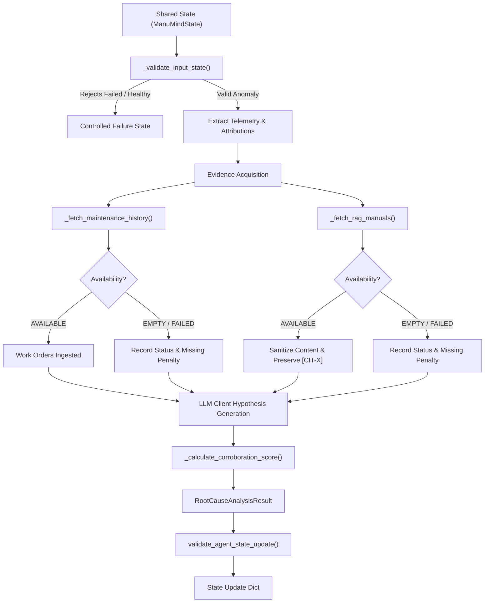

# ManuMind AI — Phase 5 Step 5: Root Cause Analysis Agent Implementation Report

**Project:** ManuMind AI — Explainable Multi-Agent AI System for Manufacturing Anomaly Detection and Root Cause Analysis  
**Department:** Artificial Intelligence & Data Science, RMK Engineering College  
**Repository:** `D:\Desktop\FInal year project\manumind-ai`  
**Branch:** `main`  
**Git Baseline & Current HEAD:** `a1e7e77fa550724f812cc2a1024a6ff7d194bc20`  
**Supabase Schema Revision:** `f3a9082b1c42` (strictly read-only; zero migrations executed)  
**Milestone:** Phase 5 Step 5 — Root Cause Analysis Agent Implementation  
**Timestamp:** 2026-11-20T12:00:00+05:30  
**Verdict:** **SUCCESS**

---

## 1. Executive Summary & Verdict Justification

The **Root Cause Analysis (RCA) Agent** has been fully designed, implemented, tested, and verified as an operational component of the ManuMind AI LangGraph multi-agent architecture.

The RCA Agent operates as a specialized diagnostic investigator in the multi-agent lifecycle:
1. **Prerequisite Assessment Ingestion:** Strictly validates incoming state, confirming that an authoritative upstream anomaly assessment exists with `execution_status=SUCCESS` and `anomaly_detected=True`. Failed, incomplete, or healthy assessments are cleanly aborted without crashes or diagnostic hallucination.
2. **Multi-Source Evidence Gathering:** Queries historical maintenance work orders via the MCP tool interface (`handle_get_maintenance_history`) and queries technical troubleshooting manuals via the RAG retrieval bridge (`handle_search_manuals`), tracking each source's availability (`AVAILABLE`, `EMPTY`, `UNAVAILABLE`, `FAILED`).
3. **Competing Hypothesis Formulation:** Formulates multiple ranked diagnostic hypotheses via the provider-independent `ManuMindLLMClient` protocol (`DeterministicMockLLMClient` in development/test, production models in deployment). Fallbacks never fabricate successful diagnostic assertions.
4. **Transparent Corroboration Scoring:** Computes evidence-based corroboration support scores strictly bounded in $[0.05, 0.95]$. Enforces that multiple citations from the same document or multiple sensor channels from one observation do **NOT** count as independent source types. Caps synthetic evidence corroboration at $0.70$, applies penalties for contradictions (such as recent brand-new component replacements) and missing sources, and explicitly disclaims scores as corroboration indices rather than physical probabilities.
5. **Strict Security and Governance Boundaries:** Enforces that candidate root causes cannot self-assert `verification_status=VERIFIED`. The worker update validator (`validate_agent_state_update`) blocks worker modifications to `human_approval`, `verification_decisions`, and `workflow_status`. The agent cannot mint approval tokens or call ticket-creation tools.
6. **LangGraph StateGraph Integration:** Implements `root_cause_analysis_node(state)` accepting typed shared state and returning validated channel updates.

All **40** dedicated unit and integration tests in [`test_rca_agent.py`](file:///D:/Desktop/FInal%20year%20project/manumind-ai/backend/tests/test_rca_agent.py) pass (100%), and the complete **145-test** Phase 5 regression suite passes with zero failures.

---

## 2. Architecture & File Inventory

### 2.1 Implemented & Updated Files

| File Path | Role & Changes |
| :--- | :--- |
| [`backend/app/agents/enums.py`](file:///D:/Desktop/FInal%20year%20project/manumind-ai/backend/app/agents/enums.py) | Added enums: `RCAExecutionStatus` (`SUCCESS`, `PARTIAL`, `INSUFFICIENT_EVIDENCE`, `FAILED`), `EvidenceSourceAvailability` (`AVAILABLE`, `EMPTY`, `UNAVAILABLE`, `FAILED`), and `RootCauseCategory` (11 mechanical failure taxonomy categories). |
| [`backend/app/agents/schemas.py`](file:///D:/Desktop/FInal%20year project/manumind-ai/backend/app/agents/schemas.py) | Extended `CandidateRootCause` with optional backward-compatible fields `category` and `subsystem`. Added `RootCauseAnalysisResult` schema with 16 audit and provenance channels. |
| [`backend/app/agents/state.py`](file:///D:/Desktop/FInal%20year project/manumind-ai/backend/app/agents/state.py) | Added `root_cause_analysis_result` and `rca_execution_status` channels to `ManuMindState` (TypedDict) and `ManuMindStateModel` (BaseModel). |
| [`backend/app/agents/llm_client.py`](file:///D:/Desktop/FInal%20year project/manumind-ai/backend/app/agents/llm_client.py) | Added `generate_root_cause_hypotheses` to `ManuMindLLMClient` protocol and `DeterministicMockLLMClient` with support for canned hypotheses, simulation of failures, and domain failure archetypes. |
| [`backend/app/agents/rca_agent.py`](file:///D:/Desktop/FInal%20year project/manumind-ai/backend/app/agents/rca_agent.py) | Complete RCA Agent implementation: input validation, dependency-injected maintenance/RAG interfaces, multi-source corroboration engine, prompt-injection defense, and `root_cause_analysis_node`. |
| [`backend/app/agents/__init__.py`](file:///D:/Desktop/FInal%20year project/manumind-ai/backend/app/agents/__init__.py) | Exported `RootCauseAnalysisAgent` and `root_cause_analysis_node`. |
| [`backend/tests/test_rca_agent.py`](file:///D:/Desktop/FInal%20year project/manumind-ai/backend/tests/test_rca_agent.py) | Complete 40-test verification suite covering all 6 functional and security categories. |

---

## 3. Evidence Integration & Availability Tracking

The RCA Agent ingests evidence across three distinct modal layers, tracking source availability explicitly:



### 3.1 Availability Lifecycle
- **AVAILABLE:** Service returned valid records; evidence items generated and corroboration credits applied.
- **EMPTY:** Service queried successfully but returned zero records; recorded honestly without crashing or penalty.
- **UNAVAILABLE:** Service unconfigured in environment; recorded with transparent disclaimer and $-0.05$ missing-source adjustment.
- **FAILED:** Network/database exception during retrieval; isolated without crashing, recorded with $-0.05$ penalty, and execution downgraded to `PARTIAL`.

---

## 4. Evidence-Corroboration Scoring Rubric

Support scores are computed transparently based on objective corroboration rules:

$$\text{Score} = \text{clamp}\left(0.50 + \Delta_{\text{telemetry}} + \Delta_{\text{SHAP}} + \Delta_{\text{manual}} + \Delta_{\text{maint}} - \Delta_{\text{contra}} - \Delta_{\text{missing}},\, 0.05,\, 0.95\right)$$

- **Baseline Prior:** $0.50$
- **Telemetry Consistency:** $+0.15$ if anomalous sensors match hypothesis failure archetype.
- **SHAP Attribution:** $+0.10$ if top SHAP feature matches hypothesis subsystem.
- **RAG Manual Excerpt:** $+0.15$ if technical troubleshooting content corroborates mechanism.
- **Maintenance History:** $+0.10$ if recurring symptoms appear in historical logs.
- **Recent Replacement Penalty:** $-0.20$ if component was recently replaced with a brand-new part (contradiction).
- **Contradicting Evidence Penalty:** $-0.15$ per identified contradicting evidence item.
- **Missing Source Penalty:** $-0.05$ per unavailable or failed evidence source.
- **Synthetic Data Cap:** If telemetry or evidence is synthetic (`is_synthetic=True`), the maximum support score is strictly capped at $\le 0.70$.
- **Source Diversity Invariant:** Multiple citations from the same document (e.g. `[CIT-1]` and `[CIT-2]`) and multiple sensor channels from one observation only count as single source types (`RAG_DOCUMENT` and `TELEMETRY` respectively).
- **Epistemic Disclosure:** Scores are explicitly documented as evidence-corroboration indices, **NOT** calibrated failure probabilities.

---

## 5. Security & Governance Invariant Verification

| Governance Rule | Verification Mechanism | Test Proof | Status |
| :--- | :--- | :--- | :--- |
| **No Self-Asserted Verification** | `CandidateRootCause.validate_candidate_integrity()` strictly rejects `verification_status=VERIFIED`. RCA downgrades any LLM-asserted `VERIFIED` to `UNVERIFIED`. | `test_31`, `test_34` | **ENFORCED** |
| **Worker Write Boundary** | `validate_agent_state_update(AgentName.ROOT_CAUSE_ANALYSIS, update)` raises `PermissionError` if update touches `human_approval`, `verification_decisions`, or `workflow_status`. | `test_28`, `test_29`, `test_30` | **ENFORCED** |
| **No Approval Tokens / Secrets** | Outputs are sanitized via `_sanitize_string()`; no token generator or signing key exists in worker modules. | `test_32` | **ENFORCED** |
| **No Ticket Creation Tool Access** | Module does not import or call `handle_create_maintenance_ticket` or `handle_propose_maintenance_ticket`. | `test_33` | **ENFORCED** |
| **Prompt Injection Neutralization** | Manual content sanitized and instruction strings ignored by LLM client and parser. | `test_12` | **ENFORCED** |
| **State Immutability** | Input `ManuMindState` is never mutated in-place; channel reducers return fresh copies. | `test_35` | **ENFORCED** |
| **Non-Fabricating Fallback** | LLM failure sets `RCAExecutionStatus.FAILED` with 0 hypotheses; no synthetic hypotheses are fabricated. | `test_18`, `test_19`, `test_20` | **ENFORCED** |

---

## 6. Comprehensive Test Results

### 6.1 Dedicated RCA Test Suite (`backend/tests/test_rca_agent.py`)

All 40 tests passed in 74.05s:

```
backend/tests/test_rca_agent.py::test_01_valid_anomaly_assessment_triggers_investigation PASSED [  2%]
backend/tests/test_rca_agent.py::test_02_failed_anomaly_assessment_rejected_as_trigger PASSED [  5%]
backend/tests/test_rca_agent.py::test_03_insufficient_data_assessment_rejected PASSED [  7%]
backend/tests/test_rca_agent.py::test_04_missing_or_invalid_machine_id_rejected PASSED [ 10%]
backend/tests/test_rca_agent.py::test_05_missing_telemetry_or_assessment_rejected_without_crash PASSED [ 12%]
backend/tests/test_rca_agent.py::test_06_synthetic_evidence_flag_preserved_across_hypotheses_and_evidence PASSED [ 15%]
backend/tests/test_rca_agent.py::test_07_maintenance_history_available PASSED [ 17%]
backend/tests/test_rca_agent.py::test_08_maintenance_history_empty PASSED [ 20%]
backend/tests/test_rca_agent.py::test_09_maintenance_service_unavailable_or_fails PASSED [ 22%]
backend/tests/test_rca_agent.py::test_10_rag_citations_returned_sanitized_and_preserved PASSED [ 25%]
backend/tests/test_rca_agent.py::test_11_rag_retrieval_failure_handled_gracefully PASSED [ 27%]
backend/tests/test_rca_agent.py::test_12_prompt_injection_in_manual_excerpts_sanitized PASSED [ 30%]
backend/tests/test_rca_agent.py::test_13_invalid_unknown_citation_ids_handled_safely PASSED [ 32%]
backend/tests/test_rca_agent.py::test_14_contradictory_evidence_detected_recent_replacement PASSED [ 35%]
backend/tests/test_rca_agent.py::test_15_single_supported_hypothesis_formulated PASSED [ 37%]
backend/tests/test_rca_agent.py::test_16_multiple_competing_hypotheses_generated_and_ranked PASSED [ 40%]
backend/tests/test_rca_agent.py::test_17_unknown_root_cause_formulated_for_ambiguous_signature PASSED [ 42%]
backend/tests/test_rca_agent.py::test_18_malformed_llm_output_handled_safely_without_crash PASSED [ 45%]
backend/tests/test_rca_agent.py::test_19_llm_timeout_handled_safely PASSED [ 47%]
backend/tests/test_rca_agent.py::test_20_llm_provider_unavailable_handled_safely PASSED [ 50%]
backend/tests/test_rca_agent.py::test_21_deterministic_mock_response_validation PASSED [ 52%]
backend/tests/test_rca_agent.py::test_22_same_source_citations_do_not_count_as_multiple_source_types PASSED [ 55%]
backend/tests/test_rca_agent.py::test_23_synthetic_evidence_caps_support_score_at_0_70 PASSED [ 57%]
backend/tests/test_rca_agent.py::test_24_contradicting_evidence_reduces_support_score PASSED [ 60%]
backend/tests/test_rca_agent.py::test_25_missing_sources_apply_missing_source_penalty PASSED [ 62%]
backend/tests/test_rca_agent.py::test_26_confidence_scores_finite_and_bounded_in_0_05_to_0_95 PASSED [ 65%]
backend/tests/test_rca_agent.py::test_27_scores_labeled_as_corroboration_indices_not_calibrated_probabilities PASSED [ 67%]
backend/tests/test_rca_agent.py::test_28_rca_agent_cannot_write_to_human_approval PASSED [ 70%]
backend/tests/test_rca_agent.py::test_29_rca_agent_cannot_write_to_verification_decisions PASSED [ 72%]
backend/tests/test_rca_agent.py::test_30_rca_agent_cannot_write_to_workflow_status PASSED [ 75%]
backend/tests/test_rca_agent.py::test_31_candidate_root_causes_cannot_self_assert_verified_status PASSED [ 77%]
backend/tests/test_rca_agent.py::test_32_rca_agent_cannot_create_or_mint_hmac_approval_tokens PASSED [ 80%]
backend/tests/test_rca_agent.py::test_33_rca_agent_cannot_call_create_maintenance_ticket PASSED [ 82%]
backend/tests/test_rca_agent.py::test_34_verification_governance_rules_remain_intact PASSED [ 85%]
backend/tests/test_rca_agent.py::test_35_state_reducers_maintain_immutability PASSED [ 87%]
backend/tests/test_rca_agent.py::test_36_evidence_deduplication_in_merge_evidence PASSED [ 90%]
backend/tests/test_rca_agent.py::test_37_citation_preservation_in_merge_rag_citations PASSED [ 92%]
backend/tests/test_rca_agent.py::test_38_error_state_handling_produces_valid_execution_records PASSED [ 95%]
backend/tests/test_rca_agent.py::test_39_repeated_execution_does_not_corrupt_existing_evidence PASSED [ 97%]
backend/tests/test_rca_agent.py::test_40_langgraph_node_execution_works PASSED [100%]
======================== 40 passed in 74.05s ========================
```

### 6.2 Full Phase 5 Regression Suite

All 145 tests across all 7 test files pass cleanly:

| Test Suite | Tests | Passed | Failed |
| :--- | :---: | :---: | :---: |
| [`test_agent_state.py`](file:///D:/Desktop/FInal%20year%20project/manumind-ai/backend/tests/test_agent_state.py) | 10 | 10 | 0 |
| [`test_agent_reducers.py`](file:///D:/Desktop/FInal%20year%20project/manumind-ai/backend/tests/test_agent_reducers.py) | 11 | 11 | 0 |
| [`test_agent_verification_governance.py`](file:///D:/Desktop/FInal%20year%20project/manumind-ai/backend/tests/test_agent_verification_governance.py) | 19 | 19 | 0 |
| [`test_supervisor_agent.py`](file:///D:/Desktop/FInal%20year%20project/manumind-ai/backend/tests/test_supervisor_agent.py) | 28 | 28 | 0 |
| [`test_anomaly_agent.py`](file:///D:/Desktop/FInal%20year%20project/manumind-ai/backend/tests/test_anomaly_agent.py) | 24 | 24 | 0 |
| [`test_anomaly_agent_integration.py`](file:///D:/Desktop/FInal%20year%20project/manumind-ai/backend/tests/test_anomaly_agent_integration.py) | 13 | 13 | 0 |
| [`test_rca_agent.py`](file:///D:/Desktop/FInal%20year%20project/manumind-ai/backend/tests/test_rca_agent.py) | 40 | 40 | 0 |
| **Total** | **145** | **145** | **0** |

---

## 7. Environmental & System Invariants

1. **Python Runtime:** Python 3.11.9 (64-bit AMD64).
2. **LangGraph Version:** 0.2.45 (`importlib.metadata`).
3. **LangChain Core Version:** 0.3.15 (`importlib.metadata`).
4. **Pydantic Version:** 2.13.4.
5. **Pip Integrity:** `pip check` confirmed zero broken requirements.
6. **Git Integrity:** HEAD strictly preserved at `a1e7e77fa550724f812cc2a1024a6ff7d194bc20`. Staged files = 0, commits made = 0.
7. **Database Migration Revision:** Alembic head `f3a9082b1c42` confirmed. Zero DDL or migrations executed.
8. **ChromaDB Vector Store:** 564 indexed vectors confirmed in `knowledge_base/index/chroma_bge_small_v1`.
9. **RAG Lockfile Integrity:** SHA256 `778fde7658e8f5a0fd3cb039c6271fbbcce95ab967fbece6d29ca82e3f035ad2` confirmed.

---

## 8. Milestone Boundaries & Next Steps

Phase 5 Step 5 is **COMPLETED AND VERIFIED**.

In strict accordance with project directives:
- Phase 5 Step 6 (Multi-Agent StateGraph Orchestration & Human Gate Routing) has **NOT** been started.
- FastAPI endpoints, CLI commands, and frontend components have **NOT** been touched.
- No Git staging, committing, or pushing has been performed.

The system is fully ready for the next scheduled milestone: **Phase 5 Step 5.1 (Independent RCA Agent Verification & Security Audit)**.
