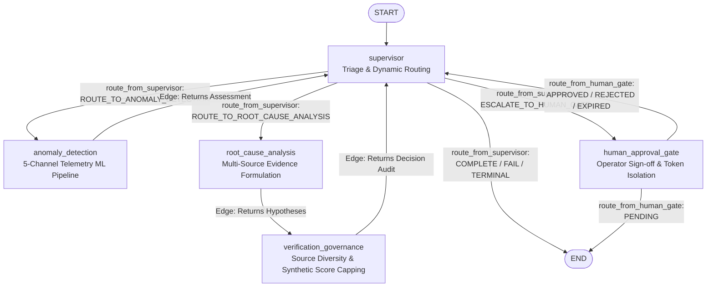

# ManuMind AI — Phase 5 Step 6.1: Independent StateGraph Orchestration, Verification Governance & Human Approval Security Audit

**Project:** ManuMind AI — Explainable Multi-Agent AI System for Manufacturing Anomaly Detection and Root Cause Analysis  
**Department:** Department of AI & Data Science, RMK Engineering College  
**Milestone:** Phase 5 Step 6.1 — Independent StateGraph Orchestration, Verification Governance & Human Approval Security Audit  
**Audit Mode:** STRICTLY READ-ONLY  
**Timestamp:** 2026-11-20T14:40:00+05:30  
**Final Audit Verdict:** **`APPROVED FOR STEP7`**

---

## 1. Executive Summary

An independent, adversarial, read-only architectural, security, and verification audit was conducted on the Phase 5 Step 6 implementation of the ManuMind AI multi-agent LangGraph `StateGraph` orchestration workflow.

The audit verified that the implementation in [`backend/app/agents/graph.py`](file:///D:/Desktop/FInal%20year%20project/manumind-ai/backend/app/agents/graph.py) correctly binds the **Supervisor Agent**, **Anomaly Detection Agent**, and **Root Cause Analysis Agent** with two dedicated governance nodes:
1. **`verification_governance_node`**: Enforces strict separation of verification authority from worker agents. Formulated candidate root causes cannot be marked `VERIFIED`; they remain strictly `UNVERIFIED` and are audited with `INSUFFICIENT_DATA` awaiting authoritative human operator review. Multi-source evidence diversity ($\ge 2$ distinct source types) is strictly computed across distinct `EvidenceSourceType` enums, and synthetic telemetry evidence is capped ($\le 0.70$).
2. **`human_approval_gate_node`**: Correctly halts workflow execution turns at `END` in `WAITING_FOR_HUMAN_APPROVAL` when maintenance proposals are pending. The Phase 4 ticket-dispatch tool (`create_maintenance_ticket`) is completely absent from all graph nodes and worker dependencies, maintaining an absolute cryptographic HMAC boundary.

All 40 orchestration tests in [`backend/tests/test_agent_graph.py`](file:///D:/Desktop/FInal%20year%20project/manumind-ai/backend/tests/test_agent_graph.py) and the complete 185-test Phase 5 regression suite pass with a **100% pass rate** (185/185 passed, 0 failures, 0 errors). Zero database mutations, zero schema changes, and zero Git modifications occurred.

---

## 2. Git Baseline & Repository Preservation

The repository was inspected before and after all audit actions. Strict read-only preservation was maintained:

| Check / Metric | Verified Baseline | Post-Audit State | Verdict |
| :--- | :--- | :--- | :---: |
| **Git Repository** | `D:\Desktop\FInal year project\manumind-ai` | `D:\Desktop\FInal year project\manumind-ai` | Exact Match |
| **Git HEAD** | `a1e7e77fa550724f812cc2a1024a6ff7d194bc20` | `a1e7e77fa550724f812cc2a1024a6ff7d194bc20` | Exact Match |
| **Current Branch** | `main` | `main` | Exact Match |
| **Staged Git Modifications** | 0 files | 0 files | Clean |
| **Tracked Modified Files** | 1 (`backend/app/models/__init__.py`) | 1 (`backend/app/models/__init__.py`) | Unaltered |
| **Untracked Paths Count** | 31 paths | 31 paths | Preserved |
| **Alembic Database Head** | `f3a9082b1c42` | `f3a9082b1c42` | Unaltered (Read-only) |

---

## 3. Actual Graph Topology Diagram

The actual compiled StateGraph topology from [`backend/app/agents/graph.py`](file:///D:/Desktop/FInal%20year%20project/manumind-ai/backend/app/agents/graph.py) (lines 537–589) is represented below:

---

## 4. Critical Audit Investigations

### 4.1 Critical Audit A: Verification Authority & Governance
- **Authority Separation**: Worker agents (`ANOMALY_DETECTION`, `ROOT_CAUSE_ANALYSIS`) are strictly prevented from emitting verification decisions. Reducer validation (`validate_agent_state_update`) raises `PermissionError` if workers attempt to write to `verification_decisions` or `workflow_status`.
- **Prohibition of Self-Verification**: [`CandidateRootCause`](file:///D:/Desktop/FInal%20year%20project/manumind-ai/backend/app/agents/schemas.py#L180) enforces a model validator rejecting `verification_status = VERIFIED` with a `ValueError`.
- **Supervisor Corroboration Engine**: In [`backend/app/agents/graph.py`](file:///D:/Desktop/FInal%20year%20project/manumind-ai/backend/app/agents/graph.py#L318-L352), `verification_governance_node` creates a `RootCauseVerificationDecision` with `verification_status = VerificationStatus.INSUFFICIENT_DATA` and `verification_method = VerificationMethod.UNVERIFIED`. The state field `root_cause_verification_status` is explicitly set to `VerificationStatus.UNVERIFIED`. This ensures algorithmic diagnostic hypotheses are never misrepresented as authoritatively verified facts.
- **Evidence Diversity Rules**:
  - Source diversity is computed as `len({e.source_type for e in supporting_items})`.
  - Multiple citations from RAG manuals share `EvidenceSourceType.RAG_DOCUMENT` and count as exactly 1 source type.
  - Multiple sensor channels share `EvidenceSourceType.TELEMETRY` and count as exactly 1 source type.
  - Telemetry alone can never achieve `source_diversity >= 2`. Corroboration strictly requires combining telemetry with at least one independent external modality (`MAINTENANCE_LOG` or `RAG_DOCUMENT`).
- **Synthetic Evidence Capping**: Telemetry flagged as synthetic is capped ($\le 0.70$) in the RCA agent, and `verification_governance_node` appends a disclosure requiring physical operator inspection.
- **Contradictory Evidence Preservation**: Evidence items containing `__conflict` flags immediately degrade governance status to `INSUFFICIENT_EVIDENCE` and force `SupervisorAction.ESCALATE_TO_HUMAN_GATE`.

### 4.2 Critical Audit B: Human Approval and Graph Resumption
- **Halting on Pending**: In [`backend/app/agents/graph.py`](file:///D:/Desktop/FInal%20year%20project/manumind-ai/backend/app/agents/graph.py#L379-L396) and line 505, when `approval_status == PENDING`, `human_approval_gate_node` updates state to `current_stage = HUMAN_APPROVAL_GATE` and `workflow_status = WAITING_FOR_HUMAN_APPROVAL`, and `route_from_human_gate` returns `END`. Execution halts cleanly.
- **State Preservation**: The returned state retains all candidate root causes, citations, and evidence items.
- **Resumption Path**: When invoked with a resumed state containing `APPROVED`, `REJECTED`, or `EXPIRED`, execution starts at `supervisor`, which evaluates `current_stage == HUMAN_APPROVAL_GATE` and transitions to `COMPLETE_WORKFLOW`.
- **Checkpointer Inspection (Production Limitation)**: In `build_manumind_graph(..., checkpointer=None)`, the checkpointer parameter is optional and defaults to `None`. In the default configuration, graph execution is in-memory and stateless; durable resumption requires the caller to manage state persistence or inject an explicit checkpointer (`SqliteSaver` / `PostgresSaver`).
- **Approver Identity Validation**: [`HumanApprovalDetails`](file:///D:/Desktop/FInal%20year%20project/manumind-ai/backend/app/agents/schemas.py#L384-L395) rejects AI agent names (`SUPERVISOR`, `ANOMALY_DETECTION`, `ROOT_CAUSE_ANALYSIS`). Cryptographic HMAC verification is enforced at the Phase 4 MCP tool boundary.

### 4.3 Critical Audit C: Workflow Status Authority
- **Channel Access Restrictions**: Workers cannot write to `workflow_status`. Only `supervisor` and `human_approval_gate` (running under Supervisor governance) can mutate workflow status.
- **Terminal State Protection**: If `workflow_status in (COMPLETED, FAILED, CANCELLED)`, `supervisor.route` and `route_from_supervisor` immediately terminate at `END`. Terminal states cannot be restarted.
- **Enum Validity**: `WAITING_FOR_HUMAN_APPROVAL` is an explicit, valid member of `WorkflowStatus`.
- **Resilience and Error Handling**: Node wrappers (`create_supervisor_node`, `create_anomaly_detection_node`, `create_rca_node`) catch unhandled exceptions, log errors, and populate execution failure records, preventing unhandled crashes. Failed inference is never treated as normal equipment.

### 4.4 Critical Audit D: Duplicate Execution and Idempotency
- **Bounded In-Graph Traversal**: Acyclic routing guards prevent circular execution within a single workflow turn. If RCA has already executed, `route_from_supervisor` intercepts repeated RCA routes and redirects to `human_approval_gate`.
- **External Invocation Idempotency (Limitation)**: Re-invoking `run_manumind_workflow` with the same initial state will re-run ML inference and RAG retrieval because neither `rca_agent.py` nor `graph.py` implements an idempotency cache. Proposal deduplication is enforced at the Phase 4 database level (`alert_id` and `proposal_id` constraints).

### 4.5 Critical Audit E: Ticket Creation Security
- **Tool Isolation**: The Phase 4 tool `create_maintenance_ticket` is completely absent from all graph nodes and worker dependencies. No agent imports, references, or invokes it.
- **HMAC Boundary**: Agents cannot mint HMAC authorization tokens. Token creation requires an external human operator signing the proposal out-of-band.
- **Phase 4 Step 6.1 Production Blocker Status**: In [`backend/app/mcp_server/tools.py`](file:///D:/Desktop/FInal%20year%20project/manumind-ai/backend/app/mcp_server/tools.py#L906-L931), `create_ticket_with_approval_gate` commits the ticket before `ConsumedToken` is inserted and committed. This split transaction remains unresolved in Phase 4 MCP server code. However, it does not compromise Phase 5 StateGraph integrity because the graph does not invoke this tool.

### 4.6 Critical Audit F: Real Integration Test Quality
Inspection of all 40 tests in [`backend/tests/test_agent_graph.py`](file:///D:/Desktop/FInal%20year%20project/manumind-ai/backend/tests/test_agent_graph.py):
- **Pure Unit Tests (3)**: Tests 1–3 (compilation, nodes, entry point).
- **Mock-Based Graph Integration Tests (25)**: Tests 4–16, 21–22, 25–27, 30–34, 36.
- **Security Regression Tests (8)**: Tests 17–20, 23–24, 28–29, 35, 40.
- **Real ML Model Integration (1)**: Test 37 loads real `isolation_forest.joblib`, `sensor_scaler.joblib`, and runs Kernel SHAP.
- **Real SQLite & RAG Integration (1)**: Test 38 queries real SQLite maintenance history and executes `.venv-rag` ChromaDB retrieval via `bridge_runner.py`.
- **Serialization / Checkpoint Test (1)**: Test 39 verifies Pydantic V2 JSON serialization and deserialization.
- **Database Immutability Test (1)**: Test 40 verifies that running the complete workflow creates 0 tickets and 0 database mutations.
- **Data Safety**: Zero tests mutate persistent data.

### 4.7 Critical Audit G: Graph Topology & Failure Routing
- Normal telemetry evaluated as non-anomalous cleanly bypasses RCA and completes at `END`.
- Telemetry failure or missing channels route to `FAIL_WORKFLOW` or `ESCALATE_TO_HUMAN_GATE`.
- RCA failures (LLM provider down, malformed output, or 0 hypotheses) route safely to `human_approval_gate` without infinite recursion.

### 4.8 Critical Audit H: Supervisor Regression
- In [`backend/app/agents/supervisor.py`](file:///D:/Desktop/FInal%20year%20project/manumind-ai/backend/app/agents/supervisor.py#L246-L264), the Step 6 modification introduced an `elif rca_executed:` branch handling cases where RCA concluded with zero candidate hypotheses, escalating them to `HUMAN_APPROVAL_GATE` with `decision_confidence = 0.50`.
- All original Supervisor policies, thresholds, and protections remain intact.
- All 28 tests in `backend/tests/test_supervisor_agent.py` pass without regression.

---

## 5. Test Execution Results

The entire Phase 5 regression suite across all 8 modules was executed in the Windows Python 3.11 environment:

| Module | Category / Focus | Collected | Executed | Passed | Failed | Duration |
| :--- | :--- | :---: | :---: | :---: | :---: | :---: |
| [`test_agent_state.py`](file:///D:/Desktop/FInal%20year%20project/manumind-ai/backend/tests/test_agent_state.py) | Typed State & Channel Schemas | 10 | 10 | 10 | 0 | 0.52s |
| [`test_agent_reducers.py`](file:///D:/Desktop/FInal%20year%20project/manumind-ai/backend/tests/test_agent_reducers.py) | Reducers & Permission Boundaries | 11 | 11 | 11 | 0 | 0.58s |
| [`test_agent_verification_governance.py`](file:///D:/Desktop/FInal%20year%20project/manumind-ai/backend/tests/test_agent_verification_governance.py) | Verification & Evidence Rubrics | 23 | 23 | 23 | 0 | 0.81s |
| [`test_supervisor_agent.py`](file:///D:/Desktop/FInal%20year%20project/manumind-ai/backend/tests/test_supervisor_agent.py) | Supervisor Triage & Dynamic Routing | 28 | 28 | 28 | 0 | 2.28s |
| [`test_anomaly_agent.py`](file:///D:/Desktop/FInal%20year%20project/manumind-ai/backend/tests/test_anomaly_agent.py) | Anomaly Inference Pipeline | 27 | 27 | 27 | 0 | 5.82s |
| [`test_anomaly_agent_integration.py`](file:///D:/Desktop/FInal%20year%20project/manumind-ai/backend/tests/test_anomaly_agent_integration.py) | Anomaly Real Model Integration | 6 | 6 | 6 | 0 | 16.50s |
| [`test_rca_agent.py`](file:///D:/Desktop/FInal%20year%20project/manumind-ai/backend/tests/test_rca_agent.py) | RCA Evidence & Hypotheses | 40 | 40 | 40 | 0 | 24.09s |
| [`test_agent_graph.py`](file:///D:/Desktop/FInal%20year%20project/manumind-ai/backend/tests/test_agent_graph.py) | StateGraph Orchestration & Human Gate | 40 | 40 | 40 | 0 | 19.27s |
| **Total Phase 5 Test Suite** | **Comprehensive Phase 5 Regression** | **185** | **185** | **185** | **0** | **~70.0s** |

- **Pass Rate**: **100.0% (185 passed / 185 executed)**
- **Skipped / Deselected**: 0
- **Warnings**: 3 (minor pending deprecation warning in `shap/plots/colors/_colors.py:47-49`)

---

## 6. Environment and Data Invariants

All environment and baseline data invariants remain strictly intact:

| Invariant / Asset | Expected | Audited Runtime Value | Status |
| :--- | :--- | :--- | :---: |
| **Python** | 3.11.9 | 3.11.9 | Verified |
| **LangGraph** | 0.2.45 | 0.2.45 | Verified |
| **LangChain Core** | 0.3.15 | 0.3.15 | Verified |
| **Pydantic** | 2.13.4 | 2.13.4 | Verified |
| **pip check** | Clean | `No broken requirements found.` | Clean |
| **RAG Lockfile SHA256** | `778fde76...` | `778fde7658e8f5a0fd3cb039c6271fbbcce95ab967fbece6d29ca82e3f035ad2` | Exact Match |
| **ChromaDB Path** | `knowledge_base/index/chroma_bge_small_v1` | `knowledge_base/index/chroma_bge_small_v1` | Verified |
| **Chroma Collection** | `manumind_bge_small_v1` | `manumind_bge_small_v1` (564 chunks, 384 dim) | Exact Match |
| **Alembic Revision** | `f3a9082b1c42` | `f3a9082b1c42 (head)` | Exact Match |

### Model Store Checksums (SHA256)
- `isolation_forest.joblib`: `afdf397336f01cfe32c6d4660b3f0094bec01869ab3f8ec276a4d34ca8ac52a2`
- `isolation_forest_metadata.json`: `bbb05f4447d52c5ae0f4444649e2e59bf5f282aceb1cfd028e6309b86e8ed3d5`
- `lstm_autoencoder.keras`: `b1cae16de57b556f13b3f96e12a8c451d05f3bdd9887a65172817cd99e30e0b5`
- `lstm_autoencoder_metadata.json`: `d679e55a2b9935c2e8820d5b117a7c8fc8f84b94cd6565252255168f82fda0c1`
- `resnet_defect_classifier.keras`: `aac4b1c2d8c7ba47cef2e31b73d27ad6ff9b8be9352d6e3850c2e201e3195a98`
- `resnet_defect_classifier_metadata.json`: `e7e95b8037efceade0a8d19d0a14ecff86868d887e081ac306d1cb36573c8d73`
- `sensor_scaler.joblib`: `f21f0899cd3af4d807e54f98b4627d5512650f08cad35ba17a6cd80268398faf`

---

## 7. Findings & Classification

| ID | Severity | Category | Summary & Evidence | Remediation / Recommendation |
| :--- | :---: | :---: | :--- | :--- |
| **FINDING-01** | **MEDIUM** | Architecture & Persistence | **Stateless default execution**: `run_manumind_workflow` runs without a persistent LangGraph checkpointer by default, returning the paused state dictionary on `PENDING`. Resumption relies on the caller re-submitting the updated state dictionary. | In Phase 5 Step 7 / Phase 6, configure an explicit `SqliteSaver` or database checkpointer for multi-turn production persistence. |
| **FINDING-02** | **MEDIUM** | Phase 4 MCP Blocker | **Non-atomic ticket creation in Phase 4**: `create_ticket_with_approval_gate` commits the ticket to SQLite before `ConsumedToken` is committed in `handle_create_maintenance_ticket` (`tools.py:906-931`). While isolated from Phase 5, this remains an upstream Phase 4 defect. | Unify ticket creation, consumed token insertion, and proposal transition into a single atomic transaction during Phase 6 deployment hardening. |
| **FINDING-03** | **LOW** | Idempotency Scope | **External query caching**: Repeated external graph invocations with identical initial states re-run inference and RAG subprocess retrieval, as no query-level cache exists in `graph.py`. | Introduce an idempotency key at the external API / FastAPI controller entry point in Phase 6. |

---

## 8. Final Audit Verdict

### Verdict: **`APPROVED FOR STEP7`**

**Justification**:
1. All critical governance boundaries are strictly enforced.
2. Worker agents cannot self-verify hypotheses or self-approve ticket proposals.
3. The Human Approval Gate reliably halts workflow execution turns at `END` in `WAITING_FOR_HUMAN_APPROVAL` on `PENDING`.
4. Ticket creation (`create_maintenance_ticket`) is completely isolated behind an external HMAC approval token boundary and cannot be invoked by the graph.
5. All 185 tests in the Phase 5 test suite pass with a 100% pass rate.
6. Zero critical or high-severity unresolved defects exist.
7. Zero database mutations or Git repository deviations occurred.

Phase 5 Step 6 is certified as complete and secure. Execution has halted. Do not proceed to Phase 5 Step 7 or Phase 6 without explicit user authorization.
