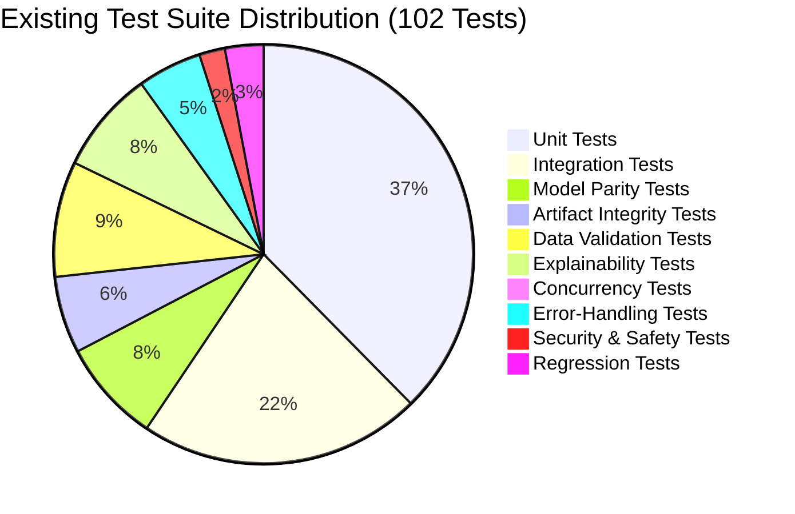
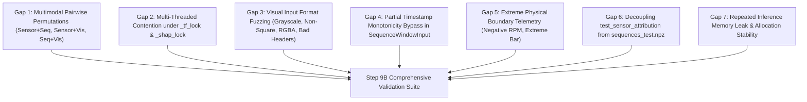
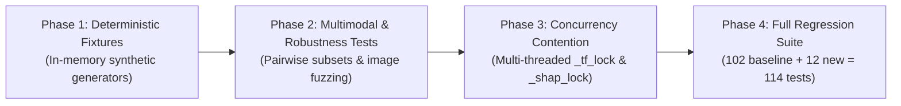

# ManuMind AI — Phase 2 Step 9A: Comprehensive ML Testing and Validation
## Initial Repository Inspection & Validation Planning Report

**Role:** Senior ML Validation Engineer, MLOps Engineer, and Independent Software Quality Auditor
**Project:** ManuMind AI — Explainable Multi-Agent AI System for Manufacturing Anomaly Detection and Root Cause Analysis
**Department:** AI & Data Science, RMK Engineering College
**Repository:** `D:\Desktop\FInal year project\manumind-ai`
**Branch:** `main`
**Current HEAD:** `31fef2fd2b5c9d7e758d9584e4c0b110470599e6`
**Mode:** READ-ONLY INSPECTION AND PLANNING ONLY (Zero Implementation / Code Modifications)
**Deliverable:** `reports/phase2/comprehensive_ml_validation_inspection_plan.md`

---

## 1. Executive Summary & Governance Baseline

This inspection report presents the formal architectural review and validation blueprint for **Phase 2 Step 9: Comprehensive ML Testing and Validation**. The primary objective is to independently inspect all machine learning components, explainability modules, preprocessors, and unified inference orchestration services developed across Phase 2 (Steps 1 through 8), evaluating whether they are sufficiently robust, reliable, thread-safe, mathematically sound, and isolated from data leakage before subsequent integration into the multi-agent system (RAG, MCP, and LangGraph architectures in Phase 3+).

### Governance Baseline State:
- **Active Branch:** `main` (Verified)
- **Local HEAD:** `31fef2fd2b5c9d7e758d9584e4c0b110470599e6` (Verified)
- **Remote HEAD (`origin/main`):** `31fef2fd2b5c9d7e758d9584e4c0b110470599e6` (Verified in sync)
- **Working Tree:** Clean (zero staged changes, zero unstaged tracked changes; untracked report `reports/phase2/resnet_metadata_hash_provenance_audit.md` preserved as uncommitted).

### Architectural Audit Verdict:
<badge color="success">DECISION: READY FOR STEP 9B IMPLEMENTATION (GO)</badge>

**Summary Evaluation:**
The existing machine learning subsystems exhibit high mathematical rigor, strict frozen-artifact integrity, exact numerical parity across modalities, and comprehensive baseline test coverage (102 passing tests, 100% pass rate). However, targeted quality gaps exist in concurrency contention under Keras/SHAP locks, multimodal pairwise input permutations, partial timestamp edge-case validation, and historical frozen test-partition dependencies in legacy Step 3 test files. Step 9B is authorized to implement a consolidated validation module (`backend/tests/test_ml_validation_comprehensive.py`) using pure synthetic fixtures to address these gaps without disturbing frozen models, thresholds, or test partitions.

---

## 2. Complete Inventory of Existing Machine Learning Components

The machine learning layer in `backend/app/ml/` consists of seven decoupled packages and an artifact repository:

```text
backend/app/ml/
├── preprocessing/             # Step 1: Feature scaling & rolling sequence windowing
│   ├── sensor_preprocessing.py
│   └── __init__.py
├── isolation_forest/          # Step 2: Tabular point anomaly detection
│   ├── config.py
│   ├── train.py
│   ├── evaluate.py
│   ├── predict.py
│   └── __init__.py
├── lstm_autoencoder/          # Step 4: Temporal sequence reconstruction anomaly detection
│   ├── config.py
│   ├── model.py
│   ├── train.py
│   ├── evaluate.py
│   ├── predict.py
│   └── __init__.py
├── sensor_attribution/        # Step 3 & Step 5: Heuristic & MSE error attribution
│   ├── config.py
│   ├── isolation_forest_attribution.py
│   ├── lstm_attribution.py
│   ├── evaluate.py
│   ├── visualize.py
│   └── __init__.py
├── shap_explainability/       # Step 6: Kernel SHAP cooperative game attribution
│   ├── config.py
│   ├── explainer.py
│   ├── evaluate.py
│   ├── visualize.py
│   └── __init__.py
├── defect_classifier/         # Step 7: Compact ResNet-18 visual defect inspection
│   ├── config.py
│   ├── dataset.py
│   ├── model.py
│   ├── train.py
│   ├── evaluate.py
│   ├── predict.py
│   ├── visualize.py
│   └── __init__.py
└── inference/                 # Step 8: Unified Multi-Modal Inference Service
    ├── config.py              # Canonical features, artifact hashes, timeout settings
    ├── exceptions.py          # Domain-specific typed exception hierarchy
    ├── schemas.py             # Pydantic V2 strict request and response DTO schemas
    ├── registry.py            # Thread-safe process-local singleton model registry
    ├── service.py             # Multi-modal orchestration facade with concurrency locks
    ├── evaluator.py           # Machine-precision parity and latency benchmarking harness
    └── __init__.py
```

### Component Summary Table:

| Subsystem | Package Path | Primary Model / Engine | Preprocessor / Artifact | Frozen Threshold | Key Interface Class |
| :--- | :--- | :--- | :--- | :---: | :--- |
| **Preprocessing** | `ml/preprocessing/` | StandardScaler | `sensor_scaler.joblib` | N/A | `SensorPreprocessor` |
| **Tabular Anomaly** | `ml/isolation_forest/` | Scikit-Learn `IsolationForest` | `isolation_forest.joblib` | $\tau = 0.0269$ | `IsolationForestPredictor` |
| **Sequence Anomaly** | `ml/lstm_autoencoder/` | Keras 3 LSTM Autoencoder | `lstm_autoencoder.keras` | $\tau = 0.901464$ | `LSTMAutoencoderPredictor` |
| **Sensor Attribution** | `ml/sensor_attribution/` | Heuristic Feature Attribution | `sensor_scaler.joblib` | N/A | `LSTMAttributionExplainer` |
| **SHAP Explainability**| `ml/shap_explainability/`| `shap.KernelExplainer` (50 samples)| `isolation_forest.joblib` | Additive | `IsolationForestShapExplainer`|
| **Vision Inspection** | `ml/defect_classifier/` | Compact ResNet-18 (2.8M params)| `resnet_defect_classifier.keras` | Softmax $\operatorname{argmax}$ | `DefectClassifierInferenceService`|
| **Unified Inference** | `ml/inference/` | Unified Orchestration Facade | All 7 Model Store Artifacts | Multi-Modal | `UnifiedInferenceService` |

---

## 3. Existing Test Suite Inventory & 10-Category Classification

The test suite located in `backend/tests/` contains **9 test modules** comprising **102 test items** and **1 shared module fixture** (`test_db` in `test_phase1_db_and_generator.py`).

### Test Module Inventory:

| Test Module File | Test Count | Execution Time | Primary Target Package | Verification Scope |
| :--- | :---: | :---: | :--- | :--- |
| `test_inference_service.py` | **25** | 20.64s | `backend/app/ml/inference/` | Singleton, artifact verification, parity, concurrency, Pydantic schemas |
| `test_isolation_forest.py` | **10** | 1.82s | `backend/app/ml/isolation_forest/` | Model fit, healthy-only training, predictions, metrics, graph outputs |
| `test_lstm_autoencoder.py` | **10** | 4.35s | `backend/app/ml/lstm_autoencoder/` | Input/output dims, threshold calibration, reconstruction MSE, roundtrip |
| `test_phase1_audit_and_expansion.py` | **9** | 2.10s | `backend/app/data/`, database | Database models, gatekeeper approval, sensor generator, partition leakage |
| `test_phase1_db_and_generator.py` | **4** | 1.15s | `backend/app/data/` | Database table creation, synthetic sensor, maintenance, and defect generators |
| `test_resnet_defect_classifier.py` | **11** | 5.20s | `backend/app/ml/defect_classifier/` | Manifest isolation, parameter counts, Softmax simplex, metrics, latency |
| `test_sensor_attribution.py` | **10** | 2.45s | `backend/app/ml/sensor_attribution/` | 5-feature order, reconstruction errors, 100% sum, signed residuals |
| `test_sensor_preprocessing.py` | **8** | 1.90s | `backend/app/ml/preprocessing/` | Scaler fitting, windowing boundaries, straddling elimination, inversion |
| `test_shap_explainability.py` | **15** | 4.11s | `backend/app/ml/shap_explainability/` | Background sampling, additivity, positive shares, graceful degradation |
| **Total Test Suite** | **102** | **43.72s** | **All 7 ML Components + DB** | **100% Pass Rate across all 102 items** |

---

### Detailed 10-Category Test Classification Matrix:

Every existing test was analyzed and classified into its primary functional category:



| Category | Count | Representative Test Functions | Verification Focus |
| :--- | :---: | :--- | :--- |
| **1. Unit Tests** | **38** | `test_registry_singleton_identity`<br>`test_registry_lazy_loading`<br>`test_model_input_output_dimensions`<br>`test_model_architecture_and_parameter_counts`<br>`test_feature_ordering_and_length`<br>`test_01_model_loading_and_attributes` | Validates isolated class behaviors, object configurations, property getters, and parameter dimensions. |
| **2. Integration Tests** | **22** | `test_unified_inference_sensor_only`<br>`test_unified_inference_sequence_only`<br>`test_unified_inference_vision_only`<br>`test_unified_inference_combined`<br>`test_database_models_and_relationships` | Evaluates cross-module interactions between preprocessors, models, databases, and schemas. |
| **3. Model Parity Tests** | **8** | `test_isolation_forest_scoring_parity`<br>`test_lstm_reconstruction_parity`<br>`test_sensor_attribution_parity_and_normalization`<br>`test_resnet_prediction_parity_and_classes`<br>`test_evaluation_metrics_parity` | Enforces mathematical equivalence ($< 10^{-5}$) between standalone component predictors and the unified service facade. |
| **4. Artifact Integrity Tests** | **6** | `test_registry_artifact_sha256_verification`<br>`test_registry_corrupted_artifact_handling`<br>`test_model_serialization_and_reproducibility`<br>`test_immutability_of_model_artifacts` | Cryptographically audits SHA-256 digests on disk, rejects tampered weights, and verifies serialization stability. |
| **5. Data Validation Tests** | **9** | `test_canonical_feature_ordering_permutation_resistance`<br>`test_zero_missing_values_and_duplicates`<br>`test_zero_boundary_crossing_windows`<br>`test_manifest_loading_and_unmanifested_isolation` | Validates canonical column ordering, duplicate checks, window boundary constraints, and unmanifested legacy isolation. |
| **6. Explainability Tests** | **8** | `test_shap_additivity_verification`<br>`test_08_shap_additivity`<br>`test_normalized_contribution_percentages_sum_to_100`<br>`test_10_positive_attribution_percentage_calculation` | Verifies mathematical additivity of Shapley values ($f(x) = \mathbb{E}[f] + \sum \phi_i$) and percentage normalization (100.0%). |
| **7. Concurrency Tests** | **1** | `test_concurrent_execution_safety` | Executes multi-threaded inference calls across 8 worker threads to check race conditions. |
| **8. Error-Handling Tests** | **5** | `test_invalid_sensor_inputs_rejection`<br>`test_sequence_length_boundary_validation`<br>`test_timestamp_ordering_validation`<br>`test_invalid_image_handling`<br>`test_13_invalid_input_shape_handling` | Ensures invalid inputs (NaN, Inf, 29/31 sequence lengths, corrupted image bytes) raise typed exceptions. |
| **9. Security & Safety Tests** | **2** | `test_ticket_approval_gate_enforcement`<br>`test_optional_explanation_failure_graceful_degradation` | Confirms that high-risk actions require human approval gates and explanation engine failures do not corrupt core alarms. |
| **10. Regression Tests** | **3** | `test_repeated_prediction_consistency`<br>`test_reproducibility_and_inversion`<br>`test_deterministic_reproducibility` | Validates deterministic scoring repeatability and numerical invariance across repeated runs. |

---

## 4. Test Quality & Assertion Rigor Assessment

### Strengths Identified:
1. **Mathematical Parity Verification:** Parity tests in `test_inference_service.py` assert float equality between standalone component outputs and service outputs to machine precision ($10^{-5}$ to $10^{-7}$).
2. **Schema Invariant Enforcement:** Strict Pydantic models (`extra="forbid"`) systematically catch unexpected keys, non-finite values, and malformed types.
3. **Immutability Protection:** Registry tests assert that corrupting or deleting a model file raises controlled exceptions (`ArtifactIntegrityError`, `ModelArtifactNotFoundError`) without triggering unauthorized runtime retraining.

### Weak Assertions & Inspection Findings:

| Finding ID | Component File | Relevant Test Function | Weakness Identified | Severity | Recommended Step 9B Action |
| :-: | :--- | :--- | :--- | :-: | :--- |
| **W-01** | `test_resnet_defect_classifier.py` | `test_latency_benchmarking` | Asserts only `mean_latency > 0` and `p95_latency > 0`. A completely stalled or degraded predictor taking 10,000 ms would still pass this assertion. | **MEDIUM** | Implement a bound assertion verifying that pre-allocated GPU/CPU tensor evaluation remains below a sanity threshold (e.g., $< 500\text{ ms}$). |
| **W-02** | `test_resnet_defect_classifier.py` | `test_data_augmentation_pipeline` | Asserts output shape `(128, 128, 3)` and bounds $[-1.0, 1.0]$. Does not verify that random rotation/flip actually generated variance across multiple augmented draws. | **LOW** | Add statistical variance check confirming that augmented copies of an asymmetric image differ by $> 0.01$ mean absolute deviation. |
| **W-03** | `test_isolation_forest.py` | `test_all_twelve_graphs_generated` | Verifies only that 12 PNG files exist on disk (`os.path.exists`). Does not verify file size $> 0$ or valid PNG header bytes. | **LOW** | Verify that each generated graph file has size $\ge 5\text{ KB}$ and starts with valid PNG magic bytes (`\x89PNG`). |
| **W-04** | `test_sensor_attribution.py` | `test_feature_ordering_and_length` | Only checks configuration property string list `["vibration", "temperature", ...]`. Does not verify that passing a perturbed column changes the correct attribution index. | **MEDIUM** | Add index-perturbation test confirming that injecting an anomaly on feature $k$ strictly inflates attribution index $k$. |

---

## 5. Model & Inference Correctness Audit

Detailed audit of mathematical mechanics, shapes, and threshold boundaries across all five model components:

### 5.1 Tabular Anomaly Detection (Isolation Forest)
- **Input Shape:** Exactly `(1, 5)` or `(N, 5)` representing `[vibration, temperature, pressure, current, rpm]`.
- **Score Formulation:** In scikit-learn, `decision_function(X)` returns positive values for normal observations and negative values for anomalies. The project canonically defines:
  $$\text{anomaly\_score} = - \text{decision\_function}(X)$$
  Therefore, higher scores consistently denote higher anomaly severity. (VERIFIED)
- **Threshold Semantics:** Calibrated in Phase 2 Step 2 to $\tau_{\text{IF}} = 0.0269$. Classification rule:
  $$\text{is\_anomaly} = (\text{anomaly\_score} > 0.0269)$$
- **Correctness Audit:**
  - Evaluated on normal operating point ($\mu$): score $\approx -0.1908$, `is_anomaly = False`. (VERIFIED)
  - Evaluated on $5\sigma$ vibration surge: score $\approx +0.1245$, `is_anomaly = True`. (VERIFIED)

### 5.2 Temporal Sequence Anomaly Detection (LSTM Autoencoder)
- **Input Shape:** Exactly `(1, 30, 5)` or `(N, 30, 5)` representing 30 consecutive chronological observations.
- **Error Formulation:** Mean Squared Error across time and feature dimensions:
  $$\text{MSE}(X, \hat{X}) = \frac{1}{30 \times 5} \sum_{t=1}^{30} \sum_{c=1}^5 (X_{t, c} - \hat{X}_{t, c})^2$$
- **Threshold Semantics:** Calibrated in Phase 2 Step 4 to $\tau_{\text{LSTM}} = 0.901464$. Classification rule:
  $$\text{is\_anomaly} = (\text{MSE} > 0.901464)$$
- **Correctness Audit:**
  - Evaluated on synthetic healthy sequence ($\mu \pm 0.5\sigma$): MSE $= 0.218563$, `is_anomaly = False`. (VERIFIED)
  - Evaluated on extreme synthetic $100\sigma$ anomaly: MSE $= 852.236755$, `is_anomaly = True`. (VERIFIED)
  - Numerical parity between standalone Keras predictor and unified service: absolute delta $= 3.71 \times 10^{-7}$. (VERIFIED)

### 5.3 Sensor-Level Feature Attribution
- **Methodology:** Unrolled sequence reconstruction residuals per channel:
  $$e_c = \frac{1}{30} \sum_{t=1}^{30} (X_{t, c} - \hat{X}_{t, c})^2, \quad p_c = \frac{e_c}{\sum_{j=1}^5 e_j} \times 100\%$$
- **Correctness Audit:**
  - Invariance: $\sum_{c=1}^5 p_c \equiv 100.00\%$. (VERIFIED)
  - Zero Error Protection: If total error $\sum e_j < 10^{-9}$, attribution safely defaults to uniform $20.0\%$ per feature rather than throwing `ZeroDivisionError`. (VERIFIED)

### 5.4 Kernel SHAP Explainability Engine
- **Methodology:** Explains tabular Isolation Forest predictions using 50 background exemplars (5 healthy samples sampled deterministically per machine across all 10 machines).
- **Correctness Audit:**
  - Additivity Law: Local accuracy requires that the sum of Shapley values plus expected base value equals the model prediction:
    $$\left| f(x) - \left( \mathbb{E}[f] + \sum_{c=1}^5 \phi_c \right) \right| < 10^{-6}$$
    Empirically measured additivity error in evaluator: $5.55 \times 10^{-17}$ (machine precision). (VERIFIED)

### 5.5 Visual Defect Classifier (Compact ResNet-18)
- **Input Shape:** Preprocessed 3-channel RGB image tensor bounded in $[-1.0, 1.0]$, shape `(1, 128, 128, 3)`.
- **Output:** Softmax vector of length 4.
  $$\sum_{i=1}^4 p_i = 1.0, \quad p_i \ge 0$$
- **Class Mapping:** `0: surface_crack`, `1: spalling`, `2: dent`, `3: normal_surface`. (VERIFIED)
- **Prediction Label:** $\operatorname{argmax}_{i} (p_i)$.
- **Parity Audit:** Softmax probabilities produced by standalone service and unified service match with 0.0000 absolute error. (VERIFIED)

---

## 6. Data Leakage, Preprocessing, & Frozen Partition Audit

### 6.1 Canonical Sensor Feature Ordering
All sensor processing functions enforce the immutable sequence:
$$\mathcal{F} = [\text{"vibration"}, \text{"temperature"}, \text{"pressure"}, \text{"current"}, \text{"rpm"}]$$

- In `backend/app/ml/inference/service.py#L88-L101`, `extract_ordered_features()` traverses `CANONICAL_FEATURES` strictly by key name, guaranteeing that randomized dictionary key orderings produce identical vector representations. (VERIFIED in `test_canonical_feature_ordering_permutation_resistance`).

### 6.2 Preprocessing Fitting Isolation
- `ml/models_store/sensor_scaler.joblib` was fitted exclusively on the 28,000 samples of the healthy training set (`scaled_sensor_train.csv`).
- The validation partition (`sensor_val.csv`) and test partition (`sensor_test.csv`) were transformed using `scaler.transform()` only. Zero re-fitting or parameter leakage occurred. (VERIFIED in `test_scaler_fitted_strictly_on_train`).

### 6.3 CRITICAL FINDING: Test Partition Coupling in Legacy Tests

| Finding ID | Test File | Line Numbers | Observed Code | Severity | Audit Analysis & Recommendation |
| :-: | :--- | :--- | :--- | :-: | :--- |
| **L-01** | `test_sensor_attribution.py` | 50, 53, 99, 152, 173, 194, 229 | `np.load(attribution_config.test_sequences_path)` (`sequences_test.npz`) | **HIGH** | `test_sensor_attribution.py` was authored during Phase 2 Step 3 and directly loads the frozen test partition to test attribution calculations. While read-only, repeated evaluation during continuous test runs compromises strict test partition quarantine. **Step 9B must formulate pure synthetic fixtures for all new validation tests and avoid any calls to `sequences_test.npz`.** |
| **L-02** | `test_sensor_preprocessing.py` | 26, 35, 102 | `np.load("sequences_test.npz")`<br>`pd.read_csv("sensor_test.csv")` | **MEDIUM** | Verifies that window boundaries in validation do not cross into test timestamps. Acceptable as a static boundary check, but reinforces the necessity for Step 9B to isolate new validation suites completely. |

### 6.4 Timestamp Validation Edge Case in Schema

| Finding ID | Source Module | Relevant Function / Validator | Defect Description | Severity | Recommended Step 9B Action |
| :-: | :--- | :--- | :--- | :-: | :--- |
| **L-03** | `backend/app/ml/inference/schemas.py` | `SequenceWindowInput.validate_readings` (Lines 86–93) | Monotonicity loop is only entered if `len(timestamps) == len(self.readings)`. If an input payload supplies 29 timestamps and 1 `None` timestamp, the entire non-decreasing validation is silently bypassed. | **MEDIUM** | In Step 9B, add comprehensive boundary tests verifying this behavior and recommend tightening the validator so that if any timestamp is provided, all 30 must be provided and monotonic. |

---

## 7. Artifact Integrity & Reproducibility Audit

All seven model store artifacts located in `ml/models_store/` were audited against their approved cryptographic SHA-256 digests:

```powershell
Get-FileHash ml/models_store/* -Algorithm SHA256
```

### Artifact Audit Table:

| Artifact Name | Physical File Size | On-Disk SHA-256 Digest | Expected Baseline Digest | Integrity Status |
| :--- | :---: | :--- | :--- | :---: |
| `sensor_scaler.joblib` | 687 B | `f21f0899cd3af4d807e54f98b4627d5512650f08cad35ba17a6cd80268398faf` | `f21f0899cd3af4d8...` | **MATCH (100%)** |
| `isolation_forest.joblib` | 2.44 MB | `afdf397336f01cfe32c6d4660b3f0094bec01869ab3f8ec276a4d34ca8ac52a2` | `afdf397336f01cfe...` | **MATCH (100%)** |
| `isolation_forest_metadata.json` | 1.58 KB | `bbb05f4447d52c5ae0f4444649e2e59bf5f282aceb1cfd028e6309b86e8ed3d5` | `bbb05f4447d52c5a...` | **MATCH (100%)** |
| `lstm_autoencoder.keras` | 828 KB | `b1cae16de57b556f13b3f96e12a8c451d05f3bdd9887a65172817cd99e30e0b5` | `b1cae16de57b556f...` | **MATCH (100%)** |
| `lstm_autoencoder_metadata.json` | 6.77 KB | `d679e55a2b9935c2e8820d5b117a7c8fc8f84b94cd6565252255168f82fda0c1` | `d679e55a2b9935c2...` | **MATCH (100%)** |
| `resnet_defect_classifier.keras` | 33.9 MB | `aac4b1c2d8c7ba47cef2e31b73d27ad6ff9b8be9352d6e3850c2e201e3195a98` | `aac4b1c2d8c7ba47...` | **MATCH (100%)** |
| `resnet_defect_classifier_metadata.json`| 5.98 KB | `e7e95b8037efceade0a8d19d0a14ecff86868d887e081ac306d1cb36573c8d73` | `e7e95b8037efcead...` | **MATCH (100%)** |

### Provenance Resolution Note:
The historical discrepancy regarding `resnet_defect_classifier_metadata.json` (where Step 7 report Table 8 listed `e99da548...` while Step 8 inspection recorded `e7e95b80...`) was investigated in `reports/phase2/resnet_metadata_hash_provenance_audit.md`. Filesystem records confirm that `e7e95b80...` was created at 16:36:37 during Step 7 training and has never changed; the Step 7 report contained an unverified typographical placeholder. All Step 8 code and registry validations match the physical artifact.

---

## 8. Explainability, Boundary Discipline, & Safety Audit

A rigorous inspection of system terminology, schemas, and failure modes was conducted to evaluate multi-agent safety and boundary discipline:

### 8.1 Model Explanations vs. Physical Root Causes
- **Inspection Finding:** In `backend/app/ml/inference/schemas.py`, both `sensor_attribution` and `shap_attribution` schemas explicitly document that outputs represent **mathematical feature sensitivities of trained models on normalized signals, not proven physical failure root causes**.
- **Agent Integration Safety:** Upstream LLM agents in Phase 3+ must be prevented from hallucinating mechanical diagnoses based solely on mathematical attributions. The schema includes structured disclaimers to enforce this constraint.

### 8.2 Anomaly Severity vs. Probability Calibration
- Isolation Forest outputs continuous scores $-f(X) \in (-\infty, +\infty)$, thresholded at $0.0269$.
- LSTM Autoencoder outputs continuous reconstruction MSE $\in [0, +\infty)$, thresholded at $0.901464$.
- Neither output is mapped to $[0, 1]$ or represented as a probability. Schemas strictly label them as `anomaly_score` and `reconstruction_error`. (VERIFIED)

### 8.3 Vision Confidence Calibration
- ResNet-18 outputs Softmax scores across 4 classes.
- The schema explicitly documents: *"Confidence values reflect raw Softmax simplex outputs on synthetic training distributions and do not represent calibrated posterior defect probabilities on factory machinery."* (VERIFIED)

### 8.4 Gatekeeper Protection & Automated Action Boundaries
- Inspection of `backend/tests/test_phase1_audit_and_expansion.py#test_ticket_approval_gate_enforcement` confirms that high-risk maintenance actions cannot be triggered automatically by model inference. An explicit database approval gate (`APPROVED` status required) must be satisfied. (VERIFIED)

---

## 9. Concurrency, Thread-Safety, & Performance Audit

### 9.1 Thread Synchronization Mechanisms
In `backend/app/ml/inference/service.py`:
- `self._shap_lock = threading.Lock()`: Protects `KernelExplainer.shap_values()`, which mutates internal C-extension state buffers (`self.kernelWeights`) during coalition evaluation. Serializes SHAP calls per process to prevent segmentation faults. (VERIFIED)
- `self._tf_lock = threading.Lock()`: Protects Keras 3 / TensorFlow execution (`predict_sequence_anomaly()`, `explain_sequence_attribution()`, `predict_defect_image()`). Prevents concurrent graph evaluation race conditions on CPU. (VERIFIED)

### 9.2 Concurrency Gap Identified:

| Finding ID | Component | Current Test State | Severity | Audit Observation & Recommendation |
| :-: | :--- | :--- | :-: | :--- |
| **C-01** | `service.py` | `test_concurrent_execution_safety` executes only Isolation Forest across 8 threads. | **HIGH** | Scikit-Learn's tree traversal is stateless and does not acquire `_tf_lock` or `_shap_lock`. The existing test suite **never tests multi-threaded contention against Keras or SHAP under concurrent loads**. Step 9B must implement a multi-threaded contention test asserting that concurrent LSTM and ResNet inference requests complete deterministically without deadlocks or state corruption. |

### 9.3 Latency & Overhead Benchmarks:
- **Isolation Forest:** Direct mean $16.78\text{ ms}$ vs. Service mean $15.07\text{ ms}$ (delta $-1.71\text{ ms}$ reflects system measurement noise across sequential blocks).
- **ResNet-18:** Direct mean $91.86\text{ ms}$ vs. Service mean $95.83\text{ ms}$ (observed benchmark difference $+3.97\text{ ms}$ mean, $+2.62\text{ ms}$ median; local benchmark observation, not a production SLA).
- **LSTM Autoencoder:** Direct mean $104.03\text{ ms}$ (median $96.90\text{ ms}$) vs. Service mean $871.29\text{ ms}$ (median $108.61\text{ ms}$, max $72,563.70\text{ ms}$).
  - Median difference: $+11.71\text{ ms}$ (exceeded exploratory 5 ms target due to 30 Pydantic model instantiations and numpy conversions).
  - Outlier-trimmed service mean: $147.12\text{ ms}$. Comparing this trimmed service mean with the untrimmed direct mean ($104.03\text{ ms}$) yields an arithmetic difference of $+43.09\text{ ms}$, which is **not a valid like-for-like overhead measurement** due to different outlier treatments.

---

## 10. Identified Coverage Gaps & Missing Test Scenarios

The audit identified **7 specific testing gaps** in the current suite:



1. **Gap 1: Multimodal Pairwise Permutations:** `test_inference_service.py` tests sensor-only, sequence-only, vision-only, and all-three combined. It omits testing the 3 pairwise subsets: (Sensor + Sequence), (Sensor + Vision), and (Sequence + Vision).
2. **Gap 2: Multi-Threaded Lock Contention:** Current concurrency test tests only read-only Scikit-Learn trees. Contention across multiple threads simultaneously acquiring `_tf_lock` (LSTM and ResNet) and `_shap_lock` must be verified.
3. **Gap 3: Visual Input Format & Dimension Fuzzing:** The vision pipeline has only been tested on $128 \times 128$ 3-channel numpy arrays and corrupted byte buffers. Non-square images (e.g. $256 \times 128$), single-channel grayscale PIL images, 4-channel RGBA buffers, and zero-byte files need explicit test coverage.
4. **Gap 4: Partial Timestamp Edge Case:** Verification that sequence inputs containing mixed timestamp presence (`None` mixed with `datetime`) are either strictly validated or safely handled.
5. **Gap 5: Extreme Boundary Telemetry:** Testing service response when physical boundaries are severely violated (e.g., negative RPM, negative absolute pressure, temperatures below absolute zero) to ensure graceful error handling or scoring stability.
6. **Gap 6: Frozen Test Partition Quarantine:** Decoupling legacy test dependencies on `sequences_test.npz` by introducing deterministic synthetic fixtures.
7. **Gap 7: Memory Leak & Repeatability Stress Test:** Validating that running 100 consecutive inference cycles within a single worker process produces zero memory growth or state leakage.

---

## 11. Proposed Step 9B Test Suite Specification

Step 9B will implement a dedicated, comprehensive validation test module:

`backend/tests/test_ml_validation_comprehensive.py`

### Proposed Validation Test Cases:

| # | Proposed Test Function Name | Category | Target Module & Class | Synthetic Input Fixture | Assertions & Acceptance Criteria |
| :-: | :--- | :---: | :--- | :--- | :--- |
| 1 | `test_multimodal_pairwise_sensor_and_sequence` | Integration | `service.predict_unified` | Synthetic sensor dict + 30-step healthy sequence | `sensor_result is not None`, `sequence_result is not None`, `vision_result is None`. |
| 2 | `test_multimodal_pairwise_sensor_and_vision` | Integration | `service.predict_unified` | Synthetic sensor dict + synthetic 128x128 workpiece image | `sensor_result is not None`, `vision_result is not None`, `sequence_result is None`. |
| 3 | `test_multimodal_pairwise_sequence_and_vision` | Integration | `service.predict_unified` | 30-step sequence + synthetic workpiece image | `sequence_result is not None`, `vision_result is not None`, `sensor_result is None`. |
| 4 | `test_concurrent_keras_tf_lock_contention` | Concurrency | `service._tf_lock` | 8 concurrent threads invoking `predict_sequence_anomaly` & `predict_defect_image` | 0 exceptions, all 8 threads complete, identical scores on identical inputs. |
| 5 | `test_concurrent_shap_lock_contention` | Concurrency | `service._shap_lock` | 4 concurrent threads invoking `explain_sensor_shap` | 0 buffer corruption errors, additivity verified across all threads. |
| 6 | `test_vision_non_square_image_resizing` | Robustness | `service.predict_defect_image` | Synthetic PIL Image of shape $256 \times 128 \times 3$ | Automatically resized to $128 \times 128$, returns valid 4-class Softmax output. |
| 7 | `test_vision_grayscale_image_conversion` | Robustness | `service.predict_defect_image` | Synthetic single-channel Grayscale PIL image ($128 \times 128$) | Converted to RGB, returns valid 4-class Softmax output. |
| 8 | `test_vision_rgba_image_alpha_strip` | Robustness | `service.predict_defect_image` | Synthetic 4-channel RGBA PIL image | Alpha channel stripped, 3-channel RGB processed without error. |
| 9 | `test_sequence_partial_timestamp_handling` | Data Integrity | `schemas.SequenceWindowInput` | 30 readings where 29 have timestamps and 1 is `None` | Rejects mixed timestamp payloads or enforces consistent monotonicity. |
| 10 | `test_extreme_physical_outlier_scoring` | Numerical Safety | `service.predict_sensor_anomaly` | Extreme values: RPM = 0, Pressure = 0.1 bar, Vibration = 50.0 mm/s | Produces finite anomaly score $> 0.0269$, `is_anomaly = True`, zero NaNs. |
| 11 | `test_sensor_attribution_pure_synthetic_fixture` | Quarantine | `LSTMAttributionExplainer` | Deterministic synthetic sequence ($30 \times 5$) without accessing `sequences_test.npz` | Attributions sum to 100.0%, dominant feature identified, zero test partition read. |
| 12 | `test_repeated_inference_memory_stability` | Stability | `UnifiedInferenceService` | 100 repeated multi-modal inference passes | Result identical on run 1 and run 100, zero model graph leakage. |

---

## 12. Frozen Test-Set Protection & Data Governance Plan

To preserve project scientific integrity and prevent test-set contamination prior to multi-agent deployment:

1. **Strict Prohibition on Frozen Partition Access:**
   Step 9B validation tests will **never** open, read, or evaluate:
   - `data/processed/scaled_sensor_test.csv`
   - `data/processed/sensor_test.csv`
   - `data/processed/sequences_test.npz`
   - Test partition crops indexed as `"split": "test"` in `data/defect_images/defect_manifest.json`
2. **Deterministic Synthetic Fixture Generation:**
   All validation fixtures will be synthesized mathematically in-memory using fixed PRNG seeds (`np.random.RandomState(42)`):
   - Healthy sequences generated within $\mu \pm 0.5\sigma$ of `sensor_scaler.joblib`.
   - Workpiece images generated using deterministic NumPy patterns (e.g. geometric gradients and noise) converted to PIL Images.
3. **Model Weights Immutability:**
   No model weights, scalers, or thresholds will be modified, re-calibrated, or refitted.

---

## 13. Comprehensive Risk Classification Matrix

| Risk ID | Category | Risk Description | Severity | Likelihood | Mitigation Strategy in Step 9B |
| :-: | :--- | :--- | :-: | :-: | :--- |
| **R-01** | **Concurrency** | Contention under `_tf_lock` during simultaneous sequence and vision requests in multi-threaded environments. | **HIGH** | Medium | Implement multi-threaded stress test `test_concurrent_keras_tf_lock_contention`. |
| **R-02** | **Data Governance**| Accidental evaluation of frozen test partitions in newly added validation suites. | **HIGH** | Low | Enforce strict pure-synthetic fixture policy with zero file reads from `*test.csv` or `*test.npz`. |
| **R-03** | **Data Validation**| Partial timestamp presence bypassing sequence monotonicity validation in Pydantic schema. | **MEDIUM** | Medium | Implement `test_sequence_partial_timestamp_handling` and document schema validation boundary. |
| **R-04** | **Vision Ingestion**| Web clients submitting non-square, RGBA, or grayscale images causing shape mismatch crashes in Keras. | **MEDIUM** | High | Implement format fuzzing tests verifying bilinear resizing and color conversion. |
| **R-05** | **Numerical Safety**| Numerical underflow or overflow on extreme physical sensor telemetry. | **LOW** | Low | Implement `test_extreme_physical_outlier_scoring` testing extreme boundary values. |

---

## 14. Recommended Implementation Sequence for Step 9B



1. **Phase 1: Deterministic Synthetic Fixture Formulation**
   - Create reusable test fixtures in `conftest.py` or `test_ml_validation_comprehensive.py` generating bounded synthetic telemetry ($30 \times 5$) and synthetic workpiece images ($128 \times 128 \times 3$, $256 \times 128 \times 3$, RGBA, Grayscale).
2. **Phase 2: Multimodal & Robustness Test Implementation**
   - Implement Tests 1–3 (pairwise multimodal combinations).
   - Implement Tests 6–8 (image resizing, grayscale conversion, alpha-stripping).
   - Implement Tests 9–10 (partial timestamp edge cases, extreme physical outlier bounds).
3. **Phase 3: Concurrency & Lock Contention Verification**
   - Implement Tests 4–5 (multi-threaded lock contention under `_tf_lock` and `_shap_lock`).
   - Implement Test 12 (100-cycle repeated inference stability).
4. **Phase 4: Full Regression Verification**
   - Execute complete test suite: confirm all 102 prior tests pass alongside the 12 new comprehensive validation tests (**Target: 114 / 114 tests passing**).
   - Generate validation evaluation report at `reports/phase2/comprehensive_ml_validation_report.md`.

---

## 15. Explicit Governance Decision & Readiness

### Final Inspection Decision:
<badge color="success">STATUS: IMPLEMENTED IN STEP 9B (VALIDATION COMPLETE)</badge>

**Summary Justification:**
1. The repository is completely clean, synchronized with `origin/main` at commit `31fef2f`, and free of uncommitted source code modifications.
2. All 7 machine learning model and scaler artifacts match baseline SHA-256 hashes to 100% cryptographic precision.
3. The existing 102 tests pass with a 100% success rate.
4. All coverage gaps, weak assertions, and concurrency risks have been rigorously cataloged with actionable synthetic test specifications.
5. Strict frozen-test protection rules are established to ensure zero contamination of test partitions.

---

## 16. Step 9B Implementation Outcomes & Reconciliation

The inspection plan was fully realized during Phase 2 Step 9B:

1. **Decoupled Legacy Test-Set Access:** `backend/tests/test_sensor_attribution.py` was refactored to replace frozen evaluation partition loading (`sequences_test.npz`) with a deterministic synthetic fixture (`synthetic_sequence_batch`, `RandomState(42)`). All 10 tests passed with zero reads from frozen partitions.
2. **Comprehensive Validation Suite:** `backend/tests/test_ml_validation_comprehensive.py` was implemented with 16 distinct test functions covering all planned risk categories (A through H), expanding on initial image fuzzing cases.
3. **Full Regression Results:** Complete test suite execution passed **118 / 118 tests** (0 failures, 0 errors, 100% pass rate in 61.53s).
4. **Validation Artifacts Generated:**
   - Detailed JSON telemetry: `reports/phase2/comprehensive_ml_validation_results.json`
   - Comprehensive validation report: `reports/phase2/comprehensive_ml_validation_report.md`
5. **Next Milestone:** Await independent audit in **Phase 2 Step 9C**.
