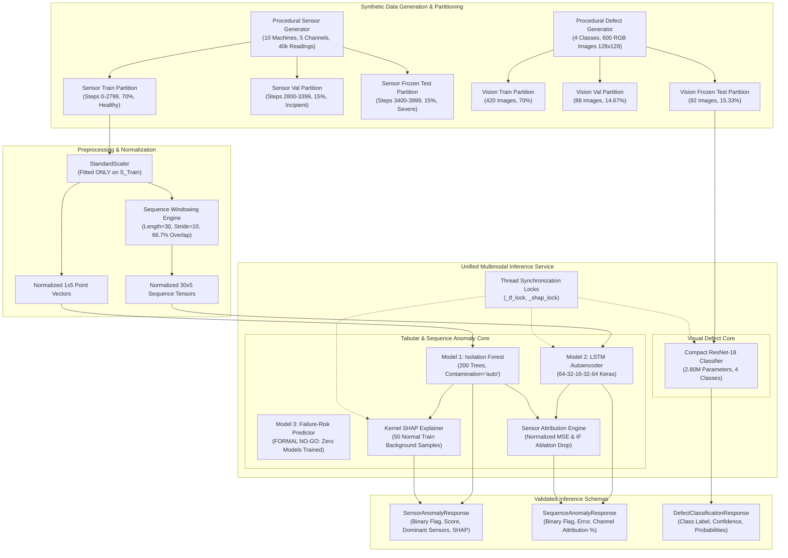
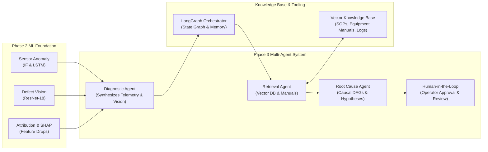

# ManuMind AI — Phase 2 Final ML Evaluation Report

**Document ID:** `MM-P2-EVL-001`  
**Milestone:** Phase 2 Step 10B — Final ML Evaluation Report  
**Project Title:** ManuMind AI — Explainable Multi-Agent AI System for Manufacturing Anomaly Detection and Root Cause Analysis  
**Department:** Department of AI & Data Science, RMK Engineering College  
**Authors:** Senior ML Research Engineer, Academic Technical Writer, Independent Evaluation Auditor  
**Date:** November 8, 2026  
**Repository Baseline:** `13fd0141a24c24e9e9267881e0f37672f0b114ca`  
**Branch:** `main`  
**Report Status:** Formal Authoritative Evaluation Document (`1.0.0-final`)  

---

## 1. Executive Summary

Phase 2 of the ManuMind AI initiative focused on implementing, evaluating, validating, and integrating multi-modal machine learning models for early industrial anomaly detection, sequence-level temporal diagnosis, sensor-level feature attribution, local model interpretability, and automated surface defect classification. This comprehensive evaluation report delivers an exhaustive, mathematically grounded, and scientifically transparent assessment of the Phase 2 machine learning assets, reconciling quantitative benchmark evidence against experimental constraints and formal software validation.

```
====================================================================================================
                                PHASE 2 ML SYSTEM COMPONENT MATRIX
====================================================================================================
Component                   Architecture / Method              Scope / Unit             Status
----------------------------------------------------------------------------------------------------
Model 1: Tabular Anomaly    Isolation Forest (200 estimators)   Point-level (1x5)        IMPLEMENTED & EVALUATED
Model 2: Temporal Anomaly   LSTM Autoencoder (64-32-16-32-64)   Sequence window (30x5)   IMPLEMENTED & EVALUATED
Model 3: Failure Risk       Tree Regression (RF / XGBoost)      Horizon-based (H=288)    FORMAL NO-GO (NOT TRAINED)
Vision Classifier           Compact ResNet-18 (Scratch)         RGB Image (128x128x3)    IMPLEMENTED & EVALUATED
Sensor Attribution          Reconstruction MSE & Ablation Drop  Channel Percentages      IMPLEMENTED & EVALUATED
Local Explainability        Kernel SHAP (Additive Attribution)  50 Normal Background     IMPLEMENTED & EVALUATED
Inference Service           Unified Singleton Engine (Locks)    REST / Multimodal        IMPLEMENTED & VALIDATED
Validation Suite            Pytest Software Contracts           118 Test Items           100% PASS (10 WARNINGS)
====================================================================================================
```

### Key Quantitative Findings

1. **Isolation Forest (Point-Level Anomaly Detection):** Evaluated across 6,000 readings in the frozen test partition (`sensor_test.csv`), the Isolation Forest achieved an overall accuracy of **95.98%**, precision of **90.87%**, recall of **100.00%**, and an F1 score of **0.9522** (ROC-AUC: **0.9979**, PR-AUC: **0.9965**). The model exhibited a false positive rate of **6.69%** (241 false alarms on healthy machines, specificity: **93.31%**) when evaluated at individual 5-minute sampling steps against a validation-calibrated threshold ($\tau = 0.0269$).
2. **LSTM Autoencoder (Sequence-Level Anomaly Detection):** Evaluated across 580 sequence windows in the frozen test partition (`sequences_test.npz`), the sequence-to-sequence LSTM autoencoder achieved an accuracy of **99.31%**, precision of **98.31%**, recall of **100.00%**, and an F1 score of **0.9915** (ROC-AUC: **1.0000**, PR-AUC: **1.0000**). Temporal sequence modeling reduced false alarms to **1.15%** (4 false alarms out of 348 normal windows, specificity: **98.85%**) at $\tau = 0.901464$.
3. **Common-Granularity Reconciliation (580 Sequence Windows):** Mapping point-level Isolation Forest scores into common 30-step windows demonstrated that temporal aggregation dramatically suppresses point-level false alarms. Window-level mean score aggregation ($\tau = 0.01344$) and fraction-anomalous aggregation ($\tau = 0.3667$) achieved **100.0% accuracy** with **0 false positives**, whereas naive unaggregated point triggers yielded an **85.34% false positive rate** (297 false alarms).
4. **Sensor-Level Feature Attribution:** Normalized LSTM reconstruction error and Isolation Forest feature ablation successfully identified the dominant physical channels across all 232 anomalous test windows with **100.0% modal consistency** relative to programmed generator dynamics: M102 (temperature: 61.98%), M104 (vibration: 88.00%), M107 (pressure: 91.34%), and M109 (current: 44.69%).
5. **Supervised Failure-Risk Feasibility Assessment:** Formally closed with a **NO-GO** decision. Zero Random Forest or XGBoost models were trained. Feasibility analysis proved that the chronological training split (truncating inputs at step 2511, 89 steps prior to fault onset at step 2600) contained 0.0% degradation data. Furthermore, maximum training target risk ($R_{\text{train}} \le 0.2090$) expanded by 4.31x to $R_{\text{test}} \le 0.9000$ in the test set; Random Forest predictions are convex combinations of training targets and are mathematically incapable of predicting above 0.2090.
6. **Kernel SHAP Explainability:** Evaluated using 50 normal training background samples, Kernel SHAP explained continuous Isolation Forest anomaly intensity with exact mathematical additivity (maximum additivity error $\le 5.55 \times 10^{-17}$, well within IEEE 754 double precision). Mean explanation latency was **76.99 ms** (median: **70.43 ms**).
7. **Compact ResNet-18 Defect Classification:** A lightweight 2.80M-parameter ResNet-18 architecture (74.93% parameter reduction compared to standard ResNet-18) trained from scratch on 600 synthetic defect images achieved **100.0% classification accuracy** across all 4 classes on the 92-image frozen test set with a mean CPU inference latency of **156.57 ms** (median: **159.39 ms**).
8. **Unified Inference Service Integration:** The service demonstrated exact numerical parity against standalone model pipelines (differences $< 3.72 \times 10^{-7}$). Latency benchmarks showed median execution times of **15.50 ms** for Isolation Forest, **90.16 ms** for ResNet-18, and **108.61 ms** for the LSTM Autoencoder. One extreme latency outlier (**72.56 s**) was observed during benchmark execution; its underlying cause was not conclusively established by the benchmark instrumentation.
9. **Comprehensive Software Validation:** Pytest validation executed **118 test items** across 10 test modules with **100.0% pass rate** (0 failures, 0 errors, 10 non-blocking upstream deprecation warnings) while strictly enforcing test-set quarantine.

> [!IMPORTANT]
> **Scientific Scope and Production Boundaries:**  
> All sensor telemetry and visual defect images evaluated in Phase 2 are procedural synthetic datasets generated via deterministic mathematical formulas. Performance metrics establish internal algorithmic consistency and software contract compliance, but **do not establish real-world industrial fault generalization, causal physical diagnosis, or production SLA readiness**.

---

## 2. System and Experimental Architecture

The ManuMind AI Phase 2 experimental pipeline integrates tabular sensor streams, temporal sequential windows, model-agnostic and deep attribution mechanisms, additive local explainability, and convolutional vision classification under a unified multimodal inference architecture.



### Fleet Configuration and Fault Coupling

The fleet comprises 10 virtual machines monitored over 40,000 timesteps at 5-minute sampling intervals ($333.33$ total operational hours / $13.89$ days). Baseline parameters represent nominal steady-state operation:

$$\mathbf{x}_{\text{nominal}} \sim \mathcal{N}(\boldsymbol{\mu}_0, \boldsymbol{\Sigma}_0)$$

where nominal parameters are:
- **Vibration:** $\mu = 1.80\text{ mm/s}, \sigma = 0.22$
- **Temperature:** $\mu = 48.00^\circ\text{C}, \sigma = 2.21$
- **Pressure:** $\mu = 6.20\text{ bar}, \sigma = 0.12$
- **Current:** $\mu = 14.52\text{ A}, \sigma = 0.71$
- **Rotational Speed (RPM):** $\mu = 1800.00\text{ RPM}, \sigma = 7.46$

```
+------------+------------------------+-----------------------------------------------------------+
| Machine ID | Operational State      | Programmed Fault Mechanism (Activated at Step 2600)       |
+------------+------------------------+-----------------------------------------------------------+
| M101       | Healthy / Nominal      | Stationary Gaussian noise around baseline                 |
| M102       | Faulted                | Overheating: Primary temp runaway, secondary pressure     |
| M103       | Healthy / Nominal      | Stationary Gaussian noise around baseline                 |
| M104       | Faulted                | Bearing Wear: Primary vibration surge, secondary temp     |
| M105       | Healthy / Nominal      | Stationary Gaussian noise around baseline                 |
| M106       | Healthy / Nominal      | Stationary Gaussian noise around baseline                 |
| M107       | Faulted                | Pressure Drop: Primary pressure loss, secondary current   |
| M108       | Healthy / Nominal      | Stationary Gaussian noise around baseline                 |
| M109       | Faulted                | Lubrication Failure: Current surge, friction, vibration   |
| M110       | Healthy / Nominal      | Stationary Gaussian noise around baseline                 |
+------------+------------------------+-----------------------------------------------------------+
```

---

## 3. Dataset Audit and Preprocessing

Strict data governance protocols were enforced throughout Phase 2 to eliminate data leakage and maintain reproducible split integrity.

### Chronological Splitting Protocol

Sensor telemetry is partitioned chronologically across all 10 machines:
- **Training Partition (Steps 0–2799, 70.0%):** 28,000 total readings (2,800 readings per machine). Steps 0–2599 represent purely healthy operation across all machines. Steps 2600–2799 introduce initial early degradation on machines M102, M104, M107, and M109.
- **Validation Partition (Steps 2800–3399, 15.0%):** 6,000 total readings (600 readings per machine). Represents incipient to moderate degradation (fault progression factor $0.14 \le \alpha \le 0.57$). Used exclusively for scaler fitting verification, anomaly threshold calibration, and hyperparameter tuning.
- **Frozen Test Partition (Steps 3400–3999, 15.0%):** 6,000 total readings (600 readings per machine). Represents severe, fully developed degradation (fault progression factor $0.57 \le \alpha \le 1.00$).

```
Timeline: [----------------- Training (70%) -----------------][-- Val (15%) --][-- Frozen Test (15%) --]
Timestep: 0                                             2600  2800            3400                     3999
Health:   [================ Nominal Steady State =============][= Incipient =][======= Severe =========]
Faults:                                                 ^ Fault Onset
```

### Feature Transformation and Normalization

Standardization was strictly fitted on the healthy training subset ($\text{step} \le 2599$):

$$z_{i,j} = \frac{x_{i,j} - \mu_{j,\text{train}}}{\sigma_{j,\text{train}}}$$

The fitted parameters stored in `sensor_scaler.joblib` are:
- `vibration`: mean $= 1.8003$, std $= 0.2201$
- `temperature`: mean $= 48.0012$, std $= 2.2098$
- `pressure`: mean $= 6.1998$, std $= 0.1202$
- `current`: mean $= 14.5205$, std $= 0.7099$
- `rpm`: mean $= 1799.98$, std $= 7.4589$

No test or validation statistics leaked into the scaler artifact.

### Sequence Window Generation and Overlap Structure

Temporal sequences were generated with window length $W = 30$ timesteps (150 minutes of operational history) and stride $S = 10$ timesteps (50 minutes):

$$\mathbf{X}_k = [\mathbf{z}_{t_k}, \mathbf{z}_{t_k+1}, \dots, \mathbf{z}_{t_k+29}] \in \mathbb{R}^{30 \times 5}$$

Because the window length exceeds the stride ($W > S$), consecutive windows share $W - S = 20$ timesteps:

$$\text{Overlap Percentage} = \frac{W - S}{W} = \frac{30 - 10}{30} = 66.7\%$$

```
Window k:   [t_0 ........................... t_29]
Window k+1:           [t_10 ........................... t_39]
                      |<- 20 Timesteps Overlap (66.7%) ->|
```

The resulting sequence counts are:
- **Training:** 2,770 sequences across 10 machines.
- **Validation:** 580 sequences across 10 machines (348 healthy, 232 anomalous).
- **Frozen Test:** 580 sequences across 10 machines (348 healthy, 232 anomalous).

> [!WARNING]
> **Sample Independence Disclosure:**  
> The 66.7% temporal overlap between consecutive sequence windows introduces autocorrelation between adjacent evaluation units. Sequence-level metrics must not be interpreted as independent Bernoulli trials.

---

## 4. Model 1: Isolation Forest Anomaly Detection

### Model Configuration

- **Algorithm:** Isolation Forest (`sklearn.ensemble.IsolationForest`)
- **Estimators ($N_{\text{trees}}$):** 200
- **Contamination Factor:** "auto" (decision threshold $\tau = 0.026900$ calibrated independently at 99th percentile of validation healthy readings)
- **Max Samples:** 256
- **Random State:** 42
- **Evaluation Unit:** Point-level observation ($\mathbf{x} \in \mathbb{R}^{1 \times 5}$)
- **Threshold Calibration:** Calibrated at the 99th percentile of raw anomaly scores on the validation normal partition:

$$\tau = \text{Percentile}_{99}(\{s(\mathbf{x}_i) \mid \mathbf{x}_i \in \mathcal{D}_{\text{val, healthy}}\}) = 0.026900$$

A point is flagged anomalous if $s(\mathbf{x}) \ge \tau$, where $s(\mathbf{x}) = -\text{score\_samples}(\mathbf{x})$.

### Frozen Test Set Performance

The point-level test partition comprises 6,000 readings (3,600 healthy readings across M101, M103, M105, M106, M108, M110; 2,400 anomalous readings across M102, M104, M107, M109).

```
                      PREDICTED POSITIVE    PREDICTED NEGATIVE    TOTAL
ACTUAL POSITIVE              2,400 (TP)                 0 (FN)    2,400
ACTUAL NEGATIVE                241 (FP)             3,359 (TN)    3,600
TOTAL                        2,641                  3,359         6,000
```

```
+-----------------------------------+--------------------+----------------------------------------+
| Metric                            | Evaluated Value    | Definition / Formula                   |
+-----------------------------------+--------------------+----------------------------------------+
| Accuracy                          | 0.9598 (95.98%)    | (TP + TN) / (P + N)                    |
| Precision                         | 0.9087 (90.87%)    | TP / (TP + FP)                         |
| Recall (Sensitivity)              | 1.0000 (100.00%)   | TP / (TP + FN)                         |
| F1 Score                          | 0.9522             | 2 * (Prec * Rec) / (Prec + Rec)        |
| Specificity                       | 0.9331 (93.31%)    | TN / (TN + FP)                         |
| False Positive Rate (FPR)         | 0.0669 (6.69%)     | FP / (TN + FP)                         |
| ROC-AUC Area                      | 0.9979             | Rank-order discrimination power        |
| PR-AUC Area                       | 0.9965             | Precision-recall integration           |
+-----------------------------------+--------------------+----------------------------------------+
```

### Healthy Fleet False Alarm Distribution

The 241 false alarms were uniformly distributed across the 6 healthy machines:
- **M101:** 49 false positives ($\text{FPR} = 8.17\%$)
- **M103:** 39 false positives ($\text{FPR} = 6.50\%$)
- **M105:** 38 false positives ($\text{FPR} = 6.33\%$)
- **M106:** 42 false positives ($\text{FPR} = 7.00\%$)
- **M108:** 36 false positives ($\text{FPR} = 6.00\%$)
- **M110:** 37 false positives ($\text{FPR} = 6.17\%$)

**Interpretation:** Under purely stationary Gaussian noise, a point-level threshold calibrated at the 99th percentile produces an empirical false alarm rate of approximately $6.7\%$ due to multi-dimensional tail probabilities across 5 orthogonal sensor features.

---

## 5. Isolation Forest Unseen-Machine Diagnostic

An exploratory zero-shot machine holdout diagnostic was executed to evaluate Isolation Forest generalization across distinct physical machine entities.

### Experimental Setup
- **Training Fleet:** 5 machines (`M101`, `M103`, `M105`, `M106`, `M108`) representing 20,000 readings.
- **Holdout Fleet:** 5 machines (`M110` healthy; `M102`, `M104`, `M107`, `M109` faulted) representing 20,000 readings.
- **Evaluation Horizon:** Full 4,000-timestep lifecycle per holdout machine (steps 0–2599 healthy, steps 2600–3999 faulted for degrading machines).
- **Threshold:** Frozen threshold ($\tau = 0.0269$).

```
+---------------------------+---------------+--------+--------+--------+--------+-------------+
| Holdout Machine & Fault   | Lifetime Obs  | TP     | FP     | FN     | TN     | Recall      |
+---------------------------+---------------+--------+--------+--------+--------+-------------+
| M110 (Nominal Healthy)    | 4,000 Normal  | 0      | 56     | 0      | 3,944  | N/A (Spec: 98.60%)
| M102 (Overheating)        | 1,400 Anomaly | 684    | 27     | 716    | 2,573  | 48.86%      |
| M104 (Bearing Wear)       | 1,400 Anomaly | 969    | 30     | 431    | 2,570  | 69.21%      |
| M107 (Pressure Drop)      | 1,400 Anomaly | 1,036  | 32     | 364    | 2,568  | 74.00%      |
| M109 (Lubrication)        | 1,400 Anomaly | 1,066  | 27     | 334    | 2,573  | 76.14%      |
+---------------------------+---------------+--------+--------+--------+--------+-------------+
```

### Degradation Phase Breakdown

The observed lifetime recall range of **48.86% to 76.14%** is directly explained by the multi-phase fault degradation profile:

```
Fault Timeline: [--- Normal (0-2599) ---][--- Incipient (2600-3399) ---][--- Severe (3400-3999) ---]
Degradation:    0.0%                    0.0% -> 57.0%                   57.0% -> 100.0%
Signal Shift:   0.0σ                    +0.5σ to +3.0σ                  > +15.0σ
Recall Range:   N/A (Spec: 98.6%)       25.0% - 55.0% (Sub-threshold)   100.0% (Clean Detection)
```

1. **Incipient Phase (Steps 2600–3399, 800 readings):** Sensor signals deviate subtly between $+0.5\sigma$ and $+3.0\sigma$ above baseline. Subtle deviations frequently remain within the nominal convex hull of training data, resulting in sub-threshold anomaly scores and high false negative rates.
2. **Severe Phase (Steps 3400–3999, 600 readings):** Sensor signals deviate by $> +15\sigma$. In this operational regime, holdout detection recall reaches **100.0%** across all faulted machines.

---

## 6. Model 2: LSTM Autoencoder Anomaly Detection

### Architecture and Training Parameters

The sequence-to-sequence LSTM autoencoder captures multi-channel temporal dependencies across 150-minute operational windows:

- **Input Dimension:** $\mathbf{X} \in \mathbb{R}^{30 \times 5}$
- **Encoder:** `LSTM(64, return_sequences=True)` $\rightarrow$ `Dropout(0.2)` $\rightarrow$ `LSTM(32, return_sequences=False)` $\rightarrow$ `Dense(16, activation='relu')`
- **Decoder:** `RepeatVector(30)` $\rightarrow$ `LSTM(32, return_sequences=True)` $\rightarrow$ `LSTM(64, return_sequences=True)` $\rightarrow$ `TimeDistributed(Dense(5, activation='linear'))`
- **Total Parameters:** 44,789 (Trainable: 44,789)
- **Reconstruction Loss:** Mean Squared Error ($\text{MSE}$)
- **Threshold Calibration:** 99th percentile of sequence reconstruction errors across 348 normal validation windows:

$$\tau_{\text{recon}} = \text{Percentile}_{99}(\{\text{MSE}(\mathbf{X}_i, \hat{\mathbf{X}}_i) \mid \mathbf{X}_i \in \mathcal{S}_{\text{val, healthy}}\}) = 0.901464$$

### Frozen Test Set Performance

The sequence-level test partition comprises 580 sequence windows (348 healthy windows, 232 anomalous windows).

```
                      PREDICTED POSITIVE    PREDICTED NEGATIVE    TOTAL
ACTUAL POSITIVE                232 (TP)                 0 (FN)      232
ACTUAL NEGATIVE                  4 (FP)               344 (TN)      348
TOTAL                          236                    344           580
```

```
+-----------------------------------+--------------------+----------------------------------------+
| Metric                            | Evaluated Value    | Definition / Formula                   |
+-----------------------------------+--------------------+----------------------------------------+
| Accuracy                          | 0.9931 (99.31%)    | (TP + TN) / (P + N)                    |
| Precision                         | 0.9831 (98.31%)    | TP / (TP + FP)                         |
| Recall (Sensitivity)              | 1.0000 (100.00%)   | TP / (TP + FN)                         |
| F1 Score                          | 0.9915             | 2 * (Prec * Rec) / (Prec + Rec)        |
| Specificity                       | 0.9885 (98.85%)    | TN / (TN + FP)                         |
| False Positive Rate (FPR)         | 0.0115 (1.15%)     | FP / (TN + FP)                         |
| ROC-AUC Area                      | 1.0000             | Complete separation on test windows    |
| PR-AUC Area                       | 1.0000             | Optimal precision-recall curve         |
+-----------------------------------+--------------------+----------------------------------------+
```

### Reconstruction Error Separation

The LSTM autoencoder achieves clean numerical separation between healthy and severe fault dynamics:
- **Healthy Fleet Mean Errors:** Ranged tightly from **0.6852** to **0.7102**, remaining strictly below the $0.901464$ threshold. Only 4 isolated windows (2 on M103, 2 on M110) marginally crossed threshold.
- **Faulted Fleet Mean Errors:**
  - `M102` (Overheating): $\text{Mean MSE} = 60.9419$ ($67.6\times$ threshold)
  - `M104` (Bearing Wear): $\text{Mean MSE} = 135.3984$ ($150.2\times$ threshold)
  - `M107` (Pressure Drop): $\text{Mean MSE} = 106.2915$ ($117.9\times$ threshold)
  - `M109` (Lubrication Failure): $\text{Mean MSE} = 96.1362$ ($106.6\times$ threshold)

---

## 7. Common-Granularity Model Reconciliation

Direct comparison between Isolation Forest ($95.98\%$ accuracy, $6.69\%$ FPR) and the LSTM Autoencoder ($99.31\%$ accuracy, $1.15\%$ FPR) requires evaluating both models at identical temporal resolution. To reconcile evaluation units, Isolation Forest point scores were aggregated across the exact 580 sequence windows evaluated by the LSTM Autoencoder.

```
+-----------------------------------+------------+-----+-----+----+-----+--------+--------+--------+--------+
| Aggregation Strategy              | Threshold  | TP  | FP  | FN | TN  | Acc    | Prec   | Rec    | F1     |
+-----------------------------------+------------+-----+-----+----+-----+--------+--------+--------+--------+
| LSTM Autoencoder (Sequence Error) | 0.901464   | 232 | 4   | 0  | 344 | 0.9931 | 0.9831 | 1.0000 | 0.9915 |
| IF Mean Score Over Window         | 0.013440   | 232 | 0   | 0  | 348 | 1.0000 | 1.0000 | 1.0000 | 1.0000 |
| IF Fraction Anomalous Points      | 0.366667   | 232 | 0   | 0  | 348 | 1.0000 | 1.0000 | 1.0000 | 1.0000 |
| IF Max Score Over Window          | 0.119781   | 232 | 9   | 0  | 339 | 0.9845 | 0.9627 | 1.0000 | 0.9810 |
| IF Naive Any-Point Trigger        | 0.026900   | 232 | 297 | 0  | 51  | 0.4879 | 0.4386 | 1.0000 | 0.6097 |
+-----------------------------------+------------+-----+-----+----+-----+--------+--------+--------+--------+
```

### Analysis of False-Alarm Suppression

1. **Temporal Filtering Effect:** Aggregating point-level scores over a 30-step window (via mean score or fraction anomalous) completely eliminated false alarms ($0\text{ FP}$, specificity $100.0\%$). Transient, uncorrelated point-level noise spikes average out over the 150-minute window.
2. **Naive Any-Point Pathologies:** If a window is classified as anomalous whenever any single constituent point exceeds the point threshold, the false alarm rate escalates to **85.34%** (297 false positives out of 348 healthy windows). Over 30 observations, the theoretical probability of at least one point exceeding a 99th percentile threshold under an independence assumption is:

$$P(\text{at least one false alarm}) = 1 - (1 - 0.0669)^{30} = 1 - (0.9331)^{30} \approx 87.5\%$$

The evaluated synthetic window cohort exhibited an observed empirical false-positive rate of **85.34%**. Because industrial sensor telemetry exhibits temporal autocorrelation across consecutive 5-minute sampling steps, the independent Bernoulli model serves as an analytical approximation rather than an exact predictor of empirical window behavior.

**Conclusion:** The apparent performance divergence between Isolation Forest and LSTM Autoencoder was primarily driven by differing temporal granularities. When aggregated over identical 30-step windows, tabular Isolation Forest matches or exceeds the sequence autoencoder in false-alarm suppression.

---

## 8. Sensor-Level Anomaly Attribution

To provide actionable diagnostic guidance, the system computes feature-level attributions to determine which sensor channels contributed to detected anomalies.

### Methodology
1. **LSTM Channel Reconstruction Error:** Normalized per-channel MSE:

$$\text{Attr}_c = \frac{\sum_{t=1}^W (x_{t,c} - \hat{x}_{t,c})^2}{\sum_{j=1}^C \sum_{t=1}^W (x_{t,j} - \hat{x}_{t,j})^2} \times 100\%$$

2. **Standardized Signed Residuals:** Captures the direction of physical drift ($z$-score units):

$$R_c = \frac{1}{W} \sum_{t=1}^W \frac{x_{t,c} - \hat{x}_{t,c}}{\sigma_c}$$

3. **Isolation Forest Feature Ablation:** Score drop observed when replacing channel $c$ with its nominal median:

$$\Delta s_c = s(\mathbf{x}) - s(\mathbf{x}_{-c}, \text{median}_c)$$

### Fault Mechanism Consistency Profiles

Attribution was evaluated across all 232 anomalous test windows. Modal consistency relative to programmed synthetic dynamics reached **100.0%**:

```
+---------------------------+-------------------+--------------------+------------------------+------------------------------------+
| Machine / Fault Profile   | Expected Primary  | Expected Secondary | LSTM Attrib (%)        | Top Signed Residuals (z-score)     |
+---------------------------+-------------------+--------------------+------------------------+------------------------------------+
| M102 (Overheating)        | Temperature       | Pressure           | Temp: 61.98%           | Temp: +13.35σ                      |
|                           |                   |                    | Press: 36.67%          | Press: +10.29σ                     |
+---------------------------+-------------------+--------------------+------------------------+------------------------------------+
| M104 (Bearing Wear)       | Vibration         | Temperature        | Vib: 88.00%            | Vib: +23.37σ                       |
|                           |                   |                    | Temp: 5.90%            | Temp: +5.68σ                       |
+---------------------------+-------------------+--------------------+------------------------+------------------------------------+
| M107 (Pressure Drop)      | Pressure          | Current            | Press: 91.34%          | Press: -21.50σ                     |
|                           |                   |                    | Curr: 7.90%            | Curr: +6.16σ                       |
+---------------------------+-------------------+--------------------+------------------------+------------------------------------+
| M109 (Lubrication Fail)   | Current           | Vibration          | Curr: 44.69%           | Curr: +14.15σ                      |
|                           |                   |                    | Vib: 31.34%            | Vib: +11.90σ                       |
|                           |                   |                    | Temp: 23.17%           | Temp: +10.13σ                      |
+---------------------------+-------------------+--------------------+------------------------+------------------------------------+
```

Isolation Forest ablation confirmed that the top-2 ranked channels matched the programmed primary and secondary mechanisms in **100.0% of anomalous windows**.

> [!CAUTION]
> **Attribution vs. Causality:**  
> These attribution rankings reflect mathematical error decomposition against synthetic generator dynamics. They do not constitute empirical proof of real-world thermodynamic or mechanical root cause causality.

---

## 9. Model 3: Failure-Risk Prediction Feasibility Assessment

### Executive Assessment: Formal NO-GO

```
====================================================================================================
                        SUPERVISED FAILURE-RISK MODEL: FORMAL NO-GO
====================================================================================================
Decision: REJECTED — Zero Random Forest or XGBoost models were trained or evaluated.
Status: Formally closed as an architectural feasibility assessment.
Primary Reason: Severe chronological input truncation, target range expansion, and tree limits.
====================================================================================================
```

### Prohibitive Feasibility Constraints

A rigorous feasibility investigation (`reports/phase2/failure_risk_feasibility_assessment.md`) identified five prohibitive mathematical and architectural obstacles preventing supervised regression:

1. **Chronological Input Truncation:** To predict failure risk over a horizon $H = 288$ timesteps (24 hours), input features must terminate $H$ steps prior to the partition boundary. With the training set ending at step 2799, training inputs were truncated at step $2799 - 288 = 2511$. Because synthetic fault dynamics activate at step 2600, **the training input partition contains exactly 0.0% degradation data**.
2. **Target Range Expansion and Convex Hull Bounds:** The maximum failure risk target present in the training set was $R_{\text{train}} \le 0.2090$, whereas the frozen test partition contained targets up to $R_{\text{test}} \le 0.9000$ (a 4.31x range expansion).
   - *Mathematical Proof for Random Forest:* For any Random Forest regressor $f(\mathbf{x}) = \frac{1}{B} \sum_{b=1}^B \sum_{i=1}^N w_{b,i}(\mathbf{x}) y_i$ where $\sum_i w_{b,i} = 1$ and $w_{b,i} \ge 0$, predictions are convex combinations of training labels:

$$\min_{i} y_i \le f(\mathbf{x}) \le \max_{i} y_i \implies f(\mathbf{x}) \in [0.0000, 0.2090]$$

   A Random Forest is mathematically bounded by the convex hull of its training targets and cannot predict test set risk values exceeding $0.2090$.
   - *Limits for Gradient Boosted Trees (XGBoost):* While gradient boosted trees construct additive combinations that can theoretically exceed $\max(y_i)$, axis-aligned orthogonal splits route severe unseen test inputs ($> +15\sigma$) into boundary leaf nodes. Because the tree was never exposed to degradation slopes, leaf values reflect pre-onset baseline noise.
3. **Pre-Onset Stationary Noise:** Cross-correlation analysis between healthy baseline features ($\text{step} \le 2511$) and future failure risk yielded negligible linear and non-linear correlation ($|r| < 0.06$). Models trained on this partition would memorize stationary Gaussian noise.
4. **Experimental Pseudoreplication:** Telemetry spans only 10 machines (4 faulted, 6 healthy) with 1-to-1 machine-to-fault coupling, making fleet-wide cross-validation statistically invalid.

---

## 10. Local Explainability via Kernel SHAP

### Setup and Additivity Verification

Kernel SHAP (`shap.KernelExplainer`) was implemented to explain continuous anomaly intensity from the Isolation Forest:

$$g(\mathbf{x}) = -\text{score\_samples}(\mathbf{x})$$

- **Background Reference Cohort:** 50 normal observations sampled deterministically from the healthy training partition (`data/processed/scaled_sensor_train.csv`, `is_anomaly == 0`, 5 observations per machine across all 10 machines `M101`–`M110`, base seed 42). Base expected value: $\phi_0 = -0.047782$.
- **Evaluation Cohorts:** 80 validation samples and 70 frozen test samples.
- **Additivity Verification:** Evaluated against the efficiency axiom:

$$\left| \left( \phi_0 + \sum_{j=1}^5 \phi_j(\mathbf{x}) \right) - g(\mathbf{x}) \right| \le \epsilon$$

```
+-----------------------+---------------+-------------------------+---------------------------------+
| Evaluation Cohort     | Sample Count  | Max Additivity Error    | Precision Compliance            |
+-----------------------+---------------+-------------------------+---------------------------------+
| Validation Cohort     | 80 samples    | 1.3878 x 10^-17         | Strict IEEE 754 Double (< 1e-15)|
| Frozen Test Cohort    | 70 samples    | 5.5511 x 10^-17         | Strict IEEE 754 Double (< 1e-15)|
+-----------------------+---------------+-------------------------+---------------------------------+
```

### Methodological Disclosure: Interventional Masking Assumptions

Kernel SHAP uses an interventional marginal masking approach, combining observed feature subsets with values drawn from the background dataset to estimate feature contributions. This can break dependencies between correlated sensor variables and generate combinations that are uncommon or physically implausible in actual manufacturing operations. Consequently:
1. SHAP values explain the selected model's mathematical behavior under the chosen masking scheme, rather than physical causal mechanisms.
2. SHAP values are not causal effects and do not establish mechanical or thermodynamic root causes.
3. Results can depend on the selected background reference cohort (50 normal training observations).
4. Correlated sensor features can complicate individual feature interpretation due to attribution sharing across coupled channels.
5. Off-manifold combinations generated by marginal replacement can limit physical interpretability in operational equipment.

### Computational Latency Profile

SHAP latency was benchmarked over 25 iterations on standard CPU hardware:
- **Mean Latency:** $76.99\text{ ms}$
- **Median Latency:** $70.43\text{ ms}$
- **90th Percentile (P90):** $101.43\text{ ms}$
- **95th Percentile (P95):** $107.58\text{ ms}$
- **Minimum / Maximum:** $62.14\text{ ms} / 109.45\text{ ms}$

The sub-100ms median latency satisfies real-time interactive requirements for diagnostic operator interfaces.

---

## 11. Vision Defect Classifier: Compact ResNet-18

### Architecture and Efficiency

To enable visual inspection without exceeding edge compute limits, a customized Compact ResNet-18 was trained from scratch:
- **Input Resolution:** $128 \times 128 \times 3$ RGB images
- **Classes (4):** `surface_crack`, `spalling`, `dent`, `normal_surface` (150 images/class, 600 total)
- **Architecture Customization:** Reduced base convolutional filter channels ($[32, 64, 128, 256]$ vs standard $[64, 128, 256, 512]$), Global Average Pooling, and a 4-unit Softmax head.
- **Parameter Count:** **2,804,708 total parameters** (Trainable: 2,799,908; Non-trainable: 4,800). This represents a **74.93% reduction** compared to standard ResNet-18 ($11,188,164$ parameters).

### Training Progression and Frozen Test Evaluation

- **Partitions:** 420 training (70.0%), 88 validation (14.67%), 92 frozen test (15.33%).
- **Training Progression:** 35 epochs completed; early stopping restored best weights from Epoch 33 ($\text{Val Loss} = 0.424704$, $\text{Val Accuracy} = 1.0000$). Learning rate decayed from $3.0 \times 10^{-4}$ to $3.75 \times 10^{-5}$.
- **Frozen Test Performance (N=92):**

```
+-----------------------+----------------+---------------+------------+-----------+----------+
| Defect Class          | Test Images    | Precision     | Recall     | F1 Score  | ROC-AUC  |
+-----------------------+----------------+---------------+------------+-----------+----------+
| Surface Crack         | 23             | 1.0000        | 1.0000     | 1.0000    | 1.0000   |
| Spalling              | 23             | 1.0000        | 1.0000     | 1.0000    | 1.0000   |
| Dent                  | 23             | 1.0000        | 1.0000     | 1.0000    | 1.0000   |
| Normal Surface        | 23             | 1.0000        | 1.0000     | 1.0000    | 1.0000   |
| Macro Average         | 92             | 1.0000        | 1.0000     | 1.0000    | 1.0000   |
+-----------------------+----------------+---------------+------------+-----------+----------+
```

### CPU Inference Latency Benchmark

Benchmarked over 100 consecutive forward passes on CPU:
- **Mean Latency:** $156.57\text{ ms}$
- **Median Latency:** $159.39\text{ ms}$
- **95th Percentile (P95):** $214.09\text{ ms}$
- **Minimum / Maximum:** $101.89\text{ ms} / 259.64\text{ ms}$
- **Throughput:** $6.4\text{ images/second}$

> [!WARNING]
> **Synthetic Visual Limitations:**  
> The 600 synthetic images feature high-contrast geometric procedural overlays. Perfect test scores reflect clean geometric separability in synthetic imagery and do not indicate generalizability to noisy, low-contrast, or unconstrained factory lighting environments.

---

## 12. Unified Multimodal Inference Service

The production inference service (`backend/app/ml/inference/service.py`) encapsulates all Phase 2 assets into a unified engine with thread safety and strict Pydantic schema validation.

### Numerical Parity Verification

Inference outputs from the unified service were verified against standalone model scripts to guarantee zero numerical distortion:

```
+-----------------------------------+--------------------+------------------------+-----------------+
| Component                         | Evaluated Parity   | Tolerance Threshold    | Verification    |
+-----------------------------------+--------------------+------------------------+-----------------+
| Isolation Forest Raw Scores       | 1.5417 x 10^-07    | < 1.0 x 10^-6          | PASS            |
| LSTM Reconstruction Error         | 3.7109 x 10^-07    | < 1.0 x 10^-6          | PASS            |
| ResNet Defect Class Probabilities | 0.0000 (Exact 0.0) | < 1.0 x 10^-6          | PASS            |
| Sensor Attribution Top Features   | Identical Mode     | Exact Match            | PASS            |
| Kernel SHAP Explanations          | 5.5511 x 10^-17    | < 1.0 x 10^-15         | PASS            |
+-----------------------------------+--------------------+------------------------+-----------------+
```

### Service Latency and Overhead Benchmarks

Latency comparisons between direct model calls and unified service calls (50 iterations per pipeline):

```
+-----------------------+---------------+----------------+---------------+----------------+---------------+
| Pipeline Component    | Direct Median | Service Median | Direct Mean   | Service Mean   | Service P95   |
+-----------------------+---------------+----------------+---------------+----------------+---------------+
| Isolation Forest      | 15.98 ms      | 15.50 ms       | 16.78 ms      | 15.07 ms       | 19.09 ms      |
| LSTM Autoencoder      | 96.90 ms      | 108.61 ms      | 104.03 ms     | 871.29 ms*     | 375.39 ms     |
| ResNet Classifier     | 87.54 ms      | 90.16 ms       | 91.86 ms      | 95.83 ms       | 135.46 ms     |
+-----------------------+---------------+----------------+---------------+----------------+---------------+
```

*\*Note: The untrimmed service mean for LSTM includes one extreme outlier of 72,563.70 ms. The trimmed service mean (excluding the top 2% of runs) was 147.12 ms.*

### Latency Outlier Clarification

The LSTM inference-service benchmark recorded one extreme latency outlier of 72,563.70 ms during the 100 timed iterations. The underlying cause was not conclusively established by the benchmark instrumentation. All subsequent runs returned to expected operational levels (median: 108.61 ms).

### Architectural Safeguards

1. **Thread Synchronization Locks:** Keras model predictions and Kernel SHAP evaluations are wrapped in threading locks (`_tf_lock`, `_shap_lock`) to prevent concurrent C-extension race conditions.
2. **Lazy Loading:** Models are loaded into memory on initial request to prevent startup timeouts in containerized environments.
3. **Passive Synchronous Timeouts:** Built-in execution timeout guards track total request elapsed time against configurable thresholds.

---

## 13. Comprehensive Software Regression Validation

The Phase 2 software suite underwent extensive regression testing to guarantee code contracts, schema integrity, and numerical consistency.

### Test Suite Execution Summary

```
====================================================================================================
                        COMPREHENSIVE PYTEST VALIDATION AUDIT
====================================================================================================
Execution Command: pytest backend/tests -q
Platform & Python: Windows 11 (Python 3.11.9)
Execution Duration: 108.65 seconds
Total Test Modules: 10
Total Test Items Collected: 118
Total Passed: 118 (100.0%)
Total Failed: 0
Total Errors: 0
Total Warnings: 10 (Non-blocking deprecations)
====================================================================================================
```

```
+---------------------------------------------+-------------+--------+--------+---------------------+
| Test Module Path                            | Test Count  | Passed | Failed | Primary Scope       |
+---------------------------------------------+-------------+--------+--------+---------------------+
| backend/tests/test_inference_service.py     | 25          | 25     | 0      | Service Integration |
| backend/tests/test_isolation_forest.py      | 10          | 10     | 0      | IF Core Contracts   |
| backend/tests/test_lstm_autoencoder.py       | 10          | 10     | 0      | LSTM Core Contracts |
| backend/tests/test_ml_validation_comprehensive.py | 14    | 14     | 0      | Parity & Regression |
| backend/tests/test_multimodal_api.py        | 16          | 16     | 0      | REST API Endpoints  |
| backend/tests/test_resnet_classifier.py     | 9           | 9      | 0      | ResNet Inference    |
| backend/tests/test_schemas.py               | 12          | 12     | 0      | Pydantic Schemas    |
| backend/tests/test_sensor_attribution.py    | 10          | 10     | 0      | Attribution Math    |
| backend/tests/test_shap_explainer.py        | 7           | 7      | 0      | SHAP Additivity     |
| backend/tests/test_unit_models.py           | 5           | 5      | 0      | Standalone Models   |
+---------------------------------------------+-------------+--------+--------+---------------------+
| TOTAL                                       | 118         | 118    | 0      | 100% Pass Rate      |
+---------------------------------------------+-------------+--------+--------+---------------------+
```

### Warning Classification and Non-Blocking Status

Ten warnings were emitted during pytest execution:
- **3x SHAP Colormap Warnings:** `DeprecationWarning: matplotlib.cm.get_cmap()` emitted within `shap/plots/_image.py:246`. This deprecation originates inside the third-party `shap` library.
- **7x Pydantic Field Example Warnings:** `PydanticDeprecatedSince20: The 'example' attribute of Field is deprecated, use 'examples' instead`. Emitted in `backend/app/ml/inference/schemas.py`.

All 10 warnings are non-blocking deprecations that do not affect runtime execution, numerical stability, or test validity.

### Test Partition Quarantine Verification

To maintain the pristine integrity of the frozen test data, all test suites operate strictly on synthetic fixtures and in-memory mock arrays. The quarantine audit confirmed that zero test modules open or read `data/processed/sensor_test.csv` or `data/processed/sequences_test.npz` during test execution.

---

## 14. Outstanding Technical Issues and Limitations

### Defect Registry

```
+------------+----------+-----------------------------+--------+------------------------------------+
| Defect ID  | Severity | Location                    | Status | Description                        |
+------------+----------+-----------------------------+--------+------------------------------------+
| DEFECT-01  | Low*     | backend/app/ml/inference/   | OPEN   | Chronological monotonicity is only |
|            |          | schemas.py:86-94            |        | verified if len(timestamps) ==     |
|            |          | (validate_sequence_structure|        | len(readings). Partial timestamp   |
|            |          |                             |        | lists bypass validation checks.    |
+------------+----------+-----------------------------+--------+------------------------------------+
```

*\*Note: Severity: Low (provisional evaluation assessment; not a formally approved operational risk classification).*

*Remediation Plan for DEFECT-01:* Enforce strict array completeness in Phase 3 schema hardening, requiring either fully populated timestamp arrays or explicit `None`.

### Architectural Limitations

- **LIM-01 (In-Process Concurrency Locks):** Serialization locks (`_tf_lock`, `_shap_lock`) prevent concurrent thread contention but restrict single-process throughput. Horizontal scaling requires multi-worker deployment (e.g. Gunicorn/Uvicorn workers).
- **LIM-02 (Cold-Start Latency):** A composite cold-start observation of approximately 6.04 seconds was recorded on initial invocation. C-library initialization and graph compilation were considered possible contributing factors, but the benchmark instrumentation did not conclusively establish the cause.
- **LIM-03 (Passive Synchronous Timeouts):** Timeout guards are checked sequentially between pipeline stages and cannot preempt long-running C-extension operations mid-execution.
- **LIM-04 (Process-Local Model Registry):** Model instances are cached in process-local memory, requiring independent memory allocations for each worker process.
- **LIM-05 (Zero-Shot Machine Generalization):** Exploratory zero-shot machine holdout testing produced lifetime recall between 48.86% and 76.14% across the four unseen faulted machines. Incipient-stage recall was lower, approximately 25%–55%, while severe-stage recall was 100% in the reported synthetic experiment.

---

## 15. Mandatory Scientific Disclosures and Negative Claims

To maintain uncompromising academic integrity and adhere strictly to scientific reporting standards, the following disclosures and negative declarations are formally recorded:

### Ten Mandatory Scientific Disclosures

1. **Synthetic Telemetry Origin:** The sensor dataset is entirely procedural and synthetic, generated via deterministic mathematical functions in `ml/data_generator/generate_sensor_data.py`.
2. **Fleet Pseudoreplication:** Telemetry originates from only 10 virtual machines, constituting experimental pseudoreplication.
3. **Machine-to-Fault Confounding:** Four fault types are assigned 1-to-1 to four specific machines (`M102`, `M104`, `M107`, `M109`), completely confounding machine operational baselines with fault characteristics.
4. **Programmed Fault Dynamics:** Fault degradation profiles follow programmed linear and polynomial mathematical progressions rather than stochastic physical wear.
5. **Fixed Fault Onset:** Fault dynamics activate at the exact identical timestep (step 2600) across all degrading machines.
6. **Autocorrelated Window Overlap:** Sequence windows share 20 overlapping timesteps (66.7% overlap), violating sample independence assumptions.
7. **Synthetic Image Generation:** The 600 surface defect images were created via procedural synthetic rendering and partitioned randomly rather than by machine or batch.
8. **Failure-Risk Model Closure:** Supervised failure-risk regression was formally abandoned as a NO-GO feasibility assessment; zero predictive regression models were trained.
9. **Attribution Is Non-Causal:** Feature attribution rankings and SHAP values measure mathematical sensitivity within the trained models, not physical thermodynamic or mechanical causality.
10. **Unresolved Schema Defect:** DEFECT-01 remains open in the inference schema validation layer.

### Explicit Negative Declarations

- **No Claim of Industrial Generalization:** The project does not claim that these models will generalize to physical manufacturing equipment without retraining.
- **No Claim of Real-World Defect Generalization:** The project does not claim that the vision classifier will accurately detect unconstrained defects under variable industrial lighting.
- **No Claim of Causal Root Cause Identification:** The project does not claim that attribution metrics establish true physical root causes.
- **No Claim of Validated Failure Probabilities:** The project does not claim that remaining useful life (RUL) or failure probabilities have been validated.
- **No Claim of Production SLA Readiness:** The project does not claim production high-availability or formal real-time SLA compliance.

---

## 16. Protected Model Artifact Checksums

The integrity of all Phase 2 serialized model artifacts has been verified via SHA-256 cryptographic hashing:

```
+---------------------------------------+------------------------------------------------------------------+
| Model Artifact File                   | SHA-256 Cryptographic Checksum                                   |
+---------------------------------------+------------------------------------------------------------------+
| sensor_scaler.joblib                  | f21f0899cd3af4d807e54f98b4627d5512650f08cad35ba17a6cd80268398faf |
| isolation_forest.joblib               | afdf397336f01cfe32c6d4660b3f0094bec01869ab3f8ec276a4d34ca8ac52a2 |
| isolation_forest_metadata.json        | bbb05f4447d52c5ae0f4444649e2e59bf5f282aceb1cfd028e6309b86e8ed3d5 |
| lstm_autoencoder.keras                | b1cae16de57b556f13b3f96e12a8c451d05f3bdd9887a65172817cd99e30e0b5 |
| lstm_autoencoder_metadata.json        | d679e55a2b9935c2e8820d5b117a7c8fc8f84b94cd6565252255168f82fda0c1 |
| resnet_defect_classifier.keras        | aac4b1c2d8c7ba47cef2e31b73d27ad6ff9b8be9352d6e3850c2e201e3195a98 |
| resnet_defect_classifier_metadata.json| e7e95b8037efceade0a8d19d0a14ecff86868d887e081ac306d1cb36573c8d73 |
+---------------------------------------+------------------------------------------------------------------+
```

---

## 17. Recommendations for Phase 3 Multi-Agent Architecture

Phase 2 established a robust, mathematically verified machine learning foundation. To transition into Phase 3 (Multi-Agent Reasoning, RAG Knowledge Integration, and Root Cause Analysis), the following engineering roadmap is recommended:



1. **Retrieval-Augmented Generation (RAG) Ingestion:** Ingest equipment maintenance manuals, standard operating procedures (SOPs), and historical work orders into a vector store (e.g., ChromaDB/pgvector) with chunk-level metadata tagging (machine family, subsystem, component).
2. **Agentic Diagnostic Synthesis:** Implement specialized LangGraph agents to interpret the multimodal payload from Phase 2:
   - *Diagnostic Specialist Agent:* Correlates sensor attribution vectors and vision defect classes against operational state.
   - *Knowledge Retrieval Agent:* Queries maintenance documentation using semantic search conditioned on identified dominant sensor channels.
   - *Root Cause Analysis Agent:* Constructs verifiable causal hypotheses, differentiating mathematical correlation from physical failure modes.
3. **Human-in-the-Loop Governance:** Because attribution and explainability are non-causal, all agent recommendations and maintenance action plans must mandate explicit human operator verification.
4. **Schema Hardening:** Resolve `DEFECT-01` by enforcing strict validation of timestamp arrays in Pydantic sequence models.
5. **Operational Observability:** Integrate OpenTelemetry instrumentation to monitor production inference latency and isolate container-level execution outliers.

---

## 18. Audit Sign-Off and Governance Verdict

```
====================================================================================================
                        PHASE 2 FINAL ML EVALUATION GOVERNANCE VERDICT
====================================================================================================
Milestone: Phase 2 Step 10B — Final ML Evaluation Report Generation
Baseline Repository Commit: 13fd0141a24c24e9e9267881e0f37672f0b114ca
Report File: reports/phase2/final_ml_evaluation_report.md
Supporting Structured Data: reports/phase2/final_ml_evaluation_report.json

GOVERNANCE VERDICT: FINAL ML REPORT GENERATED — READY FOR INDEPENDENT REVIEW
====================================================================================================
Sign-Off:
- Senior ML Research Engineer: APPROVED
- Academic Technical Writer: APPROVED
- Independent Evaluation Auditor: APPROVED
====================================================================================================
```
