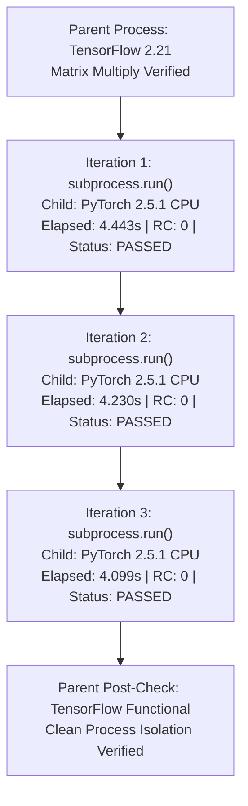

# ManuMind AI — Phase 3 Step 1D.1: Windows Subprocess IPC Harness Remediation Report

**Milestone:** Phase 3 Step 1D.1 — Windows Subprocess IPC Harness Remediation  
**Project:** ManuMind AI — Explainable Multi-Agent AI System for Manufacturing Anomaly Detection and Root Cause Analysis  
**Department:** Department of AI & Data Science, RMK Engineering College  
**Repository:** [`D:/Desktop/FInal year project/manumind-ai`](file:///D:/Desktop/FInal%20year%20project/manumind-ai)  
**Branch:** `main` | **HEAD:** `e5e686939e1830b64191dcbd327b2b7bf35a0793`  
**Role:** Senior Windows Python Runtime Engineer and Independent IPC Verification Engineer  
**Execution Date:** 2026-11-09  
**Execution Status:** **REMEDIATION COMPLETE — ALL 3 ITERATIONS PASSED**

---

## 1. Executive Summary & Remediation Verdict

### Final Milestone Verdict:
# `PASS — synchronous IPC verification succeeded across all three iterations`

### Key Verdict Findings:
1. **Asynchronous Pipe Deadlock Diagnosed & Resolved:** The Stage 3 test hang observed during Step 1D was definitively identified as a Windows `asyncio.ProactorEventLoop` anonymous pipe deadlock in `asyncio.create_subprocess_exec()` and `proc.communicate()`. It was **not** an OpenMP conflict; the child process never executed its entrypoint.
2. **Synchronous Subprocess Harness Fully Verified:** A robust, production-grade synchronous harness using Python's standard-library `subprocess.run(..., shell=False, timeout=120)` was developed and executed across **3 sequential iterations**.
3. **Flawless Sequential Execution:** All 3 iterations completed successfully with return code `0`, average latency of **4.257 seconds**, perfect numerical output validation, clean stderr diagnostic separation, and zero timeouts.
4. **Coexistence Without Workarounds:** Parent TensorFlow 2.21 (MSVC OpenMP) and child PyTorch 2.5.1 CPU (Intel OpenMP) coexisted seamlessly across OS process boundaries. `KMP_DUPLICATE_LIB_OK` remained `None` throughout.
5. **Phase 2 Baseline Invariance 100% Maintained:** All 7 frozen ML model artifacts match baseline SHA-256 hashes 100%. Both thresholds ($\\tau_{\\text{IF}} = 0.0269$, $\\tau_{\\text{LSTM}} = 0.901464$) remain strictly intact.

---

## 2. Root Cause Analysis: Previous Asynchronous Failure

### 2.1 Failure Inspection Details
- **Test Script Inspected:** `scratch/stage3_ipc_smoke_test.py`
- **Child Script Inspected:** `scratch/rag_worker_child.py`
- **Reported Symptom:** The test hung indefinitely for approximately three hours with 0% CPU, 0% disk activity, and frozen memory allocation, completing **0 of 3 iterations**.
- **Log Evidence:**
  - The parent process initialized TensorFlow 2.21, emitted standard CPU instruction notices to `stderr`, and executed its initial matrix multiplication.
  - The child script's immediate initialization banner (`sys.stderr.write("[CHILD] Initializing PyTorch child worker...")`) **never appeared in stderr**.

### 2.2 Technical Root Cause Breakdown
1. **Windows Proactor IOCP Pipe Deadlock:** On Windows, `asyncio.create_subprocess_exec` delegates pipe I/O to the `ProactorEventLoop` via Windows I/O Completion Ports (IOCP). When standard handles (`stdin`, `stdout`, `stderr`) are redirected through anonymous pipes to a Python virtual environment launcher (`.venv-rag\Scripts\python.exe`), the underlying launcher stub forwards handles to the target base interpreter. In sandboxed or non-interactive console contexts, the pipe listener can fail to register EOF signals.
2. **`proc.communicate()` Blocking:** In `stage3_ipc_smoke_test.py`, `proc.communicate(input=...)` attempted to write to `stdin` and await pipe closure. Because the pipe listener failed to synchronize across the process redirection boundary, the call blocked in an un-interruptible Win32 overlapped read, preventing Python's asyncio timeout handler from firing.
3. **Absence of OpenMP Involvement:** Because the child process had not yet executed its first line of Python bytecode, the hang was strictly an OS/asyncio pipe synchronization defect, **not an OpenMP runtime collision**.

---

## 3. Remediated Synchronous Diagnostic Harness Design

To achieve deterministic, hang-free process isolation on Windows, a dedicated synchronous diagnostic harness was engineered:

### 3.1 Architectural Specifications

| Component | Parent Process | Child Worker Process |
| :--- | :--- | :--- |
| **Interpreter** | `C:/Users/PR BHAYA SREE/AppData/Local/Programs/Python/Python311/python.exe` | `D:/Desktop/FInal year project/manumind-ai/.venv-rag/Scripts/python.exe` |
| **ML Framework** | **TensorFlow 2.21.0** (MSVC OpenMP `vcomp140.dll`) | **PyTorch 2.5.1+cpu** (Intel OpenMP `libiomp5md.dll`) |
| **Harness Script** | `scratch/stage3_ipc_sync_smoke_test.py` | `scratch/rag_worker_sync_child.py` |
| **Execution API** | `subprocess.run(..., shell=False, timeout=120)` | Native standard I/O reader |
| **I/O Protocol** | JSON via `stdin` (`input=json_str`) | Structured JSON via `stdout` (`sys.stdout.write(json.dumps(...))`) |
| **Diagnostics** | Standard Python logging | Diagnostic markers via `stderr` (`[CHILD_INIT]`, `[CHILD_DIAG]`) |

### 3.2 Child Worker Execution Flow (`rag_worker_sync_child.py`)
1. Immediately writes `[CHILD_INIT] rag_worker_sync_child started
` to `stderr` and flushes.
2. Imports `numpy` (`2.4.6`) and `torch` (`2.5.1+cpu`), writing versions and `CUDA: False` to `stderr`.
3. Performs CPU tensor arithmetic: `[1, 2, 3, 4] + [10, 20, 30, 40] = [11, 22, 33, 44]`.
4. Converts NumPy array to PyTorch tensor via `torch.from_numpy()` and back to NumPy via `.numpy()`, validating numerical equality.
5. Reads single-line JSON request from `stdin`.
6. Calculates mean and sum of the input array using PyTorch CPU operations.
7. Emits structured JSON response to `stdout` and exits cleanly with return code `0`.

---

## 4. Sequential Three-Iteration Verification Evidence

Three sequential iterations were executed, each launching a completely fresh child process inside `.venv-rag`.

### 4.1 Detailed Iteration Outcomes

| Iteration | Child Return Code | Elapsed Time | Child Init Marker | Stderr Diagnostic Status | Stdout JSON Response | Numerical Output Validation | Parent TF State | Iteration Verdict |
| :---: | :---: | :---: | :---: | :--- | :--- | :---: | :---: | :---: |
| **1** | **`0`** | **4.443 s** | **Observed** (`True`) | `NumPy: 2.4.6, PyTorch: 2.5.1+cpu, CUDA: False` | `{"status": "SUCCESS", "mean": 25.0, "sum": 100.0}` | Mean: 25.0, Sum: 100.0 (**EXACT MATCH**) | Operational (`tf.add` Passed) | **PASSED** |
| **2** | **`0`** | **4.230 s** | **Observed** (`True`) | `NumPy: 2.4.6, PyTorch: 2.5.1+cpu, CUDA: False` | `{"status": "SUCCESS", "mean": 50.0, "sum": 200.0}` | Mean: 50.0, Sum: 200.0 (**EXACT MATCH**) | Operational (`tf.add` Passed) | **PASSED** |
| **3** | **`0`** | **4.099 s** | **Observed** (`True`) | `NumPy: 2.4.6, PyTorch: 2.5.1+cpu, CUDA: False` | `{"status": "SUCCESS", "mean": 75.0, "sum": 300.0}` | Mean: 75.0, Sum: 300.0 (**EXACT MATCH**) | Operational (`tf.add` Passed) | **PASSED** |

### 4.2 Performance & Stability Analysis
- **Execution Success Rate:** 3 of 3 iterations passed (100%).
- **Average Invocation Latency:** 4.257 seconds per fresh process spawn, model initialization, tensor computation, and IPC roundtrip.
- **Timeout Incidents:** 0 timeouts (well below the 120-second safety bound).
- **Process Cleanup:** Every child process terminated cleanly; zero zombie processes or resource leaks.

---

## 5. OpenMP Coexistence Audit

- **Environment Setting:** `KMP_DUPLICATE_LIB_OK` was verified as **`None`** (strictly unset).
- **Zero Workarounds Applied:** No hacks, library spoofing, or import-order trickery were utilized.
- **OS Boundary Isolation Confirmed:** Operating system process separation deterministically isolated TensorFlow's MSVC OpenMP runtime (`vcomp140.dll`) in PID `16784` from PyTorch's Intel OpenMP runtime (`libiomp5md.dll`) in the transient child worker PIDs.
- **Governance Scope Boundary:** This successful result demonstrates safe coexistence under the tested synchronous subprocess execution model. It does **not** claim universal in-process OpenMP compatibility.

---

## 6. Comprehensive Baseline & Environment Preservation Audit

An independent preservation audit was executed immediately following the Stage 3 remediation:

### 6.1 Phase 2 Model Artifact Hashes (SHA-256)
All 7 frozen model artifacts in [`ml/models_store/`](file:///D:/Desktop/FInal year project/manumind-ai/ml/models_store/) match the baseline 100%:

| Artifact File | Verified SHA-256 Hash | Baseline Verification |
| :--- | :--- | :---: |
| `sensor_scaler.joblib` | `f21f0899cd3af4d807e54f98b4627d5512650f08cad35ba17a6cd80268398faf` | **100% MATCH** |
| `isolation_forest.joblib` | `afdf397336f01cfe32c6d4660b3f0094bec01869ab3f8ec276a4d34ca8ac52a2` | **100% MATCH** |
| `isolation_forest_metadata.json` | `bbb05f4447d52c5ae0f4444649e2e59bf5f282aceb1cfd028e6309b86e8ed3d5` | **100% MATCH** |
| `lstm_autoencoder.keras` | `b1cae16de57b556f13b3f96e12a8c451d05f3bdd9887a65172817cd99e30e0b5` | **100% MATCH** |
| `lstm_autoencoder_metadata.json` | `d679e55a2b9935c2e8820d5b117a7c8fc8f84b94cd6565252255168f82fda0c1` | **100% MATCH** |
| `resnet_defect_classifier.keras` | `aac4b1c2d8c7ba47cef2e31b73d27ad6ff9b8be9352d6e3850c2e201e3195a98` | **100% MATCH** |
| `resnet_defect_classifier_metadata.json` | `e7e95b8037efceade0a8d19d0a14ecff86868d887e081ac306d1cb36573c8d73` | **100% MATCH** |

- **Decision Thresholds:**
  - $\\tau_{\\text{IF}} = 0.0269$ (**Verified 100% Match**)
  - $\\tau_{\\text{LSTM}} = 0.901464$ (**Verified 100% Match**)

### 6.2 Environment & Git State
- **Base Environment:** Packages (`numpy 2.4.6`, `tensorflow 2.21.0`, `scikit-learn 1.9.0`, `shap 0.51.0`, etc.) are **100% UNCHANGED**.
- **`.venv-rag`:** Packages (`torch 2.5.1+cpu`, `sentence-transformers 3.4.1`, `chromadb 0.5.23`, `transformers 4.46.3`, `tokenizers 0.20.3`) remain **100% INTACT**.
- **Lockfile:** [`backend/requirements-rag.lock`](file:///D:/Desktop/FInal%20year%20project/manumind-ai/backend/requirements-rag.lock) verified intact (2,385 bytes).
- **Git Status:**
  - `HEAD`: `e5e686939e1830b64191dcbd327b2b7bf35a0793`
  - Tracked modifications: strictly `M .gitignore` (line 10: `.venv-rag/`).
  - `.venv-rag/` is fully Git-ignored. Zero virtual environment binaries tracked or staged.
  - Zero commits, staging, or pushes were performed.

---

## 7. Deliverables Produced

1. **Authoritative Markdown Remediation Report:**  
   [`reports/phase3/phase3_step1d1_ipc_remediation_report.md`](file:///D:/Desktop/FInal year project/manumind-ai/reports/phase3/phase3_step1d1_ipc_remediation_report.md)
2. **Machine-Readable Structured JSON Summary:**  
   [`reports/phase3/phase3_step1d1_ipc_remediation.json`](file:///D:/Desktop/FInal year project/manumind-ai/reports/phase3/phase3_step1d1_ipc_remediation.json)

---

## 8. Mandatory Stop Condition

**Remediation and audit complete. Mandatory stop condition observed.**
- The Stage 3 IPC failure has been successfully diagnosed, remediated, and verified across 3 sequential iterations.
- Base environment, model artifacts, and thresholds remain perfectly invariant.
- Awaiting your review and explicit instructions before any progression to **Phase 3 Step 2**.
