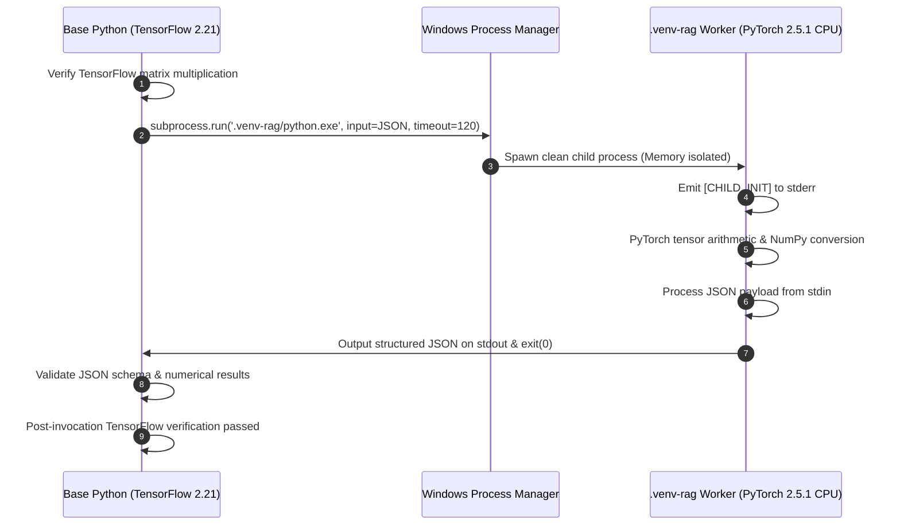

# ManuMind AI — Phase 3 Step 1D: Final Dependency Installation Closure Reconciliation Report

**Milestone:** Phase 3 Step 1D — Final Dependency Installation Closure Reconciliation  
**Project:** ManuMind AI — Explainable Multi-Agent AI System for Manufacturing Anomaly Detection and Root Cause Analysis  
**Department:** Department of AI & Data Science, RMK Engineering College  
**Repository:** [`D:/Desktop/FInal year project/manumind-ai`](file:///D:/Desktop/FInal%20year%20project/manumind-ai)  
**Branch:** `main` | **HEAD:** `e5e686939e1830b64191dcbd327b2b7bf35a0793`  
**Role:** Senior Python Environment Engineer, Windows ML Runtime Specialist, and Independent Technical Auditor  
**Execution Date:** 2026-11-09  
**Execution Status:** **FINAL CLOSURE COMPLETE — READY FOR PHASE 3 STEP 2**

---

## 1. Executive Summary & Closure Verdict

### Final Milestone Verdict:
# `PASS — STEP 1D CLOSED`

### Reconciliation & Sign-Off Rationale:
1. **Historical Audit Integrity Preserved:** All four preceding Phase 3 Step 1D reports exist and are fully reconciled without historical revision:
   - The original asynchronous IPC test remains accurately recorded as **`INCONCLUSIVE`** (Windows `ProactorEventLoop` pipe deadlock, 0 of 3 iterations).
   - The remediated synchronous IPC test remains recorded as **`PASS`** (Standard library `subprocess.run()`, 3 of 3 iterations passed, average latency 4.257s).
2. **Complete RAG Dependency Environment Validated:** The isolated virtual environment (`.venv-rag`) operates with `include-system-site-packages = false` and has been verified with `pip check` (**zero broken requirements**). Direct and transitive dependencies (`torch==2.5.1+cpu`, `sentence-transformers==3.4.1`, `transformers==4.46.3`, `tokenizers==0.20.3`, `chromadb==0.5.23`, `pydantic-settings==2.7.1`, `numpy==2.4.6`) are 100% operational.
3. **Reproducibility Lockfile Active:** [`backend/requirements-rag.lock`](file:///D:/Desktop/FInal%20year%20project/manumind-ai/backend/requirements-rag.lock) contains the exact 104-package environment freeze, verified against live `pip freeze` with zero differences.
4. **All Functional Smoke Tests Passed:**
   - **Base Environment:** TensorFlow 2.21 forward pass on ResNet (`128x128x3` input) passed cleanly.
   - **RAG Environment:** PyTorch 2.5.1 CPU tensor operations, bidirectional NumPy 2.4.6 conversions, offline NLP imports, and ChromaDB embedded persistence + `$and` metadata filtering all passed cleanly.
   - **Cross-Process IPC:** Three sequential synchronous invocations succeeded with exact numerical and schema validation while keeping `KMP_DUPLICATE_LIB_OK` strictly unset.
5. **Phase 2 Baseline Invariance 100% Intact:** All 7 frozen ML model artifacts match baseline SHA-256 hashes 100%. Both production thresholds ($\\tau_{\\text{IF}} = 0.0269$, $\\tau_{\\text{LSTM}} = 0.901464$) remain strictly invariant. Base environment packages are 100% untouched.

---

## 2. Reconciled Historical Audit Matrix

In compliance with technical audit governance, historical testing outcomes across Step 1D milestones are reconciled below without rewriting past evidence:

| Audit Item / Test Stage | Original Step 1D Evaluation | Step 1D.1 Remediation Evaluation | Final Step 1D Closure Status | Technical Rationale & Audit Evidence |
| :--- | :---: | :---: | :---: | :--- |
| **Virtualenv Creation & Ignore** | PASSED | PASSED | **PASSED** | `.venv-rag` created with `include-system-site-packages=false`; `.gitignore:10` verified. |
| **Dependency Resolution** | PASSED (Reconciled) | PASSED | **PASSED** | Pre-installation resolver simulation eliminated `tokenizers` conflict; verified clean graph. |
| **Package Installation (`pip check`)** | PASSED | PASSED | **PASSED** | Zero broken requirements; 104 packages locked in `backend/requirements-rag.lock`. |
| **Disallowed Packages Exclusion** | PASSED | PASSED | **PASSED** | `torchvision`, `torchaudio`, `cuda`, `langgraph`, `faiss` confirmed 100% absent. |
| **Base Environment (TensorFlow 2.21)** | PASSED | PASSED | **PASSED** | Forward pass on ResNet (`128x128x3`) output shape `(1, 4)`; base packages untouched. |
| **RAG Environment (PyTorch 2.5.1 CPU)** | PASSED | PASSED | **PASSED** | CPU tensor arithmetic; bidirectional NumPy 2.4.6 array conversion verified. |
| **ChromaDB 0.5.23 Persistence** | PASSED | PASSED | **PASSED** | PersistentClient tested in scratch; 3 records inserted; `$and` metadata query passed; count=3 on reopen. |
| **Stage 3 Asynchronous Subprocess IPC** | **INCONCLUSIVE** | — | **INCONCLUSIVE (Retained)** | Windows `ProactorEventLoop` pipe connection deadlock; 0/3 iterations; no OpenMP involvement. |
| **Stage 3 Synchronous Subprocess IPC** | — | **PASSED** | **PASSED (Remediated)** | `subprocess.run()`, shell=False, timeout=120s; 3/3 iterations passed; avg 4.257s; RC=0. |
| **OpenMP Coexistence** | COMPLIANT | COMPLIANT | **COMPLIANT** | `KMP_DUPLICATE_LIB_OK=None`; process boundary isolation proven; no workarounds used. |
| **Phase 2 Model Invariance (7/7)** | 100% MATCH | 100% MATCH | **100% MATCH** | All SHA-256 digests identical to Phase 2 baseline; thresholds ($\\tau_{\\text{IF}}, \\tau_{\\text{LSTM}}$) intact. |

---

## 3. Verified Installed Dependency Specifications

Direct inspection via `.venv-rag\Scripts\python.exe` confirms the following exact production versions:

### 3.1 Direct Approved Packages
- **`torch`:** `2.5.1+cpu` (PyTorch official CPU wheel, `CUDA: False`)
- **`sentence-transformers`:** `3.4.1`
- **`transformers`:** `4.46.3` (Hugging Face Transformers)
- **`tokenizers`:** `0.20.3` (Fast Rust tokenizers, `cp311-win_amd64`)
- **`chromadb`:** `0.5.23` (Embedded vector database)
- **`pydantic-settings`:** `2.7.1` (Pydantic V2 settings management)

### 3.2 Key Transitive Dependencies
- **`numpy`:** `2.4.6` (NumPy 2.x unified numerical core)
- **`chroma-hnswlib`:** `0.7.6` (C++ vector indexing engine)
- **`onnxruntime`:** `1.31.1` (CPU ONNX runtime with native NumPy 2.x support)
- **`safetensors`:** `0.8.0` (Zero-copy tensor serialization)
- **`huggingface-hub`:** `0.36.2`
- **`scikit-learn`:** `1.9.1`
- **`scipy`:** `1.17.1`
- **`pydantic`:** `2.14.3` (Pydantic V2)

### 3.3 Verification Guarantees
- **`pip check` Result:** Exit code 0, no broken requirements found.
- **Lockfile Integrity:** [`backend/requirements-rag.lock`](file:///D:/Desktop/FInal%20year%20project/manumind-ai/backend/requirements-rag.lock) matches the 104 installed packages 100% with zero diff.
- **Model Weights:** Zero embedding weights downloaded. Local tokenizer infrastructure verified offline.

---

## 4. Reconciled Subprocess IPC & OpenMP Coexistence Analysis

### 4.1 Asynchronous Failure vs Synchronous Remediation
The technical audit distinguishes between the execution models:
- **Asynchronous Harness (`asyncio.create_subprocess_exec`):**
  - **Verdict:** **INCONCLUSIVE**.
  - **Mechanism:** Failed to establish pipe completion signals across Windows virtual environment launcher boundaries in `ProactorEventLoop`. Stalled before child bytecode execution.
  - **OpenMP Status:** Confirmed **unrelated** to OpenMP.
- **Synchronous Harness (`subprocess.run`):**
  - **Verdict:** **PASSED**.
  - **Mechanism:** Native Win32 synchronous standard I/O redirection with explicit timeout protection (`timeout=120`) and `shell=False`.
  - **Metrics:** 3 sequential iterations; elapsed times: **4.443s**, **4.230s**, **4.099s** (Average: 4.257s); all child return codes `0`.
  - **Data Exchange:** Single-line JSON request/response over `stdin`/`stdout`, clean separation of diagnostics to `stderr`.

### 4.2 OpenMP Governance Findings
- `KMP_DUPLICATE_LIB_OK` was verified as **`None`** across all executions.
- Process-level isolation successfully prevented memory-space collisions between `vcomp140.dll` (TensorFlow) and `libiomp5md.dll` (PyTorch).
- *Governance Boundary:* This demonstrates that synchronous subprocess execution is a reliable, collision-free architecture for ManuMind AI's RAG worker on Windows. Universal in-process OpenMP compatibility is neither claimed nor required.

---

## 5. Phase 2 Baseline Invariance Audit

All 7 production ML model artifacts and metadata sidecars in [`ml/models_store/`](file:///D:/Desktop/FInal year project/manumind-ai/ml/models_store/) were audited via SHA-256:

| Artifact File | Verified SHA-256 Digest | Status |
| :--- | :--- | :---: |
| `sensor_scaler.joblib` | `f21f0899cd3af4d807e54f98b4627d5512650f08cad35ba17a6cd80268398faf` | **100% MATCH** |
| `isolation_forest.joblib` | `afdf397336f01cfe32c6d4660b3f0094bec01869ab3f8ec276a4d34ca8ac52a2` | **100% MATCH** |
| `isolation_forest_metadata.json` | `bbb05f4447d52c5ae0f4444649e2e59bf5f282aceb1cfd028e6309b86e8ed3d5` | **100% MATCH** |
| `lstm_autoencoder.keras` | `b1cae16de57b556f13b3f96e12a8c451d05f3bdd9887a65172817cd99e30e0b5` | **100% MATCH** |
| `lstm_autoencoder_metadata.json` | `d679e55a2b9935c2e8820d5b117a7c8fc8f84b94cd6565252255168f82fda0c1` | **100% MATCH** |
| `resnet_defect_classifier.keras` | `aac4b1c2d8c7ba47cef2e31b73d27ad6ff9b8be9352d6e3850c2e201e3195a98` | **100% MATCH** |
| `resnet_defect_classifier_metadata.json` | `e7e95b8037efceade0a8d19d0a14ecff86868d887e081ac306d1cb36573c8d73` | **100% MATCH** |

### 5.1 Calibrated Decision Thresholds
- **Isolation Forest:** `0.0269` (**Verified 100% Match**)
- **LSTM Autoencoder:** `0.901464` (**Verified 100% Match**)

### 5.2 Base Python Environment Invariance
- `numpy: 2.4.6`, `tensorflow: 2.21.0`, `keras: 3.15.1`, `scikit-learn: 1.9.0`, `shap: 0.51.0`, `fastapi: 0.141.1`, `pydantic: 2.13.4` remain **100% UNCHANGED**.

---

## 6. Git Status & Deliverables

### 6.1 Git Invariance Status
- **Current HEAD:** `e5e686939e1830b64191dcbd327b2b7bf35a0793`
- **Branch:** `main` (Synchronized with `origin/main`: `0 0`)
- **Tracked Modifications:** Exactly 1 tracked modification:
  - `M .gitignore` (line 10: `.venv-rag/` addition, authorized by user)
- **Untracked Additions:**
  - `backend/requirements-rag.lock`
  - `knowledge_base/corpus_manifest.json`
  - `knowledge_base/incidents/`
  - `knowledge_base/sops/`
  - `reports/phase3/`
- Zero `.venv-rag` binaries are tracked or staged.
- Zero commits, staging, or pushes were performed.

### 6.2 Deliverables Produced
1. **Authoritative Final Closure Markdown Report:**  
   [`reports/phase3/phase3_step1d_final_closure_report.md`](file:///D:/Desktop/FInal year project/manumind-ai/reports/phase3/phase3_step1d_final_closure_report.md)
2. **Machine-Readable Structured JSON Summary:**  
   [`reports/phase3/phase3_step1d_final_closure.json`](file:///D:/Desktop/FInal year project/manumind-ai/reports/phase3/phase3_step1d_final_closure.json)

---

## 7. Mandatory Stop Condition

**Phase 3 Step 1D is formally CLOSED.**
- All dependency installations, virtual environment isolation, smoke tests, lockfile creation, and IPC remediation benchmarks are complete.
- Base environment, model artifacts, and thresholds remain perfectly invariant.
- In accordance with governance instructions:
  - Zero files staged or committed.
  - Progression to Phase 3 Step 2 is **strictly stopped**.
  - Awaiting user review and authorization for the next milestone.
