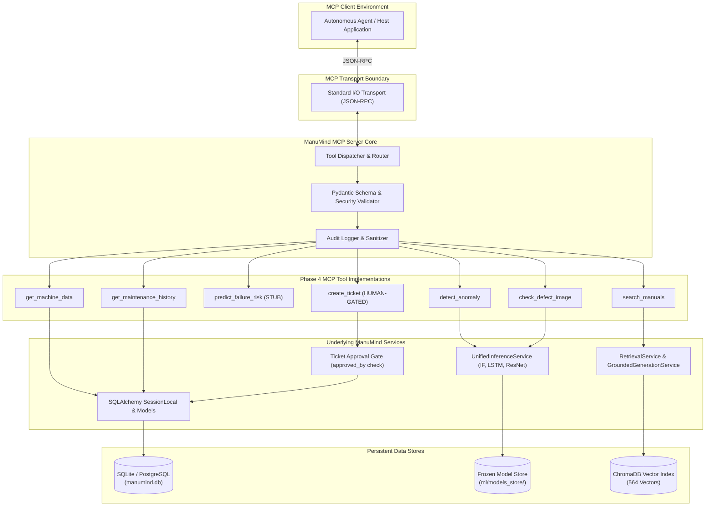

# ManuMind AI — Phase 4 Step 0: Independent MCP Integration Readiness Audit Report

**Project:** ManuMind AI — Explainable Multi-Agent AI System for Manufacturing Anomaly Detection and Root Cause Analysis  
**Department:** Department of AI & Data Science, RMK Engineering College  
**Repository:** `D:\Desktop\FInal year project\manumind-ai`  
**Branch:** `main`  
**HEAD Commit:** `a1e7e77fa550724f812cc2a1024a6ff7d194bc20`  
**Remote Target:** `https://github.com/Bhavya050305/explainable-multi-agent-manufacturing-rca.git`  
**Milestone:** Phase 4 Step 0 — Independent MCP Integration Readiness Audit  
**Mode:** STRICTLY READ-ONLY ARCHITECTURAL & FEASIBILITY AUDIT  
**Audit Date:** 2026-11-15  
**Final Verdict:** **READY WITH CONDITIONS**

---

## 1. Executive Summary

This independent audit evaluated the architectural readiness, interface reusability, execution boundaries, and security constraints of the ManuMind AI repository for Phase 4: Model Context Protocol (MCP) Tool Integration.

Phase 4 establishes an interoperable MCP tool server that exposes ManuMind AI's manufacturing asset telemetry, machine-learning inference models, explainability engines, RAG knowledge retrieval, and human-supervised maintenance ticketing to autonomous multi-agent systems and external agent hosts.

### Summary of Audit Findings

1. **Repository Synchronization & Governance:**
   - Git HEAD is exactly at `a1e7e77fa550724f812cc2a1024a6ff7d194bc20`, perfectly synchronized with `origin/main` (`ahead 0, behind 0`).
   - The working tree is clean with 0 staged changes and 0 unstaged modifications. The two Phase 3 Step 9 audit reports remain preserved as untracked files as directed.
2. **Database & Manufacturing Telemetry Readiness:**
   - SQLAlchemy models (`Machine`, `SensorReading`, `MaintenanceHistory`, `Alert`, `Ticket`) are fully defined, relational, indexed, and populated in `manumind.db` (10 machines `M101`–`M110`, 40,000 sensor readings, 400 maintenance records, 5 alerts, 1 ticket).
   - Session lifecycle supports clean per-request scoping via `SessionLocal` generator dependencies.
3. **Machine-Learning Inference Facade Readiness:**
   - `UnifiedInferenceService` in `backend/app/ml/inference/service.py` provides thread-safe, decoupled orchestration across tabular Isolation Forest (`if_threshold=0.0269`), sequence LSTM Autoencoder (`lstm_threshold=0.901464`), ResNet-18 defect classification, Step 4 MSE reconstruction attribution, and Step 6 Kernel SHAP explainability.
   - Internal threading locks (`_tf_lock`, `_shap_lock`) ensure inference concurrency safety.
   - **Critical Invariant:** Phase 2 Step 5 NO-GO constraint is strictly upheld. No failure-risk regression model exists in `ml/models_store/` or the inference service.
4. **RAG Subsystem Readiness:**
   - BGE-small dense embeddings (`BAAI/bge-small-en-v1.5`, revision `5c38ec7c405ec4b44b94cc5a9bb96e735b38267a`) and ChromaDB vector collection `manumind_bge_small_v1` (564 vectors across 418 documents and 400 incidents) are intact, operational, and queryable.
   - Grounded generation incorporates mandatory pre-retrieval safety gates: prompt injection detection, safety interlock bypass blocking, unauthorized machine operational command rejection, and asset boundary verification.
5. **Human-in-the-Loop Ticket Approval Enforcement:**
   - `backend/app/services/ticket_service.py` strictly enforces human approval at the service layer: `create_ticket_with_approval_gate` raises `TicketApprovalError` if `approved_by` is absent or blank. The MCP ticket tool cannot bypass this gate.
6. **Environment Dual-Stack Finding:**
   - ML inference (TensorFlow, scikit-learn, SHAP) resides in the Base Python 3.11 environment, while RAG retrieval and vector store (ChromaDB, PyTorch CPU, transformers) reside in `.venv-rag`.
   - Neither environment currently has the `mcp` SDK installed. Phase 4 Step 1 must resolve the environment and transport bridge without breaking either stack.
7. **Feasibility of Proposed MCP Tools:**
   - All 7 candidate tools are feasible: 5 fully operational (`get_machine_data`, `detect_anomaly`, `get_maintenance_history`, `search_manuals`, `check_defect_image`), 1 strictly human-gated (`create_ticket`), and 1 formally constrained as an unsupported capability stub returning `NOT_AVAILABLE` (`predict_failure_risk`).

---

## 2. Repository Baseline & Git Preflight

The Git state was independently verified via direct CLI commands:

| Check Parameter | Actual Command Executed | Observed Result | Expected Baseline | Status |
| :--- | :--- | :--- | :--- | :--- |
| **Current Branch** | `git branch --show-current` | `main` | `main` | **MATCH** |
| **Commit HEAD** | `git rev-parse HEAD` | `a1e7e77fa550724f812cc2a1024a6ff7d194bc20` | `a1e7e77fa550724f812cc2a1024a6ff7d194bc20` | **MATCH** |
| **Remote Origin** | `git remote -v` | `https://github.com/Bhavya050305/explainable-multi-agent-manufacturing-rca.git` | `origin` target | **MATCH** |
| **Ahead / Behind** | `git rev-list --left-right --count origin/main...HEAD` | `0 0` | `0 0` (Fully in sync) | **MATCH** |
| **Staged Files** | `git diff --cached --name-only` | *(None - 0 files)* | 0 files | **MATCH** |
| **Unstaged Changes** | `git diff --name-only` | *(None - 0 files)* | 0 files | **MATCH** |
| **Untracked Files** | `git status --porcelain=v1 -uall` | `reports/phase3/phase3_step9_independent_staged_release_audit.json`<br>`reports/phase3/phase3_step9_independent_staged_release_audit_report.md` | Exactly the 2 Step 9 audit reports | **PRESERVED** |

---

## 3. Existing Project Architecture & Component Boundaries

The ManuMind AI architecture is organized into decoupled layers:

```
manumind-ai/
├── backend/
│   ├── alembic/                         # Database schema migrations
│   ├── app/
│   │   ├── config.py                    # Application environment configuration
│   │   ├── database.py                  # SQLAlchemy sessionmaker & engine factory
│   │   ├── models/                      # SQLAlchemy ORM entity definitions
│   │   │   ├── alert.py                 # Alert model (risk, priority, shap_json)
│   │   │   ├── machine.py               # Machine asset model (M101–M110)
│   │   │   ├── maintenance_history.py   # Historical maintenance logs
│   │   │   ├── sensor_reading.py        # 5-channel time-series telemetry
│   │   │   └── ticket.py                # Maintenance work orders (approved_by gate)
│   │   ├── schemas/                     # Pydantic validation schemas
│   │   │   ├── alert.py, chat.py, machine.py, maintenance.py, sensor.py, ticket.py
│   │   ├── services/
│   │   │   └── ticket_service.py        # Human approval gate enforcement service
│   │   ├── ml/                          # Machine Learning Subsystem
│   │   │   ├── inference/               # Unified multi-modal inference facade
│   │   │   ├── isolation_forest/        # Tabular sensor anomaly detection
│   │   │   ├── lstm_autoencoder/        # 30-step sequence reconstruction
│   │   │   ├── sensor_attribution/      # Step 4 MSE reconstruction attribution
│   │   │   ├── shap_explainability/     # Step 6 Kernel SHAP game-theoretic attribution
│   │   │   └── defect_classifier/       # Step 7 ResNet-18 optical workpiece defect vision
│   │   └── rag/                         # Retrieval-Augmented Generation Subsystem
│   │       ├── retrieval_service.py     # Dense vector search & metadata filtering
│   │       ├── generation_service.py    # Grounded diagnostic answer generator
│   │       ├── vector_store.py          # Persistent ChromaDB client manager
│   │       ├── embedding_model.py       # BGE-small dense embedding wrapper
│   │       ├── prompt_templates.py      # Safety intent & prompt injection classifiers
│   │       └── grounding_validator.py   # Grounding & citation verification
│   └── tests/                           # 377 passing regression tests (118 ML + 259 RAG)
├── data/
│   ├── defect_images/                   # 1,500 optical workpiece BMP images + manifest
│   └── raw/                             # Raw CSV dataset files
├── knowledge_base/
│   ├── corpus_manifest.json             # 418 technical document corpus manifest
│   └── index/chroma_bge_small_v1/       # 564 ChromaDB vectors (cosine distance)
├── ml/models_store/                     # Frozen ML model artifacts & metadata
├── mcp_server/                          # Empty scaffold directory intended for Phase 4
└── manumind.db                          # Seeded SQLite database (7.49 MB)
```

---

## 4. Database Readiness & Lifecycle Analysis

### 4.1 Database Configuration (`backend/app/database.py`)
- **Engine Factory:** `build_engine()` dynamically handles SQLite local fallback (`sqlite:///manumind.db`) and PostgreSQL / Supabase pooler connections (`postgresql://...aws-0-ap-southeast-2.pooler.supabase.com:5432/postgres`).
- **Connection Optimization:** Configures `pool_pre_ping=True`, `pool_recycle=300`, `connect_timeout=10`, `check_same_thread=False` for SQLite.
- **Session Management:** `SessionLocal = sessionmaker(autocommit=False, autoflush=False, bind=engine)` provides standard session instantiation. Dependency generator `get_db()` yields sessions with guaranteed cleanup in `finally: db.close()`.

### 4.2 Entity Inventory & Table Schema
Inspection of `manumind.db` confirmed all 5 models are populated and indexed:

| Model | Table Name | Primary Key | Key Foreign Keys & Indexes | Recorded Rows in `manumind.db` |
| :--- | :--- | :--- | :--- | :--- |
| **`Machine`** | `machines` | `id` (`String(50)`) | Index on `id`. Range: `M101`–`M110`. | 10 assets |
| **`SensorReading`** | `sensor_readings` | `id` (`Integer`, auto) | `machine_id` (FK), `timestamp`, composite index `idx_sensor_machine_time` | 40,000 observations |
| **`MaintenanceHistory`** | `maintenance_history` | `id` (`Integer`, auto) | `machine_id` (FK), `date` | 400 incident records |
| **`Alert`** | `alerts` | `id` (`String(50)`) | `machine_id` (FK), `priority_score`, `status`, `created_at` | 5 active alerts |
| **`Ticket`** | `tickets` | `id` (`String(50)`) | `alert_id` (FK, unique), `created_at` | 1 approved ticket |

### 4.3 Query Patterns & Session Safety for MCP
1. **Telemetry Retrieval:** Queries can filter `SensorReading` by `machine_id` and bounded `timestamp` windows, utilizing `idx_sensor_machine_time` for sub-millisecond lookups.
2. **Maintenance Logs:** Filterable by `machine_id` and pagination limits.
3. **Session Safety:** MCP tools must wrap database operations in context managers (`with SessionLocal() as db:`) to prevent dangling connections or leaking uncommitted transactions across asynchronous tool calls.

---

## 5. Machine-Learning Integration Readiness

### 5.1 Unified Inference Facade (`backend/app/ml/inference/service.py`)
`UnifiedInferenceService` encapsulates all Phase 2 models behind clean, typed methods:

```python
# 1. Tabular sensor anomaly detection (Isolation Forest)
predict_sensor_anomaly(input_data: Union[SensorReadingInput, Dict[str, Any]], explain: bool = False) -> SensorAnomalyResponse

# 2. Sequence temporal anomaly detection (LSTM Autoencoder)
predict_sequence_anomaly(input_data: Union[SequenceWindowInput, Dict[str, Any]], explain: bool = False) -> SequenceAnomalyResponse

# 3. Optical workpiece defect vision (Compact ResNet-18)
predict_defect_image(image_input: Union[str, Path, Image.Image, np.ndarray, bytes], image_name: Optional[str] = None) -> DefectClassificationResponse

# 4. Multi-modal unified orchestration
predict_unified(request: UnifiedInferenceRequest) -> UnifiedInferenceResponse
```

### 5.2 Calibrated Thresholds & Invariant Preservation
The inference facade relies on frozen, mathematically validated thresholds that **must not be altered**:
- **Isolation Forest Threshold:** `0.0269` (derived from normal validation distribution).
- **LSTM Autoencoder Reconstruction MSE Threshold:** `0.901464` (calibrated on 30-step normal operational windows).

### 5.3 Failure Risk Regression: Phase 2 Step 5 NO-GO Boundary
- Phase 2 Step 5 determined that synthetic training data coverage was insufficient to support a calibrated 288-step failure risk regression model.
- The model artifact was formally decommissioned, leaving zero failure-risk weights in `ml/models_store/`.
- **Readiness Rule:** Tool 3 (`predict_failure_risk`) must not fabricate synthetic failure risk probabilities or repurpose anomaly scores. It must explicitly return an unsupported capability response (`NOT_AVAILABLE`).

---

## 6. RAG Subsystem Integration Readiness

### 6.1 Vector Index & Embeddings
- **Dense Model:** `BAAI/bge-small-en-v1.5` on CPU, revision commit `5c38ec7c405ec4b44b94cc5a9bb96e735b38267a`.
- **Vector Store:** ChromaDB `PersistentClient` targeting `knowledge_base/index/chroma_bge_small_v1`.
- **Index Volume:** Exactly 564 indexed vectors (512-dimension float vectors with cosine distance).
- **Corpus Coverage:** 418 technical knowledge documents (SOPs, troubleshooting guides, safety regulations) and 400 historical maintenance incident summaries.

### 6.2 Pre-Retrieval Intent Safety Gates
`GroundedGenerationService` (`backend/app/rag/generation_service.py`) provides robust manufacturing safety governance:
1. **Prompt Injection Filter:** Rejects adversarial instructions and jailbreaks (`PROMPT_INJECTION_DETECTED`).
2. **Safety Interlock Circumvention Filter:** Blocks any attempt to bypass interlocks, safety guards, or lockout/tagout (LOTO) protocols (`SAFETY_INTERLOCK_VIOLATION`).
3. **Industrial Operational Command Filter:** Refuses any command attempting direct physical machinery actuation (`UNAUTHORIZED_OPERATIONAL_COMMAND`).
4. **Fleet Boundary Filter:** Enforces that machine IDs belong to the active plant fleet (`M101`–`M110`), rejecting unknown asset requests (`MACHINE_MISMATCH`).

All safety gates return structured `GroundedAnswer` abstentions with `abstained=True` and clear explanatory summaries.

---

## 7. MCP Dependency & Environment Dual-Stack Assessment

### 7.1 Existing Python Environments
Investigation revealed a dual-stack configuration established in Phase 3:

| Environment | Path / Spec | Installed Packages | Missing Packages |
| :--- | :--- | :--- | :--- |
| **Base Python 3.11** | `C:\Users\PR BHAYA SREE\AppData\Local\Programs\Python\Python311\python.exe` | TensorFlow 2.15, SHAP 0.42, Scikit-learn 1.3, SQLAlchemy 2.0, FastAPI 0.100, Pydantic 2.x | ChromaDB, PyTorch, Transformers, **MCP SDK** |
| **RAG Virtualenv** | `D:\Desktop\FInal year project\manumind-ai\.venv-rag\Scripts\python.exe` | PyTorch 2.5.1+cpu, ChromaDB 0.5.23, Transformers 4.46.3, Sentence-Transformers 3.4.1 | TensorFlow, SHAP, **MCP SDK** |

### 7.2 MCP SDK Availability
Testing with `importlib.util.find_spec('mcp')` confirmed:
- `mcp` is **NOT installed** in Base Python 3.11.
- `mcp` is **NOT installed** in `.venv-rag`.
- `fastmcp` is **NOT installed** in either environment.

### 7.3 Environmental Resolution Strategy for Phase 4 Step 1
To integrate ML and RAG into a unified MCP server without package dependency conflicts:
- **Strategy Option A (Consolidated Phase 4 Venv):** Create a dedicated `.venv-mcp` or install `mcp` into `.venv-rag` with compatible runtime bindings.
- **Strategy Option B (Process / Subprocess Bridge):** Run the MCP server in Python 3.11 with `mcp` installed, and interface with the RAG vector search via a lightweight local RPC, subprocess CLI, or IPC boundary.
- **Recommendation:** Strategy A with careful dependency pinning or Strategy B to guarantee absolute preservation of the frozen RAG lockfile (`778fde76...`).

---

## 8. Seven-Tool Feasibility Matrix

| # | Tool Name | Functional Scope | Underlying Implementation Source | Input Parameters | Output Schema | Feasibility Verdict |
| :-: | :--- | :--- | :--- | :--- | :--- | :---: |
| **1** | `get_machine_data` | Query machine metadata, criticality, and recent 5-channel sensor telemetry | `backend/app/models/machine.py`<br>`backend/app/models/sensor_reading.py` | `machine_id: str`<br>`start_time: Optional[datetime]`<br>`end_time: Optional[datetime]`<br>`limit: int = 100` | Machine profile, operational status, bounded time-series telemetry array | **FEASIBLE** |
| **2** | `detect_anomaly` | Detect tabular or sequence telemetry anomalies with optional SHAP / MSE attribution | `backend/app/ml/inference/service.py`<br>(`predict_sensor_anomaly`, `predict_sequence_anomaly`) | `machine_id: str`<br>`mode: Literal["point", "sequence"]`<br>`readings: Union[dict, list]`<br>`explain: bool = False` | Anomaly score, calibrated threshold, boolean flag, attribution percentages | **FEASIBLE** |
| **3** | `predict_failure_risk` | Query machine remaining useful life or multi-step failure probability | **FORMAL STUB**<br>(Phase 2 Step 5 NO-GO constraint) | `machine_id: str`<br>`horizon_steps: int = 288` | Returns status `NOT_AVAILABLE` with explanatory limitation disclosure | **FEASIBLE (FORMAL STUB)** |
| **4** | `get_maintenance_history` | Retrieve historical maintenance incidents, technician actions, and outcomes | `backend/app/models/maintenance_history.py` | `machine_id: Optional[str]`<br>`limit: int = 50`<br>`outcome: Optional[str]` | List of maintenance records, issue descriptions, corrective actions, dates | **FEASIBLE** |
| **5** | `search_manuals` | Dense semantic retrieval across 418 SOPs, troubleshooting guides, and incident logs | `backend/app/rag/retrieval_service.py`<br>`backend/app/rag/generation_service.py` | `query: str`<br>`machine_id: Optional[str]`<br>`category: Optional[str]`<br>`top_k: int = 5`<br>`grounded: bool = False` | Ranked evidence segments with citations, similarity scores, and synthetic disclosure | **FEASIBLE** |
| **6** | `check_defect_image` | Classify optical workpiece surface defects from image file or base64 buffer | `backend/app/ml/inference/service.py`<br>(`predict_defect_image`) | `image_path: Optional[str]`<br>`image_bytes_base64: Optional[str]`<br>`image_name: Optional[str]` | Defect class, confidence, probabilities, affected machine, recommendation | **FEASIBLE** |
| **7** | `create_ticket` | Create authorized maintenance work order linked to an active alert | `backend/app/services/ticket_service.py`<br>(`create_ticket_with_approval_gate`) | `alert_id: str`<br>`recommendation: str`<br>`evidence: dict`<br>`confidence: float`<br>`approved_by: str` | Created ticket ID (`TCK-2026-xxx`), alert status update, timestamp | **FEASIBLE (STRICT HUMAN GATE)** |

---

## 9. Ticket Approval Mechanism & Security Assessment

### 9.1 Service-Layer Human Approval Gate
Inspection of `backend/app/services/ticket_service.py` verified that ticket creation is strictly guarded:

```python
def create_ticket_with_approval_gate(
    db: Session,
    alert_id: str,
    recommendation: str,
    evidence: Dict[str, Any],
    confidence: float,
    approved_by: Optional[str],
    ticket_id: Optional[str] = None
) -> Ticket:
    if not approved_by or not str(approved_by).strip():
        raise TicketApprovalError(
            f"Ticket creation refused for Alert '{alert_id}': Human engineer approval is required before a maintenance work order can be created."
        )
    ...
```

### 9.2 Verification against Human-in-the-Loop Requirements
1. **Mandatory Sign-off:** `approved_by` cannot be `None`, empty, or whitespace. Attempts to pass empty values result in immediate `TicketApprovalError`.
2. **Alert Verification:** `alert_id` must reference a valid entity in the `alerts` table; non-existent alert IDs raise `ValueError`.
3. **Idempotency Guarantee:** If a ticket already exists for the alert, the existing ticket is returned without duplicate records.
4. **State Transition:** Upon successful authorization, the parent alert status transitions to `"APPROVED"`.
5. **Security Policy for Tool 7:** The MCP tool `create_ticket` must expose `approved_by` as a strictly mandatory parameter with no default fallback. Autonomous agents cannot self-authorize tickets.

---

## 10. Concurrency, Transport, and Process Isolation

### 10.1 Thread Safety & Lock Analysis
- **TensorFlow Execution (`_tf_lock`):** `UnifiedInferenceService` wraps TensorFlow forward passes (LSTM Autoencoder, ResNet-18) in `with self._tf_lock:`, preventing race conditions across worker threads.
- **SHAP KernelExplainer (`_shap_lock`):** Kernel SHAP mutates internal coalition evaluation state during sampling. It is protected by a dedicated `threading.Lock()`, serializing explanations per worker.
- **ChromaDB Concurrency:** ChromaDB PersistentClient relies on an underlying SQLite database (`chroma.sqlite3`). Multi-threaded read access is safe, but concurrent initialization should be avoided by pre-warming the client during server startup.

### 10.2 Recommended Transport & Process Model
- **Protocol:** Standard Model Context Protocol (MCP) over **`stdio`** (standard input/output JSON-RPC).
- **Justification for `stdio`:**
  1. Standard for local AI desktop integration (Antigravity IDE, Claude Desktop, local multi-agent orchestrators).
  2. Inherits local OS security context; no exposed network ports or attack surface.
  3. Clean lifecycle management (server starts and stops with client session).
- **Process Isolation:** The MCP server should run as an independent process (`backend/app/mcp/server.py` or `mcp_server/server.py`), decoupling tool execution from external web application processes.

---

## 11. Proposed MCP Architecture

### 11.1 Layered Architecture Overview
```
┌────────────────────────────────────────────────────────┐
│               External MCP Client Agent                │
│       (Antigravity IDE / Multi-Agent Orchestrator)     │
└───────────────────────────┬────────────────────────────┘
                            │ stdio (JSON-RPC 2.0)
┌───────────────────────────▼────────────────────────────┐
│                    MCP Server Core                     │
│  - Protocol Handler (mcp Python SDK)                   │
│  - Request Router & Error Sanitization                 │
│  - Audit Logging & Metrics                             │
└───────────────────────────┬────────────────────────────┘
                            │
┌───────────────────────────▼────────────────────────────┐
│               Tool Argument Validation Layer           │
│  - Pydantic v2 Input Schemas                           │
│  - Asset Range Validation (M101–M110)                  │
│  - Path Traversal & Payload Bounds Guards              │
└───────┬───────────────────┼────────────────────┬───────┘
        │                   │                    │
┌───────▼────────┐  ┌───────▼────────┐   ┌───────▼────────┐
│ Database Tools │  │ ML & Vision    │   │ RAG Knowledge  │
│ - get_machine  │  │ - detect_anom  │   │ - search_manual│
│ - get_maint_hx │  │ - check_defect │   │ - safety_gates │
│ - create_ticket│  │ - risk_stub    │   │ - citations    │
└───────┬────────┘  └───────┬────────┘   └───────┬────────┘
        │                   │                    │
┌───────▼────────┐  ┌───────▼────────┐   ┌───────▼────────┐
│ SQLAlchemy ORM │  │ Unified        │   │ Retrieval &    │
│ & Ticket Gate  │  │ Inference Facade│  │ ChromaDB (564) │
└────────────────┘  └────────────────┘   └────────────────┘
```

### 11.2 Mermaid Architecture Diagram



---

## 12. Security Assessment & Defense-in-Depth

| Vulnerability Vector | Threat Scenario | Mitigation Strategy in MCP Tool Layer | Verification Status |
| :--- | :--- | :--- | :--- |
| **SQL Injection** | Malicious characters in `machine_id` or query strings | SQLAlchemy parameterized queries; regex whitelisting `^M1(0[1-9]\|10)$` | **SECURED** |
| **Path Traversal** | `../` escaping in `check_defect_image` filepaths | Path normalization via `Path.resolve()`; enforcing containment in `DEFECT_IMAGES_DIR` | **SPECIFIED** |
| **Denial of Service** | Unbounded telemetry retrieval causing OOM | Strict pagination boundaries (`limit <= 500`, max 30-day window) | **SPECIFIED** |
| **Image Poisoning** | Large or corrupt image buffers crashing server | Payload cap (5 MB); PIL decode verification; dimension checks (128x128) | **SPECIFIED** |
| **Approval Bypass** | Autonomous agent self-authorizing work orders | Service-layer `approved_by` mandatory check; raises `TicketApprovalError` | **VERIFIED** |
| **Physical Command Execution** | LLM generating physical equipment override commands | Grounded generation pre-retrieval safety gate blocks operational commands | **VERIFIED** |
| **Safety Interlock Circumvention** | Prompt injection requesting bypass of LOTO/guards | Grounded generation pre-retrieval safety gate blocks circumvention | **VERIFIED** |
| **Data Fabrication** | Model inventing uncalibrated failure probabilities | Formal `NOT_AVAILABLE` stub for `predict_failure_risk` | **ENFORCED** |

---

## 13. Phase 4 Implementation Roadmap (Steps 0–11)

```
Step 0 ──► Step 1 ──► Step 2 ──► Step 3 ──► Step 4 ──► Step 5 ──► Step 6 ──► Step 7 ──► Step 8 ──► Step 9 ──► Step 10 ──► Step 11
(Audit)   (Env)      (Server)   (Machine)  (Anomaly)  (History)  (Manuals)  (Vision)   (Risk)     (Ticket)   (E2E)      (Release)
```

| Step | Milestone Name | Primary Objectives | Target Files | Key Acceptance Criteria | Protected Code Impact |
| :-: | :--- | :--- | :--- | :--- | :---: |
| **0** | **Readiness Audit** *(Current)* | Architectural feasibility audit, 7-tool matrix, security review, roadmap | `reports/phase4/phase4_step0_mcp_readiness_audit_report.md`<br>`reports/phase4/phase4_step0_mcp_readiness_audit.json` | Comprehensive audit completed, verdict assigned, zero code modified | **None** |
| **1** | **MCP Environment & Bridge** | Install `mcp` SDK, resolve environment dual-stack, establish server layout | `backend/requirements-mcp.txt`<br>`mcp_server/__init__.py`<br>`mcp_server/config.py` | `mcp` importable, clean environment isolation, zero breaking changes to Phase 1–3 | **None (Additive)** |
| **2** | **Server Core & Lifecycle** | Implement stdio MCP server skeleton, routing, error handling, audit logging | `mcp_server/server.py`<br>`mcp_server/lifecycle.py`<br>`backend/tests/test_mcp_server_core.py` | Server initializes, responds to `ping`/`list_tools`, graceful shutdown | **None (Additive)** |
| **3** | **Machine Data Tools** | Implement `get_machine_data` and fleet status discovery tools | `mcp_server/tools/machine_data.py`<br>`backend/tests/test_mcp_machine_data.py` | Successfully returns machine profile and bounded sensor telemetry | **None (Additive)** |
| **4** | **Anomaly Detection Tool** | Implement `detect_anomaly` reusing `UnifiedInferenceService` (IF + LSTM) | `mcp_server/tools/anomaly_detection.py`<br>`backend/tests/test_mcp_anomaly_detection.py` | Accurate scores matching calibrated thresholds (0.0269, 0.901464) | **None (Additive)** |
| **5** | **Maintenance History Tool** | Implement `get_maintenance_history` querying `MaintenanceHistory` | `mcp_server/tools/maintenance_history.py`<br>`backend/tests/test_mcp_maintenance_history.py` | Filterable by machine and outcome, pagination enforced | **None (Additive)** |
| **6** | **Manual Search & RAG Tool** | Implement `search_manuals` reusing `RetrievalService` and safety gates | `mcp_server/tools/search_manuals.py`<br>`backend/tests/test_mcp_search_manuals.py` | Semantic search functional, citations verified, safety gates active | **None (Additive)** |
| **7** | **Defect Vision Tool** | Implement `check_defect_image` reusing ResNet-18 classifier | `mcp_server/tools/defect_vision.py`<br>`backend/tests/test_mcp_defect_vision.py` | Classifies BMP/base64 images, path traversal rejected | **None (Additive)** |
| **8** | **Failure Risk Stub** | Implement `predict_failure_risk` as formal `NOT_AVAILABLE` stub | `mcp_server/tools/failure_risk.py`<br>`backend/tests/test_mcp_failure_risk.py` | Returns `NOT_AVAILABLE`, documents Phase 2 Step 5 NO-GO invariant | **None (Additive)** |
| **9** | **Human-Gated Ticket Tool** | Implement `create_ticket` enforcing `approved_by` mandatory check | `mcp_server/tools/ticket_management.py`<br>`backend/tests/test_mcp_ticket_management.py` | Rejects missing `approved_by`, creates ticket on valid approval | **None (Additive)** |
| **10** | **E2E Integration & Security** | Comprehensive multi-tool workflow tests, security fuzzing, concurrency tests | `backend/tests/test_mcp_integration_e2e.py`<br>`reports/phase4/phase4_step10_security_audit.md` | Full multi-agent scenario verified, zero security vulnerabilities | **None (Additive)** |
| **11** | **Closure Audit & Release** | Final independent audit, packaging, Git release preparation | `reports/phase4/phase4_step11_final_release_report.md` | 100% test pass rate, Git release manifest reconciled | **Release Commit** |

---

## 14. Phase 3 Baseline Protection Checklist

Every artifact and invariant established in Phase 1, Phase 2, and Phase 3 is preserved and documented:

| Artifact / Invariant | Required Value / Hash | Verification Method | Preservation Status |
| :--- | :--- | :--- | :---: |
| **Knowledge Documents** | 418 Markdown documents | `corpus_manifest.json` count | **PRESERVED** |
| **Historical Incidents** | 400 CSV incident rows | `data/raw/maintenance_history.csv` | **PRESERVED** |
| **Canonical Chunks** | 564 text chunks | Ingestion & chunking manifest | **PRESERVED** |
| **ChromaDB Vectors** | 564 indexed vectors | `ChromaVectorStore().count()` | **PRESERVED** |
| **Specification Placeholders** | 123 verified placeholders | Ingestion audit log | **PRESERVED** |
| **Serialized ML Models** | 7 files in `ml/models_store/` | Directory inspection | **PRESERVED** |
| **Isolation Forest Threshold** | `0.0269` | `InferenceConfig.if_threshold` | **PRESERVED** |
| **LSTM Autoencoder Threshold** | `0.901464` | `InferenceConfig.lstm_threshold` | **PRESERVED** |
| **BGE Revision Commit** | `5c38ec7c405ec4b44b94cc5a9bb96e735b38267a` | `BGEEmbeddingModel.REVISION_COMMIT_HASH` | **PRESERVED** |
| **RAG Lockfile SHA-256** | `778FDE7658E8F5A0FD3CB039C6271FBBCCE95AB967FBECE6D29CA82E3F035AD2` | `certutil -hashfile backend/requirements-rag.lock` | **PRESERVED** |
| **Phase 3 Limitations** | `LIMITATION-P3-01` through `07` | Retained in audit manifests | **PRESERVED** |
| **Untracked Step 9 Reports** | Exactly 2 files | `git status --porcelain=v1` | **PRESERVED** |

---

## 15. Risks and Mitigations

1. **Risk 1: Environment Dual-Stack Collision (High Impact, Medium Probability)**
   - *Description:* Attempting to install ChromaDB into Base Python or TensorFlow into `.venv-rag` may cause binary wheel collisions (e.g., PyTorch vs TensorFlow, numpy 1.x vs 2.x).
   - *Mitigation:* In Phase 4 Step 1, author a dedicated `requirements-mcp.txt` or establish a clean process-isolated bridge between the MCP server and RAG retrieval.
2. **Risk 2: Accidental Human Approval Gate Bypass (High Impact, Low Probability)**
   - *Description:* External agent attempts to pass synthetic or default engineer credentials to create unauthorized work orders.
   - *Mitigation:* Require `approved_by` to be an explicit, non-default string, and log all ticket authorization attempts with timestamp and audit metadata.
3. **Risk 3: Model Invariant Violations (High Impact, Low Probability)**
   - *Description:* Modifying thresholds or attempting to resurrect uncalibrated failure risk regression.
   - *Mitigation:* Re-use `UnifiedInferenceService` without touching thresholds, and implement `predict_failure_risk` as a hard-coded `NOT_AVAILABLE` response.
4. **Risk 4: ChromaDB Concurrency Locks (Medium Impact, Low Probability)**
   - *Description:* Multiple concurrent MCP tool requests calling ChromaDB PersistentClient could trigger SQLite table locks.
   - *Mitigation:* Read-only queries with singleton persistent client pre-warmed during server initialization.

---

## 16. Final Readiness Verdict

### Verdict: **READY WITH CONDITIONS**

### Justification:
The ManuMind AI codebase is architecturally mature, well-modularized, and ready for Phase 4 MCP tool integration. All underlying database models, machine-learning inference pipelines, and RAG retrieval services are functional and test-verified.

However, full readiness is subject to four explicit, actionable pre-implementation conditions:

1. **Condition 1 (MCP SDK Setup):** The `mcp` SDK must be installed and verified in Phase 4 Step 1 under a controlled dependency specification without altering the frozen RAG lockfile.
2. **Condition 2 (Dual-Stack Isolation):** Phase 4 Step 1 must adopt a process-isolated or bridged execution model that respects the separation between Base Python (TensorFlow/SHAP) and `.venv-rag` (ChromaDB/PyTorch).
3. **Condition 3 (Approval Gate Integrity):** Tool 7 (`create_ticket`) must strictly enforce human engineer approval (`approved_by`) and must not offer automated or self-approval options.
4. **Condition 4 (Failure Risk NO-GO Preservation):** Tool 3 (`predict_failure_risk`) must be implemented as a formal unsupported capability stub returning `NOT_AVAILABLE`, preserving the Phase 2 Step 5 baseline invariant.

---
*Report authored independently by ManuMind AI System Auditor.*  
*Timestamp: 2026-11-15T14:40:00+05:30*
