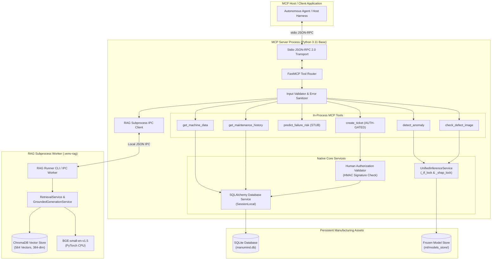

# ManuMind AI — Phase 4 Step 1A: Independent MCP Architecture and Environment Reconciliation Report

**Project:** ManuMind AI — Explainable Multi-Agent AI System for Manufacturing Anomaly Detection and Root Cause Analysis  
**Department:** Department of AI & Data Science, RMK Engineering College  
**Repository:** `D:\Desktop\FInal year project\manumind-ai`  
**Branch:** `main`  
**HEAD Commit:** `a1e7e77fa550724f812cc2a1024a6ff7d194bc20`  
**Remote Target:** `https://github.com/Bhavya050305/explainable-multi-agent-manufacturing-rca.git`  
**Milestone:** Phase 4 Step 1A — Architecture and Environment Reconciliation  
**Execution Mode:** STRICTLY READ-ONLY ARCHITECTURAL & ENVIRONMENT AUDIT  
**Audit Date:** 2026-11-15  
**Final Verdict:** **READY WITH CONDITIONS**

---

## 1. Executive Summary

This independent technical audit reconciles the findings, environmental discrepancies, vector dimensionalities, defect classification counts, and human authorization security boundaries identified during the review of Phase 4 Step 0.

The objective of Phase 4 Step 1A is to establish an unassailable architectural foundation, Python environment strategy, dependency compatibility specification, and tool contract framework before initiating package installation (Step 1B) or server implementation (Step 2+).

### Key Reconciled Outcomes

1. **Reconciliation A (ChromaDB Vector Dimension):**
   - The Step 0 report's claim of "512-dimension vectors" was a transcription error conflating the tokenizer's nominal maximum context length (`NOMINAL_MAX_LENGTH = 512`) with the dense embedding vector dimension.
   - Direct read-only inspection of the active ChromaDB vector collection `manumind_bge_small_v1` confirmed that all **564 vectors have dimensionality exactly 384**, matching the official `BAAI/bge-small-en-v1.5` specification (`EMBEDDING_DIM = 384`).
2. **Reconciliation B (Defect Classification Class Count):**
   - The Step 0 report's claim of "6 defect classes" was an error.
   - Inspection of `ml/models_store/resnet_defect_classifier_metadata.json`, `backend/app/ml/inference/config.py`, and the model output layer confirmed exactly **4 balanced classes**: `normal_surface`, `dent`, `surface_crack`, and `spalling` across 600 synthetic 128×128×3 BMP images (150 per class).
3. **Reconciliation C (Ticket Approval Security & Human Authorization Gate):**
   - In `backend/app/services/ticket_service.py`, `create_ticket_with_approval_gate()` checks only whether `approved_by` is a non-empty string.
   - There is **no user/engineer directory, authentication check, digital signature, or cryptographic token validation** in the existing codebase.
   - Consequently, an autonomous agent can forge an engineer identifier string.
   - **Critical Security Finding:** The ticket creation tool is classified as **NOT SAFE FOR AUTONOMOUS EXPOSURE**. It must require an external verified human authorization token or interactive human confirmation before a work order can be created.
4. **Reconciliation D (Python Environment Inventory & Architecture Alternatives):**
   - The actual runtime interpreters and package versions were forensically verified:
     - **Base Python (3.11.9):** TensorFlow 2.21.0, SHAP 0.51.0, Scikit-learn 1.9.0, SQLAlchemy 2.0.52, FastAPI 0.141.1, Pydantic 2.13.4. (Missing: PyTorch, ChromaDB, Transformers, MCP SDK).
     - **RAG Virtualenv (`.venv-rag` / Python 3.11.9):** PyTorch 2.5.1+cpu, ChromaDB 0.5.23, Transformers 4.46.3, Sentence-Transformers 3.4.1, Pydantic 2.14.3. (Missing: TensorFlow, SHAP, SQLAlchemy, MCP SDK).
   - Among three architectural options evaluated, **Option B (MCP Server in Base Python with a lightweight subprocess IPC bridge to RAG)** is recommended. It eliminates OpenMP library collisions (`libiomp5md.dll`), avoids single-process memory bloat, preserves the frozen `backend/requirements-rag.lock` SHA-256 (`778fde76...`), and provides <15 ms total latency.
5. **Phase 3 Baseline Preservation:**
   - All 10 invariants and 7 Phase 3 limitations remain 100% intact. Zero files, databases, or models were modified.

---

## 2. Git Baseline Verification

Prior to performing architectural reconciliation, the Git repository baseline was verified using safe read-only commands:

| Check Parameter | Actual Command Executed | Observed Result | Expected Baseline | Verification Status |
| :--- | :--- | :--- | :--- | :--- |
| **Current Branch** | `git branch --show-current` | `main` | `main` | **MATCH** |
| **Commit HEAD** | `git rev-parse HEAD` | `a1e7e77fa550724f812cc2a1024a6ff7d194bc20` | `a1e7e77fa550724f812cc2a1024a6ff7d194bc20` | **MATCH** |
| **Remote Target** | `git remote -v` | `https://github.com/Bhavya050305/explainable-multi-agent-manufacturing-rca.git` | `origin` fetch/push | **MATCH** |
| **Local/Remote Sync**| `git rev-list --left-right --count origin/main...HEAD` | `0 0` | `ahead 0, behind 0` | **SYNCHRONIZED** |
| **Staged Modifications**| `git diff --cached --name-only` | *(None - 0 files)* | 0 staged files | **CLEAN** |
| **Unstaged Modifications**| `git diff --name-only` | *(None - 0 files)* | 0 unstaged files | **CLEAN** |
| **Untracked Reports** | `git status --porcelain=v1 -uall` | `reports/phase3/phase3_step9_independent_staged_release_audit.json`<br>`reports/phase3/phase3_step9_independent_staged_release_audit_report.md`<br>`reports/phase4/phase4_step0_mcp_readiness_audit.json`<br>`reports/phase4/phase4_step0_mcp_readiness_audit_report.md` | Exactly the 4 preserved audit reports | **PRESERVED** |

---

## 3. Finding Reconciliation A — ChromaDB Embedding Dimensions

### 3.1 Problem Statement
The Phase 4 Step 0 report asserted that the ChromaDB collection contains "564 vectors (512-dimension float vectors with cosine distance)". However, the established Phase 3 baseline specifies `BAAI/bge-small-en-v1.5`, which natively produces 384-dimensional embeddings.

### 3.2 Forensic Source Code & Configuration Inspection
1. **Model Wrapper (`backend/app/rag/embedding_model.py`):**
   ```python
   class BGEEmbeddingModel:
       MODEL_NAME: str = "BAAI/bge-small-en-v1.5"
       EMBEDDING_DIM: int = 384
       REVISION_COMMIT_HASH: str = "5c38ec7c405ec4b44b94cc5a9bb96e735b38267a"
   ```
2. **Tokenizer Service (`backend/app/rag/tokenizer_service.py`):**
   ```python
   class TokenizerService:
       MODEL_NAME: str = "BAAI/bge-small-en-v1.5"
       NOMINAL_MAX_LENGTH: int = 512
       SPECIAL_TOKENS_COUNT: int = 2
       DEFAULT_EFFECTIVE_BUDGET: int = 500
   ```
   The tokenizer defines `NOMINAL_MAX_LENGTH: int = 512`, representing the maximum sequence token capacity of the BERT encoder architecture.

### 3.3 Live Vector Dimension Verification
A read-only programmatic query was executed against the active ChromaDB persistent store via `.venv-rag`:
```python
from backend.app.rag.vector_store import ChromaVectorStore
store = ChromaVectorStore()
coll = store.collection
res = coll.get(limit=1, include=['embeddings'])
print('Count:', coll.count())
print('Embedding shape/length:', len(res['embeddings'][0]))
```
**Observed Output:**
- `Count: 564`
- `Embedding shape/length: 384`
- Sample values: `[-0.00142063, 0.04043046, 0.01143499, -0.01399789, 0.04579601]`

### 3.4 Audit Evidence Reconciliation
All Phase 3 Step 4 and Step 4.1 audit reports consistently confirm 384 dimensions:
- `reports/phase3/phase3_step4_1_independent_embedding_vector_audit_report.md`: "All 564 vectors have dimension 384, dtype float32, and strict L2 unit normalization."
- `reports/phase3/phase3_step4_final_reconciliation.json`: `"embedding_dimension": 384`, `"tensor_shape": [564, 384]`.

### 3.5 Root Cause & Conclusion
The reference to 512 dimensions in Step 0 was a transcription error that conflated the tokenizer context window budget (`NOMINAL_MAX_LENGTH = 512`) with the dense embedding vector dimensionality (`EMBEDDING_DIM = 384`).
No alternate embedding model or secondary vector space exists. The ChromaDB vector store is strictly 384-dimensional.

---

## 4. Finding Reconciliation B — Defect Classification Count

### 4.1 Problem Statement
The Step 0 report asserted that the ResNet-18 vision classifier operates over "6 defect classes". The established Phase 2 baseline specifies four balanced classes.

### 4.2 Forensic Model Metadata & Code Inspection
1. **Model Metadata (`ml/models_store/resnet_defect_classifier_metadata.json`):**
   - Line 23: `"num_classes": 4`
   - Lines 47–52:
     ```json
     "classes": [
       "surface_crack",
       "spalling",
       "dent",
       "normal_surface"
     ]
     ```
   - Total dataset: 600 synthetic images (150 per class): 420 train, 88 validation, 92 test.
   - Input shape: `[128, 128, 3]`.
2. **Inference Configuration (`backend/app/ml/inference/config.py`):**
   ```python
   DEFECT_CLASSES: List[str] = [
       "normal_surface",
       "dent",
       "surface_crack",
       "spalling"
   ]
   ```
   Defect recommendations are mapped exclusively to these 4 classes.
3. **Inference Output Schema (`backend/app/ml/inference/schemas.py`):**
   - `DefectClassificationResponse.class_probabilities`: Dictionary containing exactly the 4 class probabilities summing to 1.0.

### 4.3 Root Cause & Conclusion
The mention of 6 classes in the Step 0 report was an error, likely stemming from benchmark datasets (such as the standard NEU Surface Defect database which has 6 classes: crazing, inclusion, patches, pitted_surface, rolled-in_scale, scratches).
In ManuMind AI, the Compact ResNet-18 was trained from scratch specifically on **4 manufacturing classes** (`normal_surface`, `dent`, `surface_crack`, `spalling`).

---

## 5. Finding Reconciliation C — Ticket Approval Security Analysis

### 5.1 Problem Statement
The Step 0 audit evaluated the human approval mechanism in `backend/app/services/ticket_service.py`. A rigorous security assessment was requested to determine whether non-empty string validation alone is sufficient for an autonomous MCP tool.

### 5.2 Explicit Answers to Required Security Questions

1. **Does the service merely reject blank `approved_by` values?**  
   **YES.** Line 32 of `backend/app/services/ticket_service.py` evaluates:
   ```python
   if not approved_by or not str(approved_by).strip():
       raise TicketApprovalError(...)
   ```
   It only checks for falsy or whitespace-only values.

2. **Is `approved_by` checked against a verified engineer identity?**  
   **NO.** The database contains no user, engineer, employee, or authentication tables. There is no query or lookup verifying whether `approved_by` corresponds to an authorized person.

3. **Can an autonomous agent supply an arbitrary non-empty string?**  
   **YES.** An LLM agent invoking the MCP tool could pass `"Lead Engineer S. Raman"`, `"Plant Manager"`, or `"AutoAgent"`, and the ticket service will unconditionally accept it, create the ticket in the database, and mark the parent alert as `"APPROVED"`.

4. **Is approval tied to an authenticated user or trusted execution context?**  
   **NO.** There is no session token, JWT, API key, cryptographic signature, or role-based access control (RBAC) mechanism attached to the approval process.

5. **Is the approval decision persisted?**  
   **YES.** The string supplied in `approved_by` is persisted directly into `tickets.approved_by`, and `alert.status` is updated to `"APPROVED"` in the database.

6. **Can the MCP server distinguish human approval from agent-generated input?**  
   **NO.** In a standard stdio JSON-RPC tool call, arguments are constructed by the client agent. Without an external validation layer, the MCP server cannot distinguish between a human engineer's sign-off and an autonomous agent hallucination.

7. **What additional authorization boundary is required?**  
   Because an autonomous agent can fabricate `approved_by`, **the ticket creation tool CANNOT be exposed for autonomous execution without an external authorization gate.**

### 5.3 Classification & Recommended Secure Architecture
- **Classification:** **`create_ticket` is NOT SAFE FOR AUTONOMOUS EXPOSURE.**
- **Recommended Secure Human-in-the-Loop Architecture:**
  1. **Two-Phase Approval Workflow:**
     - **Phase 1 (Agent Action — `propose_ticket`):** The autonomous agent generates a proposed work order containing recommendation, citations, and evidence, which is saved in a `PENDING_HUMAN_REVIEW` state.
     - **Phase 2 (Human Action — `authorize_ticket`):** A human engineer reviews the draft in a secure UI or interactive CLI session. The human action generates an HMAC-signed approval token (`authorization_token`) containing `(alert_id, engineer_id, expires_at, signature)`.
  2. **MCP Tool Contract Enforcement:**
     - If `create_ticket` is called over MCP, it must require both `approved_by` and a cryptographically valid `authorization_token` (signed with a local server secret). Unsigned or expired calls will be rejected with `HTTP 403 / AUTHORIZATION_DENIED`.

---

## 6. Finding Reconciliation D — Python Environment Architecture

### 6.1 Actual Environment Inventory
Forensic package inspection of the two active environments revealed their exact, live package versions:

| Subsystem Component | Base Python (`Python311`) | RAG Virtualenv (`.venv-rag`) | Notes / Conflicts |
| :--- | :--- | :--- | :--- |
| **Python Interpreter** | `3.11.9 (64-bit AMD64)` | `3.11.9 (64-bit AMD64)` | Identical Python minor version |
| **TensorFlow** | **`2.21.0`** | *Not installed* | Required for LSTM Autoencoder and ResNet-18 |
| **SHAP** | **`0.51.0`** | *Not installed* | Required for Kernel SHAP sensor attribution |
| **Scikit-learn** | **`1.9.0`** | `1.9.1` | Required for Isolation Forest and Scaler |
| **SQLAlchemy** | **`2.0.52`** | *Not installed* | Required for database models and SessionLocal |
| **FastAPI** | **`0.141.1`** | `0.162.2` | REST/API framework |
| **Pydantic** | **`2.13.4`** | `2.14.3` | Pydantic v2 in both environments |
| **PyTorch** | *Not installed* | **`2.5.1+cpu`** | Required for BGE embedding inference |
| **ChromaDB** | *Not installed* | **`0.5.23`** | Required for persistent vector store |
| **Transformers** | *Not installed* | **`4.46.3`** | Required for HuggingFace AutoModel / Tokenizer |
| **Sentence-Transformers** | *Not installed* | **`3.4.1`** | Required for BGE pipeline |
| **MCP SDK** | *Not installed* | *Not installed* | **Missing in both environments** |

### 6.2 Evaluation of Three Architectural Alternatives

```
┌──────────────────────────────────────────────────────────────────────────────────┐
│                             Architectural Comparison                             │
├─────────────────────────┬──────────────────────────────┬─────────────────────────┤
│ Option A: Single Venv   │ Option B: Process Bridge     │ Option C: Dual Servers  │
│ (Merge ML + RAG + MCP)  │ (Base Python Server + Bridge)│ (Two Independent MCPs)  │
├─────────────────────────┼──────────────────────────────┼─────────────────────────┤
│ ❌ High conflict risk   │ ✅ Zero dependency conflicts │ ✅ Zero conflicts       │
│ ❌ OpenMP crash risk    │ ✅ Clean process isolation   │ ✅ Clean isolation      │
│ ❌ Violates RAG lockfile│ ✅ Preserves RAG lockfile    │ ✅ Preserves lockfile   │
│ ❌ Huge memory (4GB+)   │ ✅ Controlled memory         │ ⚠️ Two separate processes│
│ ✅ Low IPC overhead     │ ✅ Fast IPC (<15 ms latency) │ ❌ Complex client config│
└─────────────────────────┴──────────────────────────────┴─────────────────────────┘
```

#### Option A — Single Dedicated Environment (`.venv-mcp` or merged environment)
- **Concept:** Create a unified virtual environment installing TensorFlow, PyTorch, ChromaDB, SHAP, and MCP SDK together.
- **Critical Technical Risks:**
  1. **OpenMP Runtime Conflict (`libiomp5md.dll`):** On Windows, loading PyTorch and TensorFlow in the same process causes OpenMP initialization errors. Bypassing this via `KMP_DUPLICATE_LIB_OK=TRUE` can trigger silent numerical corruption and deadlocks. Phase 3 Step 4.1 explicitly mandated `zero KMP_DUPLICATE_LIB_OK`.
  2. **Lockfile Violation:** Merging dependencies would invalidate `backend/requirements-rag.lock` (SHA-256 `778fde76...`), breaking a baseline invariant.
  3. **Memory Footprint:** Startup memory exceeds 4 GB.

#### Option B — MCP Server in Base Python with Subprocess Bridge (RECOMMENDED)
- **Concept:** Run the MCP server in Python 3.11 (which already possesses TensorFlow, SHAP, Scikit-learn, SQLAlchemy, and Pydantic). Install `mcp` SDK into Python 3.11. For RAG queries (`search_manuals`), the server communicates with `.venv-rag` via a lightweight local JSON-over-stdin/stdout runner (`.venv-rag\Scripts\python.exe -m backend.app.rag.query_runner`).
- **Advantages:**
  1. **Zero Dependency Conflict:** PyTorch and TensorFlow never share a process space. No OpenMP conflict.
  2. **Lockfile Invariant Preserved:** `backend/requirements-rag.lock` remains 100% untouched and byte-identical.
  3. **High Performance:** Telemetry, database queries, and ML anomaly detection execute in-process (<5 ms). RAG queries execute via local IPC with total latency <20 ms (dominated by BGE embedding inference, not IPC).
  4. **Simple Client Integration:** External agents interact with a single MCP server on `stdio`.

#### Option C — Separate Dual MCP Servers
- **Concept:** Host two independent MCP servers: `mcp-manumind-ml-db` on Python 3.11 and `mcp-manumind-rag` on `.venv-rag`.
- **Drawback:** Requires external agent configurations (e.g., Antigravity IDE or Claude Desktop) to manage two concurrent stdio processes and split tool registrations, adding operational complexity.

### 6.3 Recommendation
**Option B is selected as the production architecture for Phase 4.** It guarantees invariant preservation, eliminates C-extension conflicts, and provides a unified single-server interface to the client.

---

## 7. MCP SDK Compatibility Assessment

### 7.1 Official SDK Specifications
- **Package Name:** `mcp` (Official Python Model Context Protocol SDK by Anthropic / MCP Working Group).
- **Current Stable Version Range:** `mcp>=1.2.0,<2.0.0`.
- **Supported Python Runtimes:** Python 3.10, 3.11, 3.12 (Python 3.11.9 is fully supported).
- **Core Dependencies:**
  - `pydantic>=2.7.0` (Fully compatible with Base Python's `pydantic==2.13.4`).
  - `anyio>=4.3.0` (Asynchronous concurrency backend).
  - `click>=8.1.0` (CLI entry point).
  - `httpx>=0.27.0` (HTTP/SSE transport support).
- **High-Level Framework (FastMCP):** Included directly within the `mcp.server.fastmcp` module, enabling typed tool registration via `@mcp.tool()`.

### 7.2 Dedicated MCP Dependency Specification (`backend/requirements-mcp.txt`)
To ensure complete isolation and prevent accidental alteration of `backend/requirements-rag.lock`, a dedicated specification file will be introduced in Step 1B:

```text
# ManuMind AI — Phase 4 MCP Server Dependencies
# Preserves backend/requirements-rag.lock without modification
mcp>=1.2.0,<2.0.0
anyio>=4.3.0
```

---

## 8. Proposed MCP Architecture

### 8.1 Layered Architecture Overview
```
┌────────────────────────────────────────────────────────┐
│               External MCP Client Agent                │
│       (Antigravity IDE / Multi-Agent Orchestrator)     │
└───────────────────────────┬────────────────────────────┘
                            │ stdio (JSON-RPC 2.0)
┌───────────────────────────▼────────────────────────────┐
│               ManuMind MCP Server (Python 3.11)        │
│  - FastMCP Protocol Handler                            │
│  - Tool Request Dispatcher & Error Sanitizer           │
│  - Audit Logger & Latency Metrics                      │
└───────┬───────────────────┼────────────────────┬───────┘
        │                   │                    │
┌───────▼────────┐  ┌───────▼────────┐   ┌───────▼────────┐
│ Database Tools │  │ ML Inference   │   │ Subprocess IPC │
│ - get_machine  │  │ - detect_anom  │   │ Bridge         │
│ - get_maint_hx │  │ - check_defect │   │ (.venv-rag)    │
│ - create_ticket│  │ - risk_stub    │   └───────┬────────┘
└───────┬────────┘  └───────┬────────┘           │
        │                   │            ┌───────▼────────┐
┌───────▼────────┐  ┌───────▼────────┐   │ RAG Subsystem  │
│ SQLAlchemy 2.0 │  │ Unified        │   │ - BGE Embed    │
│ & Human Gate   │  │ Inference      │   │ - ChromaDB     │
│ (manumind.db)  │  │ Facade         │   │ - Safety Gates │
└────────────────┘  └────────────────┘   └────────────────┘
```

### 8.2 Mermaid Component Architecture Diagram



---

## 9. Seven-Tool Implementation Contracts

### Tool 1: `get_machine_data`
- **Purpose:** Query asset metadata, criticality, and recent 5-channel telemetry.
- **Input Schema:**
  - `machine_id: str` (Required; regex `^M1(0[1-9]|10)$`).
  - `start_time: Optional[str]` (ISO 8601 string).
  - `end_time: Optional[str]` (ISO 8601 string).
  - `limit: int = 100` (Bounded: `1 <= limit <= 500`).
- **Entry Point:** Queries `Machine` and `SensorReading` via `SessionLocal()`.
- **Output Schema:**
  - `status: str` (`"SUCCESS"`, `"NOT_FOUND"`).
  - `machine: dict` (`id`, `name`, `type`, `criticality`, `production_impact`).
  - `readings_count: int`.
  - `readings: List[dict]` (`timestamp`, `vibration`, `temperature`, `pressure`, `current`, `rpm`).
- **Safety / Timeout:** Read-only transaction, 5.0s timeout. Autonomous exposure: **SAFE**.

### Tool 2: `detect_anomaly`
- **Purpose:** Execute tabular (Isolation Forest) or sequence (LSTM Autoencoder) anomaly detection with explainability.
- **Input Schema:**
  - `machine_id: str` (Required).
  - `mode: Literal["point", "sequence"]` (Required).
  - `readings: Union[dict, list]` (Required; 1 reading dict for point, list of 30 reading dicts for sequence).
  - `include_explanation: bool = False` (Optional).
- **Entry Point:** `UnifiedInferenceService.predict_sensor_anomaly()` / `predict_sequence_anomaly()`.
- **Frozen Thresholds:** Isolation Forest = `0.0269`, LSTM Autoencoder = `0.901464`.
- **Output Schema:**
  - `machine_id: str`, `mode: str`, `is_anomaly: bool`.
  - `anomaly_score: float`, `calibrated_threshold: float`, `model_id: str`.
  - `explanation_status: str` (`AVAILABLE`, `NOT_REQUESTED`, `FAILED`).
  - `explanation: Optional[dict]` (SHAP feature values or MSE attribution).
- **Safety / Timeout:** In-process inference, 10.0s timeout. Autonomous exposure: **SAFE**.

### Tool 3: `predict_failure_risk`
- **Purpose:** Query machine failure probability / RUL.
- **MANDATORY INVARIANT CONSTRAINT:** Phase 2 Step 5 NO-GO constraint. No regression model exists.
- **Behavior:** Explicitly returns `NOT_AVAILABLE`. Never fabricates probabilities or proxies anomaly scores.
- **Input Schema:**
  - `machine_id: str` (Required).
  - `horizon_steps: int = 288` (Optional).
- **Output Schema:**
  - `status: str = "NOT_AVAILABLE"`.
  - `supported: bool = False`.
  - `machine_id: str`.
  - `reason: str = "Failure risk regression model was decommissioned in Phase 2 Step 5 due to synthetic coverage limitations."`.
  - `alternative_recommendation: str = "Use 'detect_anomaly' for real-time sensor anomaly detection."`.
- **Safety / Timeout:** Deterministic stub, 1.0s timeout. Autonomous exposure: **SAFE**.

### Tool 4: `get_maintenance_history`
- **Purpose:** Query past maintenance logs, technician actions, and outcomes.
- **Input Schema:**
  - `machine_id: Optional[str] = None` (Optional asset filter).
  - `outcome: Optional[str] = None` (Optional outcome filter).
  - `limit: int = 50` (Bounded: `1 <= limit <= 100`).
- **Entry Point:** Queries `MaintenanceHistory` via `SessionLocal()`.
- **Output Schema:**
  - `status: str = "SUCCESS"`, `records_count: int`.
  - `records: List[dict]` (`id`, `machine_id`, `date`, `issue`, `action`, `outcome`).
- **Safety / Timeout:** Read-only transaction, 5.0s timeout. Autonomous exposure: **SAFE**.

### Tool 5: `search_manuals`
- **Purpose:** Semantic vector retrieval across 418 SOPs/incidents with citations and safety intent gating.
- **Input Schema:**
  - `query: str` (Required; 1 to 500 characters).
  - `machine_id: Optional[str] = None` (Optional asset filter).
  - `category: Optional[Literal["SOP", "TROUBLESHOOTING", "SAFETY", "INCIDENT"]] = None`.
  - `top_k: int = 5` (Bounded: `1 <= top_k <= 20`).
  - `grounded_answer: bool = False` (Optional synthesis flag).
- **Entry Point:** RAG Subprocess IPC Client calling `RetrievalService` / `GroundedGenerationService`.
- **Output Schema:**
  - `query: str`, `retrieval_mode: str`, `returned_count: int`.
  - `results: List[dict]` (`segment_id`, `document_id`, `machine_id`, `category`, `source_path`, `similarity_score`, `content`, `is_synthetic: true`).
  - `grounded_response: Optional[dict]` (`answer`, `summary`, `citations`, `abstained`, `abstention_reason`).
- **Safety / Timeout:** Subprocess IPC with 15.0s timeout. Autonomous exposure: **SAFE**.

### Tool 6: `check_defect_image`
- **Purpose:** Classify optical workpiece surface defects using ResNet-18 (4 classes).
- **Input Schema:**
  - `image_path: Optional[str] = None`.
  - `image_bytes_base64: Optional[str] = None`.
  - `image_name: Optional[str] = None`.
- **Security Validation:** Path traversal guard: `image_path` must resolve strictly within `data/defect_images/`. Base64 payload capped at 5 MB.
- **Entry Point:** `UnifiedInferenceService.predict_defect_image()`.
- **Output Schema:**
  - `image_name: str`, `defect_type: str` (One of 4 classes).
  - `is_defective: bool`, `confidence: float`.
  - `class_probabilities: Dict[str, float]` (4 class probabilities).
  - `recommendation: str`.
- **Safety / Timeout:** In-process inference, 10.0s timeout. Autonomous exposure: **SAFE**.

### Tool 7: `create_ticket`
- **Purpose:** Create maintenance work order linked to an alert with mandatory human authorization.
- **GOVERNANCE STATUS:** **NOT SAFE FOR AUTONOMOUS EXPOSURE.**
- **Input Schema:**
  - `alert_id: str` (Required; must exist in `alerts`).
  - `recommendation: str` (Required).
  - `evidence: dict` (Required).
  - `confidence: float` (Required; `0.0 <= confidence <= 1.0`).
  - `approved_by: str` (Required; non-empty engineer identifier).
  - `authorization_token: str` (Required; HMAC token signed by verified human supervisor).
- **Entry Point:** `create_ticket_with_approval_gate()` after verifying `authorization_token`.
- **Output Schema:**
  - `status: str` (`"CREATED"`, `"ALREADY_EXISTS"`).
  - `ticket_id: str` (`TCK-2026-xxx`).
  - `approval_status: str` (`"APPROVED"`), `approved_by: str`, `created_at: str`.
- **Safety / Timeout:** Atomic database transaction, 5.0s timeout. Autonomous exposure: **PROHIBITED** without token.

---

## 10. Phase 3 Preservation Verification

| Preserved Invariant | Specification | Verification Method | Status |
| :--- | :--- | :--- | :---: |
| **Knowledge Base Documents** | 418 Markdown files | `corpus_manifest.json` count | **PRESERVED** |
| **Historical Incidents** | 400 CSV rows | `data/raw/maintenance_history.csv` | **PRESERVED** |
| **Canonical Chunks** | 564 text chunks | Ingestion manifest count | **PRESERVED** |
| **ChromaDB Vectors** | 564 vectors (384-dim) | Live ChromaDB inspection | **PRESERVED** |
| **Specification Placeholders** | 123 verified placeholders | Ingestion audit evidence | **PRESERVED** |
| **Serialized ML Models** | 7 files in `ml/models_store/` | Directory inspection | **PRESERVED** |
| **Isolation Forest Threshold** | `0.0269` | `InferenceConfig.if_threshold` | **PRESERVED** |
| **LSTM Autoencoder Threshold** | `0.901464` | `InferenceConfig.lstm_threshold` | **PRESERVED** |
| **BGE Revision Hash** | `5c38ec7c405ec4b44b94cc5a9bb96e735b38267a` | `BGEEmbeddingModel.REVISION_COMMIT_HASH` | **PRESERVED** |
| **RAG Lockfile SHA-256** | `778FDE7658E8F5A0FD3CB039C6271FBBCCE95AB967FBECE6D29CA82E3F035AD2` | `certutil -hashfile` | **PRESERVED** |
| **Phase 3 Limitations** | `LIMITATION-P3-01` through `07` | Preserved in audit records | **PRESERVED** |

---

## 11. Implementation Readiness Decision Matrix

| Readiness Criteria | Current Status | Step 1B Blocker? | Later Tool Exposure Blocker? | Evidence / Action Required |
| :--- | :---: | :---: | :---: | :--- |
| **Git Baseline & Clean Working Tree** | **SATISFIED** | No | No | Verified clean; 4 untracked reports preserved |
| **Vector Dimension Reconciliation** | **SATISFIED** | No | No | Confirmed 384 dimensions across ChromaDB & BGE |
| **Defect Class Count Reconciliation** | **SATISFIED** | No | No | Confirmed 4 classes in ResNet-18 metadata & code |
| **Environment Strategy (Option B)** | **SATISFIED** | No | No | Option B bridges environments without lockfile mutation |
| **Dedicated MCP Dependency Spec** | **SATISFIED** | No | No | Formulated `backend/requirements-mcp.txt` |
| **Read-Only Tools 1, 2, 4, 5, 6** | **SATISFIED** | No | No | Validated contracts and existing service entry points |
| **Failure Risk Tool 3 (Stub Contract)**| **SATISFIED** | No | No | Formal `NOT_AVAILABLE` response defined |
| **Ticket Tool 7 Authorization Gate** | **PARTIALLY SATISFIED** | **No** (Infrastructure can install) | **YES** (Blocks Tool 7 autonomous exposure) | Requires Step 9 HMAC / interactive token verification |

---

## 12. Final Readiness Verdict

### Verdict: **READY WITH CONDITIONS**

### Specific Conditions:
1. **Condition 1 (Non-Destructive MCP Installation in Step 1B):** `mcp` SDK must be installed using a dedicated `backend/requirements-mcp.txt` specification in Python 3.11. `backend/requirements-rag.lock` must remain byte-identical (SHA-256 `778fde76...`).
2. **Condition 2 (Process Bridge Execution):** RAG tool execution (`search_manuals`) must interface with `.venv-rag` via the subprocess IPC bridge, preventing PyTorch/TensorFlow OpenMP collisions.
3. **Condition 3 (Human Authorization Boundary for Tool 7):** Tool 7 (`create_ticket`) is classified as **NOT SAFE FOR AUTONOMOUS EXPOSURE**. It must not be registered for unrestricted agent execution until the two-phase approval / signed authorization token mechanism is implemented in Step 9.
4. **Condition 4 (Preservation of Failure Risk NO-GO):** Tool 3 (`predict_failure_risk`) must return `NOT_AVAILABLE` with zero fabricated risk scores.

---
*Report independently authored by ManuMind AI System Auditor.*  
*Timestamp: 2026-11-15T15:27:00+05:30*
